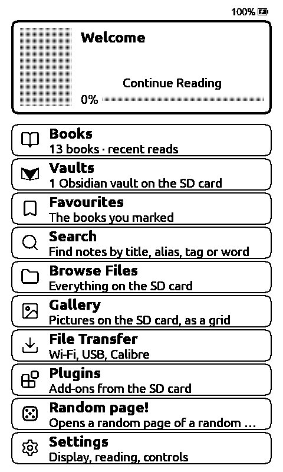

<p align="center">
  <picture>
    <source media="(prefers-color-scheme: dark)" srcset="docs/images/vaultink/logo-dark.svg">
    
  </picture>
</p>

<h1 align="center">VaultInk</h1>

<p align="center">Books and Obsidian vaults on the Xteink X4 Pro.</p>

<p align="center">
  <a href="https://github.com/Somnius/VaultInk/releases"></a>
  <a href="LICENSE"></a>
  
  
  
  
  
  
  
</p>

<p align="center">
  <a href="https://somnius.github.io/VaultInk/"><b>Install from your browser</b></a> ·
  <a href="https://lefteros.com/en/apps/vaultink">Project page and donations</a> ·
  <a href="https://github.com/Somnius/VaultInk/releases">Releases</a>
</p>

VaultInk is firmware for the Xteink X4 Pro e-reader. It keeps everything
[CrossPoint Reader](https://github.com/crosspoint-reader/crosspoint-reader) does for books, and adds
a way to carry your [Obsidian](https://obsidian.md) notes with you. You can read them, search them
and follow their links. Later on you'll be able to edit and sync them too.

It's free and open source (MIT). It is not affiliated with Obsidian, Xteink or CrossPoint.

> [!WARNING]
> **Still early.** VaultInk is at 0.62.0. Releases from 0.8.2 on have been tested on a real X4 Pro by one
> tester (kos25k, UC8279 screen); the bugs he found are fixed and listed in the release notes. Most of the
> newest features (Dice, VaultEUC, the Library sort bar) have only run in the simulator. Back up your SD
> card. The screenshots below come from the simulator.

## At a glance

<p>
  
  
  
  
</p>

Home, the Library sorted by how far you have read, an Obsidian note, and Search in Book.

<p>
  
  
  
  
</p>

Home → Plugins holds the built-in tools: Sudoku, a dice roller, and VaultEUC for electric unicycles.

<p>
  
  
  
  
  
  
  
</p>

Page background contrast with a preview, Random page!, the Library's format filter, and the lock screen.

More screenshots are in the sections below and in [docs/](docs/).

## What it does

Each line links to its guide where there is one. The full list is in [SPECS.md](SPECS.md).

**Books**
- Everything CrossPoint Reader offers: EPUB, TXT, MOBI and XTC books, PDFs read as text, comics (CBZ and XTC/XTCH), SD-card fonts, hyphenation, bookmarks, highlights, dictionaries, KOReader sync, OPDS catalogs, Calibre wireless transfer and SD-card plugins. [docs/reading-and-files.md](docs/reading-and-files.md)
- **Library**: tabs for Recent, Title, Author, Favourites and Folders, in an order you choose (Settings → Library → Tab order) with a tab it opens on. With Recent open, a bar sorts by how far you have read (**↑%** most read first, **↓%** least read first), and every book shows its percent. A gear picks the formats listed; **All | Books only** hides vault notes; Authors can be folders.
- **Search in Book**: a word or phrase, partial or whole words (accents and capitals never matter), starting at your chapter and wrapping, with the words shaded on the page and a bar to step through the hits or return to your place. The gear sets the type and the range; Settings → Reader → Search word has the rest, including an opt-in index that makes repeat searches faster.
- **Random page!** (a Home item, off by default): a random page of a random book (book formats only), saving nothing, with a way back to where you were.
- **MOBI, AZW and AZW3 books** (0.67.0, 0.67.1): `.mobi`, `.prc`, `.azw` and `.azw3` open like text books, read a record at a time; DRM books are refused ([docs/reading-and-files.md](docs/reading-and-files.md#mobi-azw-and-azw3-books-0670-0671)).
- **Advanced Typography** (0.66.0): switches for ligatures, kerning, widow/orphan control, headings kept with text and hanging punctuation, in Settings → Reader and the book's Text panel ([docs/reading-and-files.md](docs/reading-and-files.md#advanced-typography-0660-renamed-from-experimental-in-0661)).
- **Search in Browse Files** (0.64.0): a magnifier looks for files and folders by name through the whole card, with a way to show a hit in its folder. [docs/reading-and-files.md](docs/reading-and-files.md#search-in-browse-files-0640)
- **Page backgrounds** from plain to papyrus and bath towel, a set you choose for the quick button, and a 0 to 100 **contrast** slider with a preview. [Mostly for fun](#page-backgrounds).
- **Reading stats**, streaks and the reading-stats sleep screen; **battery** page with drain per hour (asleep, awake with the light off and awake with it on); **book info** on a long press, **Favourites**, **Gallery** for pictures.

**Obsidian vaults** [docs/editing.md](docs/editing.md), [docs/livesync.md](docs/livesync.md), [docs/flashcards.md](docs/flashcards.md)
- Notes read like book pages: headings, lists, tasks, quotes, tables, code, callouts, highlights, embeds, links and backlinks, with Greek handled throughout. Canvas files open in a viewer.
- Search across every vault by title, alias, tag, heading, text and block id. Edit a note line by line, tick tasks, make, rename and delete notes.
- **LiveSync** both ways with Obsidian Self-hosted LiveSync over Wi-Fi, including end-to-end encryption. **Flashcards** written in your notes with spaced repetition. Highlights from a book go to a vault note. Import a vault from a ZIP.

**Tools** (Home → Plugins)
- **Sudoku**: three levels, pencil notes, undo, hints, saves where you left off.
- **Dice**: polyhedral dice with advantage, keep-highest and exploding dice; old World of Darkness; Vampire V5 with Hunger dice, Willpower reroll and Rouse checks; Chronicles of Darkness; Fate; Powered by the Apocalypse; Blades in the Dark; Call of Cthulhu; Shadowrun; Savage Worlds; Year Zero; Cyberpunk Red. [docs/reading-and-files.md](docs/reading-and-files.md#dice-0610)
- **Focus timer, Habits, Excalidraw, Bluetooth keyboard** (0.63.0): a Pomodoro timer and a daily habit tracker in Home → Plugins ([docs/tools.md](docs/tools.md)); `.excalidraw` drawings open in a viewer; a Bluetooth keyboard can type into the on-screen keyboard's line (off by default, untried with a real keyboard). The dice seed mixes the date and time, battery percent and voltage with the chip's generator.
- **VaultEUC**: an electric unicycle companion over Bluetooth (Begode, Veteran/Leaperkim, KingSong, InMotion, Ninebot, VESC): live numbers every 5 to 30 seconds, alarms, ride logs on the SD card, your wheels remembered, km/h or mph. **Not for use while riding, and not tried on a real wheel yet.** [docs/vaulteuc.md](docs/vaulteuc.md)
- **Flashlight** (0.65.0): the front light as an S.O.S., blinking or steady, with brightness, warmth and flash speed ([docs/tools.md](docs/tools.md)).
- **Plugins** from the SD card and the Plugin Hub: [docs/sd-plugins.md](docs/sd-plugins.md).

**The device**
- A home screen with the book you are reading, rows in any order and any of them hidden; quick settings with a swipe down; settings grouped by task; touch or buttons.
- **Lock screen** with a 4-digit PIN or a corner long-press, with the owner's name and phone; sleep screens; **What's New** after an update.
- Full **Greek** interface, Greek and English keyboards, Greek hyphenation and reading font. Menus in many more languages. [docs/translating.md](docs/translating.md)
- File browser with Move, Copy, Rename, Delete, Extract and Info on every file; web page and **Android companion app** for files, notes and settings: [docs/companion.md](docs/companion.md).

### Page backgrounds

<p>
  
  
</p>

Swipe down from the top for quick settings, then tap the paper tile to change the page background
under the text. It's also under **Settings → Reader → Page Background**. The choices are plain,
paper, sandpaper, papyrus (soft, medium, hard, cloudy, aged, cracked, stained and crumpled), toilet paper, kitchen paper and bath towel.
**Settings → Reader → Paper Button Cycle** sets which of them the tile steps through, and its first row,
**Paper contrast**, opens a 0 to 100 slider with a tile of every background that changes as you move it (0.60.0).

While a background is on, text anti-aliasing is switched off, so the letters stay sharp on the
real screen. This one is mostly for fun 😄. Plain is the default and the easiest to read, but the papyrus ones
are actually nice for a long read. The idea came from kos25k.

## Getting started

The first time VaultInk starts, it shows a short welcome guide. The five pages are below.

<p>
  
  
  
  
  
</p>

1. **Welcome.** VaultInk is for your books and your Obsidian vaults. The menus are in English, Greek and many other languages, listed on this page.
2. **Reading.** Swipe left for the next page and right for the previous one, or use the side buttons. Tap the middle of the page to open the reading menu.
3. **Quick settings.** Swipe down from the top of the screen, or tap the battery. You get the light, night mode, sleep, and a full refresh (to clear ghost images).
4. **Adding books.** Copy books into the `books` folder on the SD card, or send them from your computer with File Transfer (Wi-Fi, USB or Calibre).
5. **That's it.** Open the guide again from **Settings → System → Welcome Guide**. It also comes back once after an update that changes it. To stop that, turn off **Show Welcome Guide After Updates** in the same place.

**Menus in Greek:** Settings → System → Language, then **Ελληνικά** (second in the list, right
after English). Back in Greek the same place is Ρυθμίσεις → Σύστημα → Γλώσσα.

In the guide, Next (or OK, or the right and down keys) moves on. Back goes back a page. On the first page, Back asks whether you want to skip.

## Comics and manga, with Banana Comic Converter

<a href="https://seethroughme.github.io/Banana-Comic-Converter/"></a>

Comics on the X4 Pro go through **[Banana Comic Converter](https://seethroughme.github.io/Banana-Comic-Converter/)**,
made by **u/curseofthebanana** ([Reddit](https://www.reddit.com/user/curseofthebanana/),
[GitHub: seethroughme](https://github.com/seethroughme)). It's a free tool in your browser, on a
phone or a computer, with no AI: it cuts every page into its panels and repacks them to fill the
small screen, instead of shrinking the whole page. It has an X4 / X4 Pro preset, manga
(right-to-left) or western order, a full panel editor for the pages it gets wrong, batch
conversion and file splitting, and it writes XTC, XTCH, EPUB and CBZ.

We're working on this together: its author is happy for VaultInk to send comic readers their way,
and VaultInk is built to open what it makes. Convert to **XTCH** (or **XTC** for the fastest page
turns), upload the file with the companion app or the web page, and read it like a book. The
companion app converts comics too, XTCH pages turn faster since 0.36.1, and since 0.39.0 plain CBZ
files open as well (JPEG and PNG pages). The guide: [docs/comics.md](docs/comics.md).

On the X4 Pro, **Settings → Library → Convert comics** shows a QR code that opens the converter on
your phone.

If it saves you time, the converter's page has a "Buy me a coffee" link for its author.

<br clear="right">

## What's coming

The [roadmap](ROADMAP.md) has the details and the order. Open items right now:

- Real-device testing of the newest features, above all VaultEUC with a real wheel and the Bluetooth client.
- Library tab order was added in 0.61.0; the XTCH refresh choice and a few share-to-reader edge cases wait for device tests.
- A Bluetooth keyboard for editing, and typing into the device from the companion app.

The companion app lives in `companion/` in this repo and is released separately (guide: [docs/companion.md](docs/companion.md)).

<p>
  
  
  
  
</p>

What is in and out of scope is in [SCOPE.md](SCOPE.md).

## Installing

The easiest way is the **web installer** at **https://somnius.github.io/VaultInk/**. Pick your
device there and follow its steps. For the X4 Pro, in short:

1. Back up your SD card.
2. Copy `vaultink-<version>-x4pro.bin` from the [latest release](https://github.com/Somnius/VaultInk/releases/latest)
   (not the `factory` file) to the SD card, so you can reinstall from the reader under
   **Settings → System → SD Card Firmware Update**.
3. Put the reader in boot mode: switched off, hold **Power**, then also hold both page-turn
   buttons.
4. Connect it over USB-C to a computer with Chrome or Edge and press Install. Erasing the device
   wipes the reader's own memory (settings, Wi-Fi networks), not the SD card.

After that, updates come over Wi-Fi: **Settings → System → Check for Updates** shows what's new
in the newest release (scroll it), with Cancel and Update at the bottom, and Update installs it.

You can also build it yourself (see below) and flash it over USB with
[`esptool`](https://github.com/espressif/esptool):

```sh
esptool.py --chip esp32s3 --port /dev/ttyACM0 --baud 921600 write_flash 0x0 .pio/build/x4pro/firmware.factory.bin
```

## Tech stack

| | |
| --- | --- |
| Device | Xteink X4 Pro: ESP32-S3, 480×800 e-ink touch screen, SD card |
| Firmware | C++20 on Arduino and FreeRTOS (ESP-IDF underneath), built with PlatformIO |
| Base | [CrossPoint Reader](https://github.com/crosspoint-reader/crosspoint-reader) and the [FreeInk SDK](https://freeink.org) (drivers, UI, keyboard) |
| Notes | A streaming Markdown to XHTML converter, so notes render through the book reader |
| Search | A per-vault index file on the SD card, updated incrementally, with Greek and accent folding |
| Desktop | An SDL2 simulator that runs the same code, and host tests with CMake and GoogleTest |
| Installer | ESP Web Tools on GitHub Pages; the firmware is built locally, not on CI |

## Building

You need [PlatformIO](https://platformio.org) and a copy of this repository with its submodules:

```sh
git clone --recursive https://github.com/Somnius/VaultInk.git
cd VaultInk
pio run -e x4pro            # firmware for the X4 Pro
pio run -e simulator_x4_pro # desktop simulator (Linux needs SDL2 and OpenSSL headers)
```

The simulator runs the same code in a window on your computer. It reads its "SD card" from a folder
called `fs_` in the directory you start it from:

```sh
mkdir -p fs_/books && cp some-book.epub fs_/books/
.pio/build/simulator_x4_pro/program
```

Arrow keys are the buttons, Enter is OK, Escape is Back, and the mouse works as touch.

## Translating

The menus are in English and Greek, and many other languages from CrossPoint Reader are partly
there. To ask for your language or help translate it, see [docs/translating.md](docs/translating.md),
or open a [translation request](https://github.com/Somnius/VaultInk/issues/new?template=translation_request.yml).

## Author and donations

VaultInk is made by **Lefteris Iliadis** ([lefteros.com](https://lefteros.com)). The app page,
[lefteros.com/en/apps/vaultink](https://lefteros.com/en/apps/vaultink), has more about it, and you
can donate there to support the project.

## Credits

VaultInk stands on other people's work:

- [CrossPoint Reader](https://github.com/crosspoint-reader/crosspoint-reader), which everything
  here is built on, and the [FreeInk SDK](https://freeink.org) under it.
- [CrossNext](https://github.com/manuelx900/CrossNext) and KOReader's SimpleUI plugin, for ideas.
- kos25k, who tested every step of the way.
- u/curseofthebanana ([seethroughme](https://github.com/seethroughme)), whose
  [Banana Comic Converter](https://seethroughme.github.io/Banana-Comic-Converter/) makes the comics
  VaultInk reads.

The licences of the fonts, icons and libraries are listed in [NOTICE](NOTICE).

## License

MIT. See [LICENSE](LICENSE).
