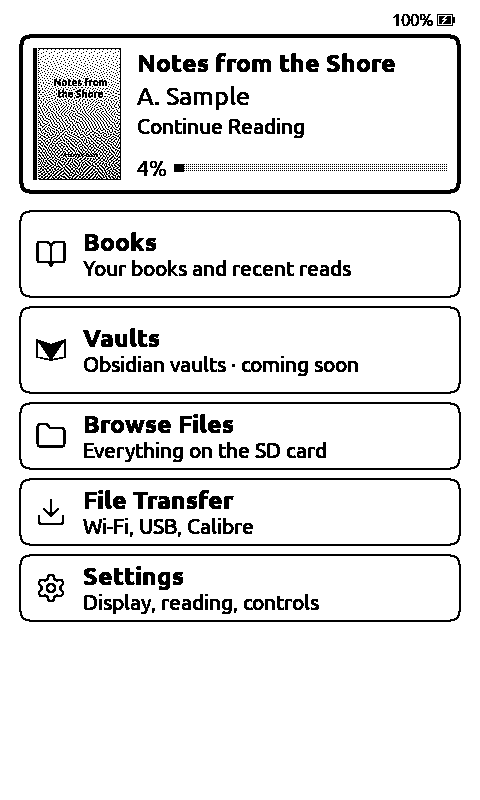
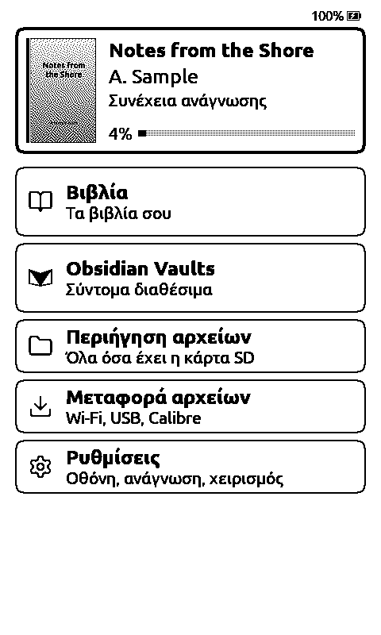
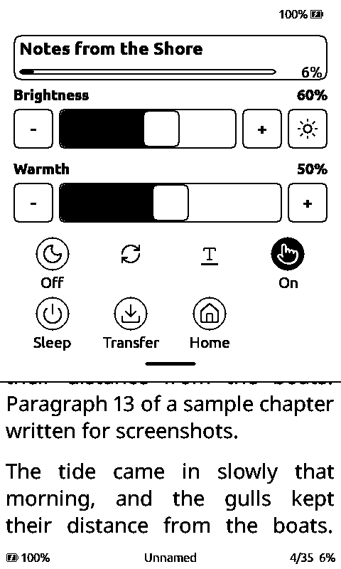
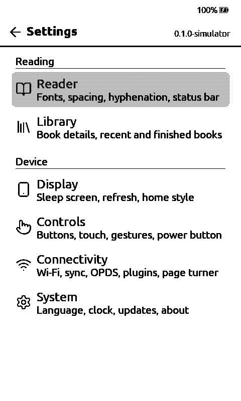
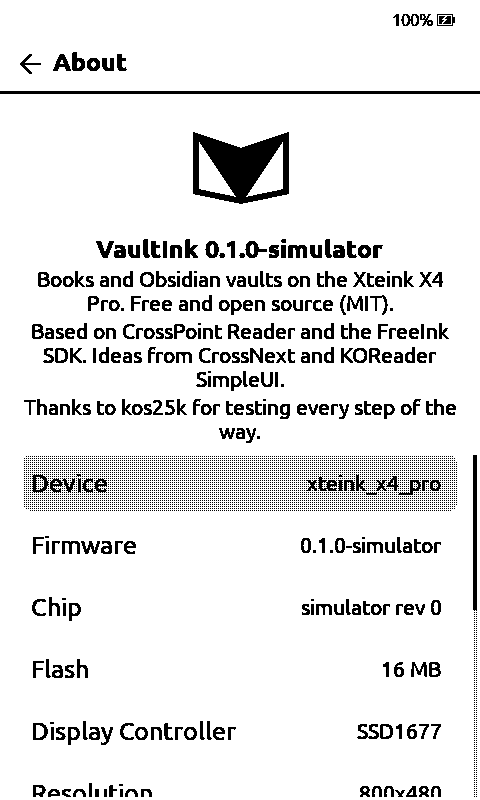

<p align="center"></p>

<h1 align="center">VaultInk</h1>

<p align="center">Books and Obsidian vaults on the Xteink X4 Pro.</p>

VaultInk is firmware for the Xteink X4 Pro e-reader. It keeps everything
[CrossPoint Reader](https://github.com/crosspoint-reader/crosspoint-reader) does for books, and adds
a way to carry your [Obsidian](https://obsidian.md) notes with you. You can read them, search them
and follow their links. Later on you'll be able to edit and sync them too.

It's free and open source (MIT). It is not affiliated with Obsidian, Xteink or CrossPoint.

> [!WARNING]
> **Early days.** Version 0.1.0 has the new home screen, menus and Greek support, but the vault
> reader isn't in yet. Nothing has been tested on real hardware so far. All the screenshots below
> come from the simulator. Please don't flash this onto your daily reader yet.

## Screenshots

<p>
  
  
  
  
  
  
</p>

From left to right: the home screen, the same in Greek, quick settings pulled down over a book, the
reading toolbar, settings, and About.

## What works now

- **Reading.** Everything CrossPoint Reader offers: EPUB, TXT and XTC books, SD-card fonts,
  hyphenation, bookmarks, highlights, dictionaries, KOReader sync, OPDS catalogs, Calibre wireless
  transfer and SD-card plugins.
- **A new home screen.** The book you're reading sits at the top, followed by Books and Vaults, then
  Files, Transfer, Plugins and Settings. Every row says in one line what's behind it. You can use
  touch or the buttons. CrossPoint's own home styles are still there under Settings → Display.
- **Quick settings.** Swipe down from the top, or tap the status bar, for brightness, warmth, night
  mode, refresh, orientation, sleep, file transfer and home. Inside a book the panel also shows the
  title and how far you've read.
- **Settings by task.** Settings are grouped under Reading and Device. Each group says what's in it.
- **Greek.** A full Greek interface, monotonic and polytonic Greek in the interface fonts, and Greek
  hyphenation for both. For reading Greek books, add a font that covers Greek from
  **Settings → Reader → Manage Fonts**. Literata, Noto Serif Extended and Gentium Book Plus cover
  polytonic Greek too.
- **Updates.** The device checks this repository's releases for new versions.

## What's coming

The [roadmap](ROADMAP.md) has the details and the order. In short:

1. **The vault reader.** Open a vault from the SD card, browse folders, read notes with their links,
   embeds, callouts, tasks and tables, and search, with Greek accents taken into account.
2. **Canvas files**, read only.
3. **Obsidian LiveSync**, so a vault stays in step with your other devices.
4. **Editing notes** on the device, then a **Bluetooth keyboard**.
5. **An Android companion app** for typing into the device, quick notes and bringing in notes from
   other apps.

The full feature list is in [SPECS.md](SPECS.md), and what is in and out of scope is in
[SCOPE.md](SCOPE.md).

## Installing

There's no release yet. When there is one, you'll find it under
[Releases](https://github.com/Somnius/VaultInk/releases), and the device will offer it through
**Settings → System → Check for Updates**.

Until then you can build it yourself (see below) and flash it over USB with
[`esptool`](https://github.com/espressif/esptool):

```sh
esptool.py --chip esp32s3 --port /dev/ttyACM0 --baud 921600 write_flash 0x10000 .pio/build/x4pro/firmware.bin
```

## Building

You need [PlatformIO](https://platformio.org) and a copy of this repository with its submodules:

```sh
git clone --recursive https://github.com/Somnius/VaultInk.git
cd VaultInk
pio run -e x4pro            # firmware for the X4 Pro
pio run -e simulator_x4_pro # desktop simulator (Linux needs SDL2 and OpenSSL headers)
```

The simulator runs the same code in a window on your computer. It reads its "SD card" from a folder
called `fs_` in the directory you start it from:

```sh
mkdir -p fs_/books && cp some-book.epub fs_/books/
.pio/build/simulator_x4_pro/program
```

Arrow keys are the buttons, Enter is OK, Escape is Back, and the mouse works as touch.

## Credits

VaultInk stands on other people's work:

- [CrossPoint Reader](https://github.com/crosspoint-reader/crosspoint-reader), which everything
  here is built on, and the [FreeInk SDK](https://freeink.org) under it.
- [CrossNext](https://github.com/manuelx900/CrossNext) and KOReader's SimpleUI plugin, for ideas.
- kos25k, who tested every step of the way.

The licences of the fonts, icons and libraries are listed in [NOTICE](NOTICE).

## License

MIT. See [LICENSE](LICENSE).
