<p align="center">
  <picture>
    <source media="(prefers-color-scheme: dark)" srcset="docs/images/vaultink/logo-dark.svg">
    
  </picture>
</p>

<h1 align="center">VaultInk</h1>

<p align="center">Books and Obsidian vaults on the Xteink X4 Pro.</p>

<p align="center">
  <a href="https://github.com/Somnius/VaultInk/releases"></a>
  <a href="LICENSE"></a>
  
  
  
  
  
  
  
</p>

<p align="center">
  <a href="https://somnius.github.io/VaultInk/"><b>Install from your browser</b></a> ·
  <a href="https://lefteros.com/en/apps/vaultink">Project page and donations</a> ·
  <a href="https://github.com/Somnius/VaultInk/releases">Releases</a>
</p>

VaultInk is firmware for the Xteink X4 Pro e-reader. It keeps everything
[CrossPoint Reader](https://github.com/crosspoint-reader/crosspoint-reader) does for books, and adds
a way to carry your [Obsidian](https://obsidian.md) notes with you. You can read them, search them
and follow their links. Later on you'll be able to edit and sync them too.

It's free and open source (MIT). It is not affiliated with Obsidian, Xteink or CrossPoint.

> [!WARNING]
> **Early days.** Version 0.19.0 opens your vaults, reads their notes, links and images, Greek
> included, and searches them. Sync isn't in yet. Every release from 0.8.2 on has been tested by kos25k
> on his X4 Pro (UC8279 screen); the bugs he found are fixed and listed in the release notes. It's still
> one tester on one device, so back up your SD card. The screenshots below come from the simulator.

## Screenshots

<p>
  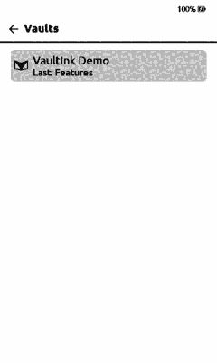
  
</p>

Left: a vault opens like a folder, a note reads like a book page, and a link goes to the other
note (Back returns). Right: the Library with Authors as folders, one author's folder, and the
Title tab with Books only.

### Vaults, notes and search

<p>
  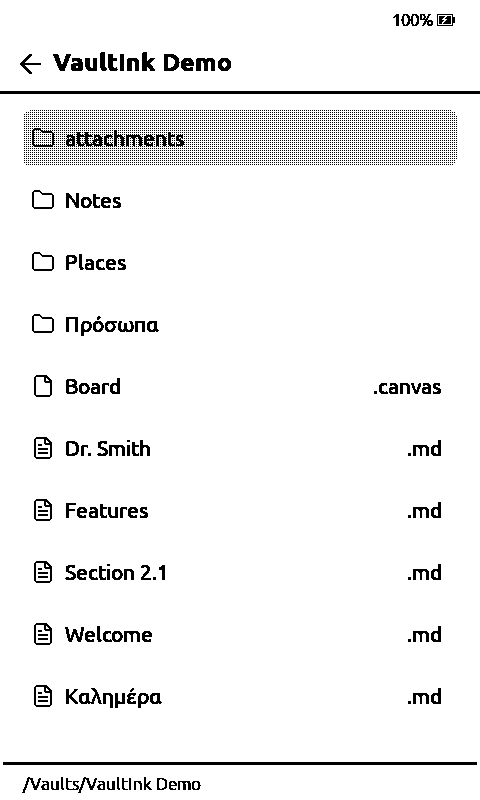
  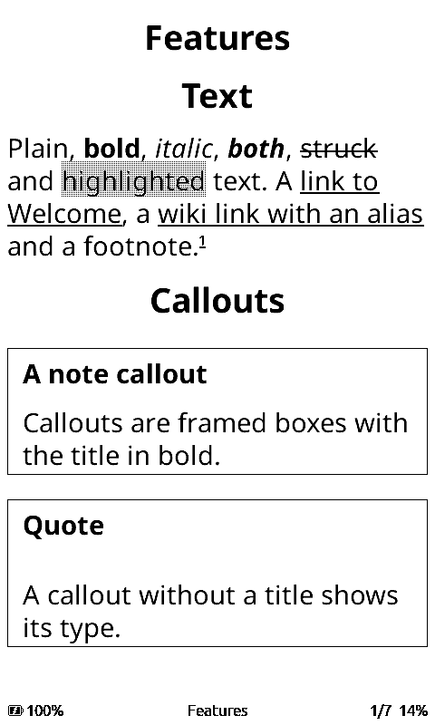
  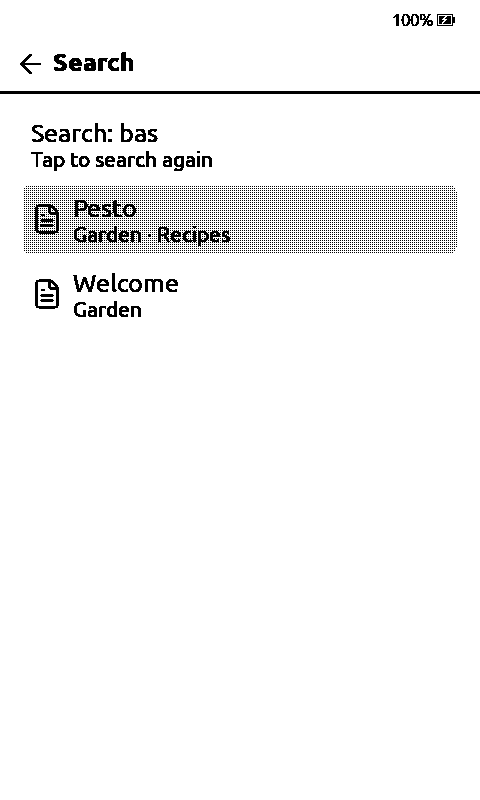
</p>

Every vault on the SD card opens like a folder of notes. A note reads like a book page, with links,
callouts, tasks and tables. Search looks through every vault at once. These show a small demo
vault.

### Greek and English keyboard

<p>
  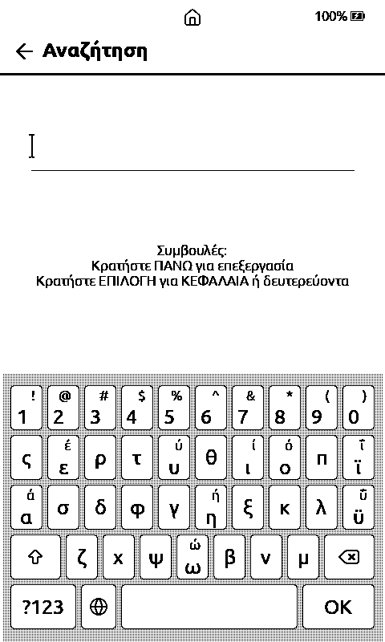
  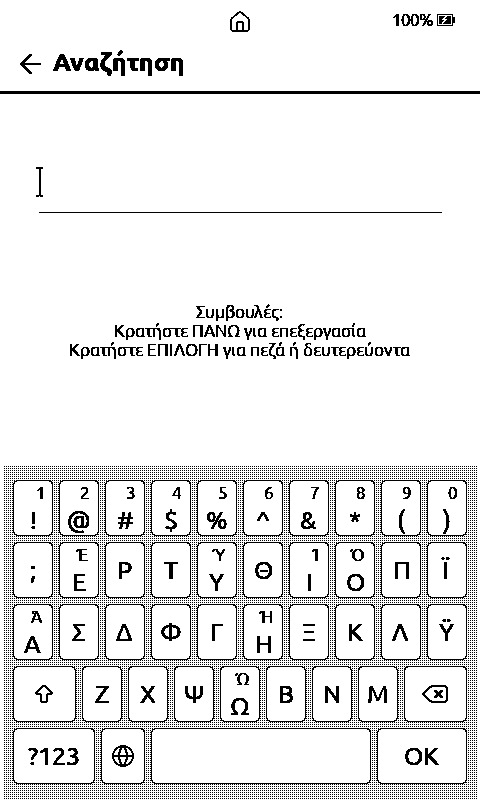
  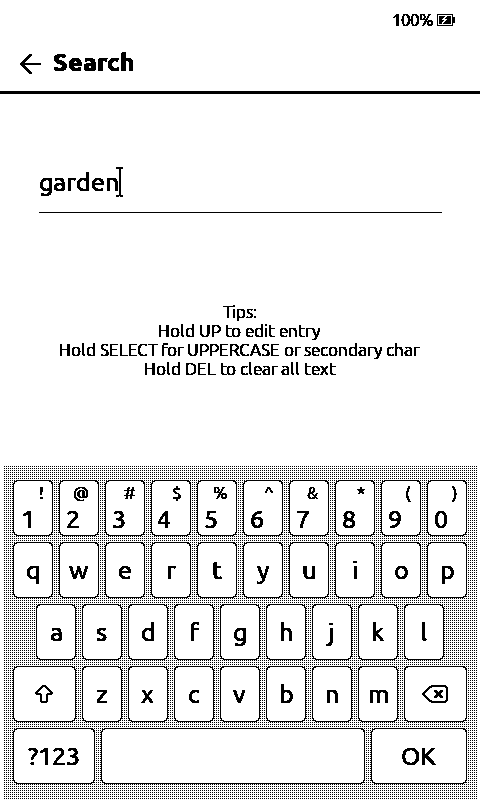
</p>

The on-screen keyboard types Greek and English. The globe key switches between them. Hold a vowel
for its accent (ά έ ή ί ό ύ ώ); ϊ and ϋ have their own keys, and holding them gives ΐ and ΰ. With
the Greek interface the keyboard opens in Greek.

### Page backgrounds

<p>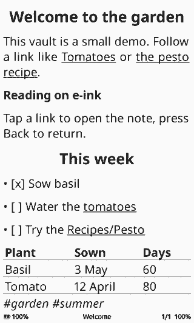</p>

Swipe down from the top for quick settings, then tap the paper tile to change the page background
under the text. It's also under **Settings → Reader → Page Background**. The choices are plain,
paper, sandpaper, papyrus (soft, medium, hard and cloudy), toilet paper, kitchen paper and bath towel.
**Settings → Reader → Paper Button Cycle** sets which of them the tile steps through.

While a background is on, text anti-aliasing is switched off, so the letters stay sharp on the
real screen.

This one is mostly for fun 😄. Plain is the default and the easiest to read, but the papyrus ones
are actually nice for a long read. The idea came from kos25k.

### Home, reading and settings

<p>
  
  
  
  
  
  
</p>

From left to right: the home screen, the same in Greek, quick settings pulled down over a book, the
reading toolbar, settings, and About.

### Library and reading

<p>
  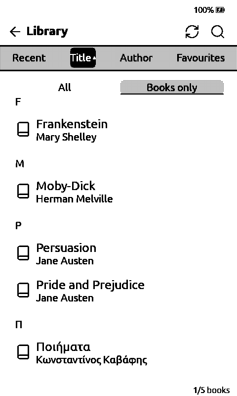
  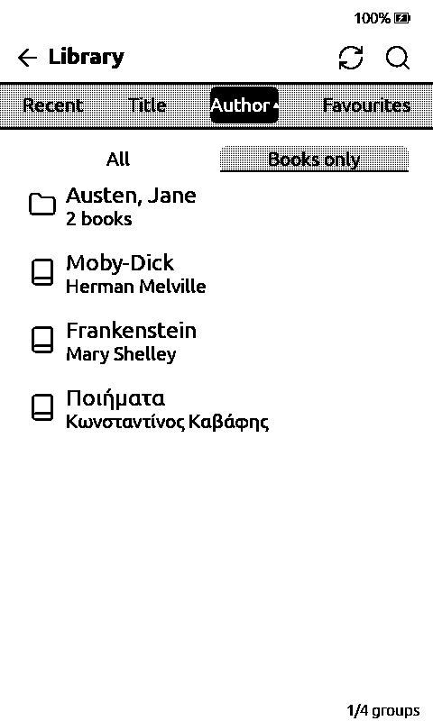
  
</p>

The Library by title with Books only on (no vault notes), the Author tab with Authors as folders
(0.36.0: an author with two or more books is a folder), and a page of a book.

### Flashcards

<p>
  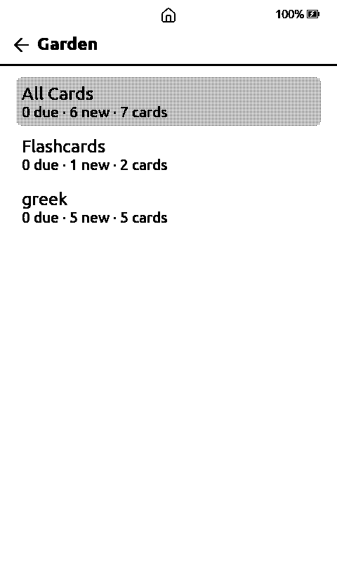
  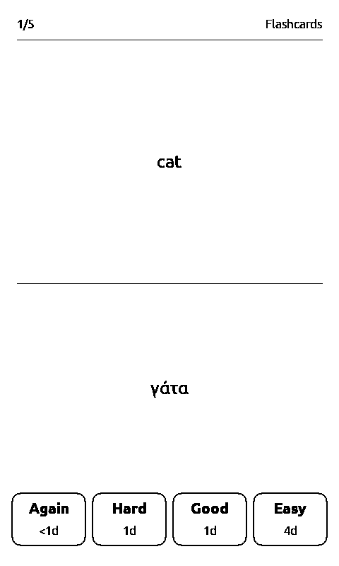
</p>

Cards written in your notes (`Front::Back`, `?` lines, `{{clozes}}`) with spaced repetition, from Vaults → Flashcards (next release):
the decks with how many are due and new, and a card with the four answers and when each brings it back. The guide:
[docs/flashcards.md](docs/flashcards.md).

## Getting started

The first time VaultInk starts, it shows a short welcome guide. The five pages are below.

<p>
  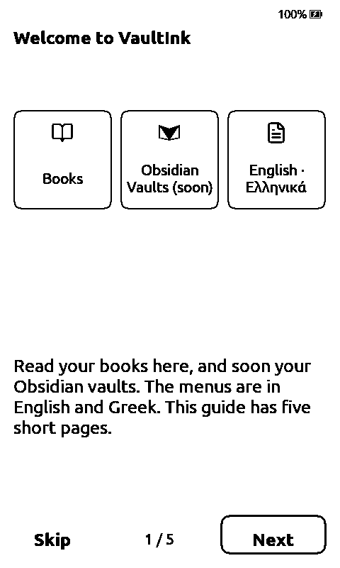
  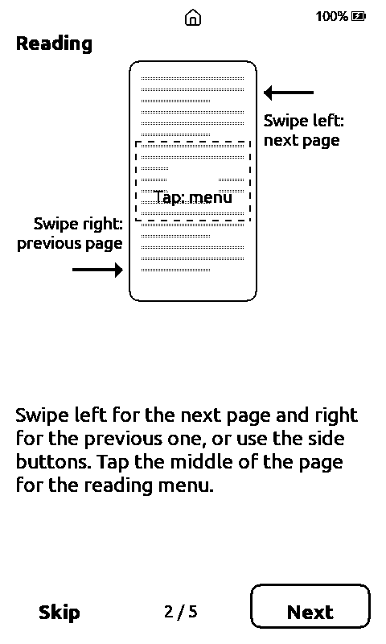
  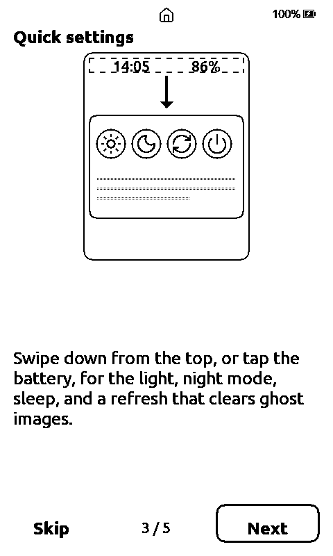
  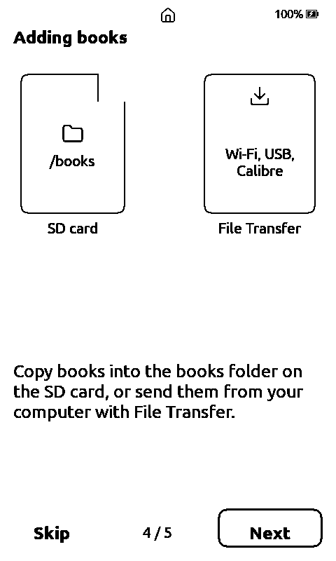
  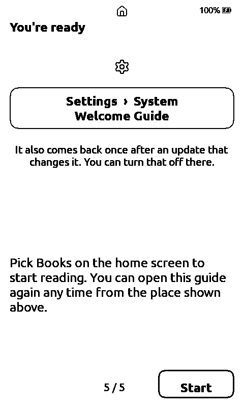
</p>

1. **Welcome.** VaultInk is for your books and your Obsidian vaults. The menus are in English, Greek and many other languages, listed on this page.
2. **Reading.** Swipe left for the next page and right for the previous one, or use the side buttons. Tap the middle of the page to open the reading menu.
3. **Quick settings.** Swipe down from the top of the screen, or tap the battery. You get the light, night mode, sleep, and a full refresh (to clear ghost images).
4. **Adding books.** Copy books into the `books` folder on the SD card, or send them from your computer with File Transfer (Wi-Fi, USB or Calibre).
5. **That's it.** Open the guide again from **Settings → System → Welcome Guide**. It also comes back once after an update that changes it. To stop that, turn off **Show Welcome Guide After Updates** in the same place.

**Menus in Greek:** Settings → System → Language, then **Ελληνικά** (second in the list, right
after English). Back in Greek the same place is Ρυθμίσεις → Σύστημα → Γλώσσα.

In the guide, Next (or OK, or the right and down keys) moves on. Back goes back a page. On the first page, Back asks whether you want to skip.

## Comics and manga, with Banana Comic Converter

<a href="https://seethroughme.github.io/Banana-Comic-Converter/">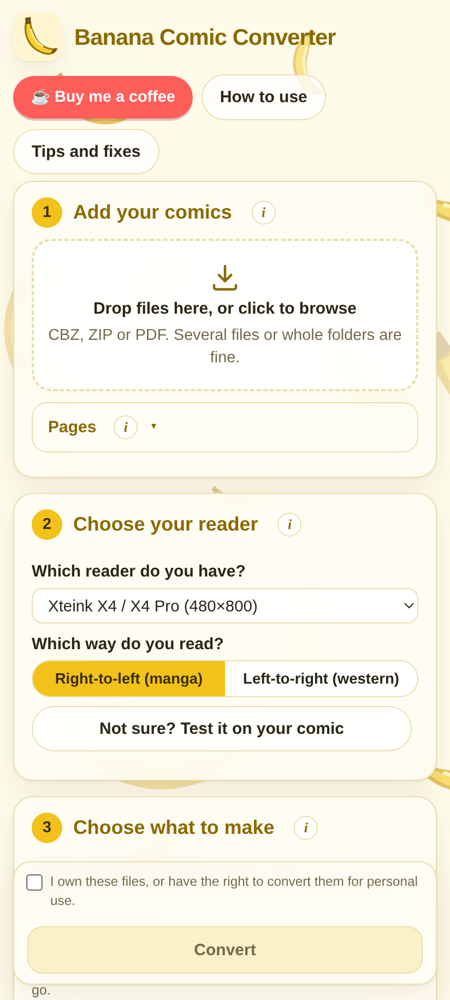</a>

Comics on the X4 Pro go through **[Banana Comic Converter](https://seethroughme.github.io/Banana-Comic-Converter/)**,
made by **u/curseofthebanana** ([Reddit](https://www.reddit.com/user/curseofthebanana/),
[GitHub: seethroughme](https://github.com/seethroughme)). It's a free tool in your browser, on a
phone or a computer, with no AI: it cuts every page into its panels and repacks them to fill the
small screen, instead of shrinking the whole page. It has an X4 / X4 Pro preset, manga
(right-to-left) or western order, a full panel editor for the pages it gets wrong, batch
conversion and file splitting, and it writes XTC, XTCH, EPUB and CBZ.

We're working on this together: its author is happy for VaultInk to send comic readers their way,
and VaultInk is built to open what it makes. Convert to **XTCH** (or **XTC** for the fastest page
turns), upload the file with the companion app or the web page, and read it like a book. The
companion app converts comics too, XTCH pages turn faster since 0.36.1, and since 0.39.0 plain CBZ
files open as well (JPEG and PNG pages). The guide: [docs/comics.md](docs/comics.md).

On the X4 Pro, **Settings → Library → Convert comics** shows a QR code that opens the converter on
your phone.

If it saves you time, the converter's page has a "Buy me a coffee" link for its author.

<br clear="right">

## What works now

- **Reading.** Everything CrossPoint Reader offers: EPUB, TXT and XTC books, SD-card fonts,
  hyphenation, bookmarks, highlights, dictionaries, KOReader sync, OPDS catalogs, Calibre wireless
  transfer and SD-card plugins.
- **Obsidian notes.** Open a `.md` note from a vault and it reads like a book: headings, bold and
  italic, lists (nested and numbered) and tasks, quotes, tables, code, footnotes, and embedded
  images found anywhere in the vault.
  - **Callouts** (`> [!quote] Title`) are a framed box with the title in bold.
  - **Highlights** (`==text==`) are a light gray band behind the words. Settings → Vaults →
    Highlight style also offers Inverted (white on black) and Dark gray (white on dark gray).
  - **Embeds:** `![[Note]]` shows the other note inside this one, `![[Note#Heading]]` just that
    heading's section, and `![[Note#^id]]` just that paragraph or list item.
  - **Links:** tap a `[[link]]` to open the other note (or jump to its heading), and press Back to
    return. Links are found the way Obsidian finds them: by name, by a path from the vault root, or
    by the end of a path (`[[People/Anna]]` finds `Notes/People/Anna.md`), and names with dots
    (`[[Dr. Smith]]`, `[[Section 2.1]]`) work too.
- **Vaults and search.** The Vaults row lists every vault on the SD card (folders under `Vaults/`
  and any folder with `.obsidian` in it), and the home screen shows how many there are. Each vault
  remembers the note you read last and opens on it (Settings → Vaults → Open last note). Under the vaults, **Recent notes** lists the last five notes you read, from any vault (0.37.0). Search
  looks through all of them by title, alias, tag, heading and text; a match in a heading shows as
  `Note > Heading` and opens the note there (0.47.0); searching for a block id (`^id`) opens the note at that block (0.53.0). Accents don't matter, so `καλημερα` finds `Καλημέρα`. In a note, **More → Backlinks** lists
  the notes that link to it. The search index lives outside the vault (`/.vaultink/` on the SD
  card) and also keeps a list of the vault's files, so links and images open without scanning the
  card; Settings → Vaults → Rebuild Search Index starts it over.
- **LiveSync, both ways.** Sync a vault with Obsidian Self-hosted LiveSync over Wi-Fi: paste the
  Setup URI on the device's web page, type its passphrase on the device, then Settings → Vaults →
  LiveSync → Sync now. End-to-end encryption (V2) and path obfuscation are supported; edits,
  deletes and renames come across, deleted files go to a trash folder, and notes you change on
  the device are sent back (a note changed on both sides keeps both versions). A Sync tile in quick
  settings, optional sync on wake, and the server's certificate checked by default (built-in
  roots, or your own `ca.pem`). See [docs/livesync.md](docs/livesync.md).
- **Changes on the device.** Tap a task box to tick it; edit a note line by line (with undo);
  new note, rename and delete (to the vault's `.trash`) from the reading menu. Notes changed here are never overwritten by a LiveSync
  pull: a newer server copy is saved beside them. See [docs/editing.md](docs/editing.md).
- **Debug logs**, off by default: Settings → System → Debug Logs saves the device's log to
  `/debug` on the SD card, to email to me@lefteros.com when something goes wrong. See
  [docs/debug-logs.md](docs/debug-logs.md).
- **Import a vault from a ZIP** on the device's web page (File Transfer, then Files →
  **Import Vault (.zip)**): it lands in `/Vaults/<name>/` ready to open. A
  [demo vault](demo-vault/VaultInk%20Demo) with notes, pictures and a canvas is in this repo
  and attached to the releases as `VaultInk-Demo.zip`.
- **Canvases.** `.canvas` files open in a viewer: the whole board fitted to the screen, cards,
  groups, labelled arrows, pictures in image cards, and coloured cards shaded gray. Pan with the
  buttons or swipes, zoom with the + / − / Fit buttons at the bottom right (or Confirm), and tap a
  card to open its note (or the card's own text). Back returns to the canvas.
- **Greek and English keyboard** on screen, switched with the globe key.
- **Comics and manga**, converted with Banana Comic Converter to XTCH or XTC and read like books:
  see [above](#comics-and-manga-with-banana-comic-converter).
- **Search settings** by name, with a jump to your notes for the same words.
- **Home screen rows** in any order, and any of them hidden (Settings → Display → Home Screen Rows / Home Screen Items), with a Favourites row.
- **Battery page** with charge, voltage, charging and temperature (Settings → System → Battery).
- **Reading stats sleep screen**: reading time today, this week, this month and in total, the last three
  books, and a month calendar of your progress (Settings → Display → Sleep Screen, 0.51.0).
- **Lock screen**: a 4-digit PIN or a long press on a corner, asked after 30 minutes asleep
  (Settings → System → Lock Screen, 0.49.0). The owner's name and phone can show on it and on the
  sleep screen (next release).
- **Highlights to a vault note** (next release): a book's clippings written to `Highlights/<title>.md` in your vault, ready for LiveSync.
- **PDF as text** (next release): a `.pdf` opens as reflowing text (Greek included, two columns in order, filled-in form fields, files locked
  only against copying); scans and pictures are not read. [docs/reading-and-files.md](docs/reading-and-files.md#pdf-as-text-next-release).
- **Flashcards** (next release): cards written in your notes (`Front::Back`, `?` lines, `{{clozes}}` in notes tagged
  `#flashcards`), reviewed with spaced repetition from Vaults → Flashcards. [docs/flashcards.md](docs/flashcards.md).
- **Favourites**: a Library tab for the books you mark, from the reading menu or the Recent tab.
- **Book info** on a long press, and an **All | Books only** switch in the Library that hides the vault notes.
- **Authors as folders**: the Library's Author tab can show one folder per author.
  See [docs/reading-and-files.md](docs/reading-and-files.md#favourites-0310).
- **Page backgrounds**, from plain to papyrus to bath towel, [mostly for fun](#page-backgrounds).
- **A new home screen.** The book you're reading sits at the top, followed by Books and Vaults, then
  Files, Transfer, Plugins and Settings. Every row says in one line what's behind it. You can use
  touch or the buttons. CrossPoint's own home styles are still there under Settings → Display.
- **Quick settings.** Swipe down from the top, or tap the status bar, for brightness, warmth, night
  mode, refresh, orientation, sleep, file transfer and home. Inside a book the panel also shows the
  title and how far you've read.
- **Settings by task.** Settings are grouped under Reading and Device. Each group says what's in it.
- **Greek.** A full Greek interface, monotonic and polytonic Greek in the interface fonts, and Greek
  hyphenation for both. The built-in reading font has Greek too, polytonic included, so Greek books
  and notes read out of the box. SD-card fonts with Greek (Literata, Noto Serif, Gentium Book Plus)
  work as well.
- **File browser actions.** Long-press a file or folder for Open, Delete, Rename, Move, Copy and
  New folder; Extract here for a .zip; Open as gallery for a folder.
- **Tap zones.** Turn pages by tapping anywhere, or only in the corners (Settings → Controls).
- **Gallery.** Home → Gallery: the pictures on the card as a grid, with View, Delete, Move, Copy. Phone photos
  (JPEG up to 50 MP), a refresh button, and a gear to show all, PNG only, vault pictures or chosen folders.
- **What's New.** After an update the device shows what changed (Settings → System → What's New). Move and Copy open a folder picker; nothing overwrites a file with the same name, and
  a copy that runs out of space leaves nothing half-written.
- **Reading layout.** Line spacing in eleven steps (0 to 10), a Hide Status Bar switch, and
  hyphenation on by default, and an Even Word Gaps option for justified text. The battery percent
  shows on the sleep screen. All of it in
  [docs/reading-and-files.md](docs/reading-and-files.md).
- **A welcome guide** on the first start, described [above](#getting-started).
- **Updates.** The device checks this repository's releases for new versions.

## What's coming

The [roadmap](ROADMAP.md) has the details and the order. In short:

1. **The vault reader.** Open a vault from the SD card, browse folders, read notes with their links,
   embeds, callouts, tasks and tables, and search, with Greek accents taken into account.
2. **Canvas files**, read only (the first version is in: viewing, pan, zoom, open a card).
3. **Obsidian LiveSync**, so a vault stays in step with your other devices (pull is in; push comes
   with editing).
4. **Editing notes** on the device, then a **Bluetooth keyboard**.
5. **An Android companion app** (in `companion/` in this repo, released separately; the first
   version, `companion-0.1.0`, is out). It does: quick notes and sharing into a vault, the whole SD card (upload, download, rename,
   move, delete) and the device settings from the phone. Since `companion-0.3.0`, books and comics
   shared from other apps go straight to the reader's Books or Comics folder. Since `companion-0.4.0`,
   notes and shares made while the reader can't be reached wait on the phone and are sent when it's
   found. Later: typing into the
   device and bringing in notes from other apps. Guide: [docs/companion.md](docs/companion.md).

   <p>
     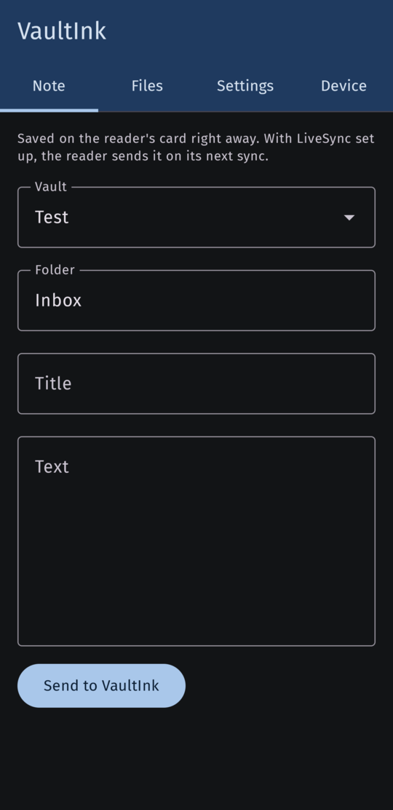
     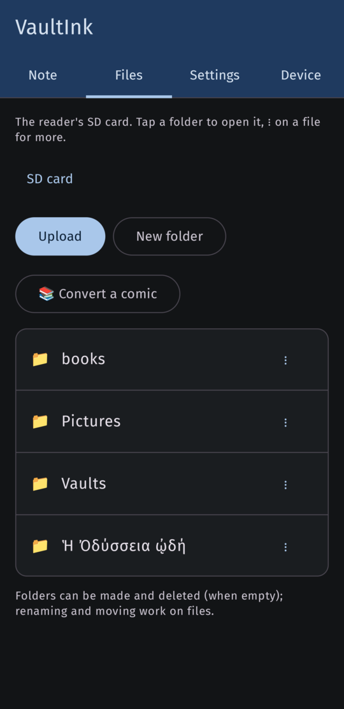
     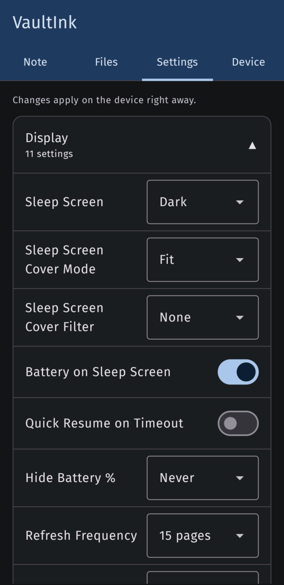
     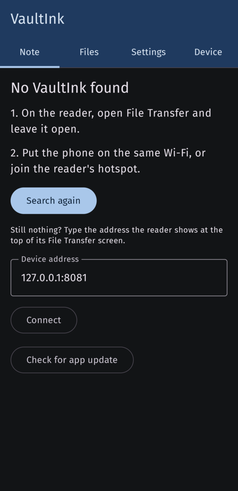
   </p>
   <p>
     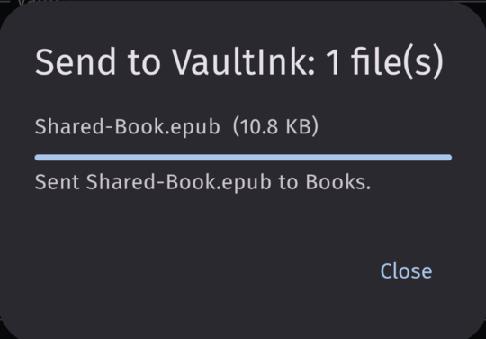
   </p>

The full feature list is in [SPECS.md](SPECS.md), and what is in and out of scope is in
[SCOPE.md](SCOPE.md).

## Installing

The easiest way is the **web installer** at **https://somnius.github.io/VaultInk/**. Pick your
device there and follow its steps. For the X4 Pro, in short:

1. Back up your SD card.
2. Copy `vaultink-<version>-x4pro.bin` from the [latest release](https://github.com/Somnius/VaultInk/releases/latest)
   (not the `factory` file) to the SD card, so you can reinstall from the reader under
   **Settings → System → SD Card Firmware Update**.
3. Put the reader in boot mode: switched off, hold **Power**, then also hold both page-turn
   buttons.
4. Connect it over USB-C to a computer with Chrome or Edge and press Install. Erasing the device
   wipes the reader's own memory (settings, Wi-Fi networks), not the SD card.

After that, updates come over Wi-Fi: **Settings → System → Check for Updates** shows what's new
in the newest release (scroll it), with Cancel and Update at the bottom, and Update installs it.

You can also build it yourself (see below) and flash it over USB with
[`esptool`](https://github.com/espressif/esptool):

```sh
esptool.py --chip esp32s3 --port /dev/ttyACM0 --baud 921600 write_flash 0x0 .pio/build/x4pro/firmware.factory.bin
```

## Tech stack

| | |
| --- | --- |
| Device | Xteink X4 Pro: ESP32-S3, 480×800 e-ink touch screen, SD card |
| Firmware | C++20 on Arduino and FreeRTOS (ESP-IDF underneath), built with PlatformIO |
| Base | [CrossPoint Reader](https://github.com/crosspoint-reader/crosspoint-reader) and the [FreeInk SDK](https://freeink.org) (drivers, UI, keyboard) |
| Notes | A streaming Markdown to XHTML converter, so notes render through the book reader |
| Search | A per-vault index file on the SD card, updated incrementally, with Greek and accent folding |
| Desktop | An SDL2 simulator that runs the same code, and host tests with CMake and GoogleTest |
| Installer | ESP Web Tools on GitHub Pages; the firmware is built locally, not on CI |

## Building

You need [PlatformIO](https://platformio.org) and a copy of this repository with its submodules:

```sh
git clone --recursive https://github.com/Somnius/VaultInk.git
cd VaultInk
pio run -e x4pro            # firmware for the X4 Pro
pio run -e simulator_x4_pro # desktop simulator (Linux needs SDL2 and OpenSSL headers)
```

The simulator runs the same code in a window on your computer. It reads its "SD card" from a folder
called `fs_` in the directory you start it from:

```sh
mkdir -p fs_/books && cp some-book.epub fs_/books/
.pio/build/simulator_x4_pro/program
```

Arrow keys are the buttons, Enter is OK, Escape is Back, and the mouse works as touch.

## Translating

The menus are in English and Greek, and many other languages from CrossPoint Reader are partly
there. To ask for your language or help translate it, see [docs/translating.md](docs/translating.md),
or open a [translation request](https://github.com/Somnius/VaultInk/issues/new?template=translation_request.yml).

## Author and donations

VaultInk is made by **Lefteris Iliadis** ([lefteros.com](https://lefteros.com)). The app page,
[lefteros.com/en/apps/vaultink](https://lefteros.com/en/apps/vaultink), has more about it, and you
can donate there to support the project.

## Credits

VaultInk stands on other people's work:

- [CrossPoint Reader](https://github.com/crosspoint-reader/crosspoint-reader), which everything
  here is built on, and the [FreeInk SDK](https://freeink.org) under it.
- [CrossNext](https://github.com/manuelx900/CrossNext) and KOReader's SimpleUI plugin, for ideas.
- kos25k, who tested every step of the way.
- u/curseofthebanana ([seethroughme](https://github.com/seethroughme)), whose
  [Banana Comic Converter](https://seethroughme.github.io/Banana-Comic-Converter/) makes the comics
  VaultInk reads.

The licences of the fonts, icons and libraries are listed in [NOTICE](NOTICE).

## License

MIT. See [LICENSE](LICENSE).
