<p align="center">
  <picture>
    <source media="(prefers-color-scheme: dark)" srcset="docs/images/vaultink/logo-dark.svg">
    
  </picture>
</p>

<h1 align="center">VaultInk</h1>

<p align="center">Books and Obsidian vaults on the Xteink X4 Pro.</p>

<p align="center">
  <a href="https://github.com/Somnius/VaultInk/releases"></a>
  <a href="LICENSE"></a>
  
  
  
  
  
  
  
</p>

<p align="center">
  <a href="https://somnius.github.io/VaultInk/"><b>Install from your browser</b></a> ·
  <a href="https://lefteros.com/en/apps/vaultink">Project page and donations</a> ·
  <a href="https://github.com/Somnius/VaultInk/releases">Releases</a>
</p>

<p align="center">
  <a href="https://github.com/Somnius/VaultInk/releases/download/android/vaultink-companion.apk"><b>Download the Android companion app (APK)</b></a> ·
  <a href="docs/companion.md">Companion guide</a>
</p>

VaultInk is firmware for the Xteink X4 Pro e-reader. It keeps everything
[CrossPoint Reader](https://github.com/crosspoint-reader/crosspoint-reader) does for books, and adds
a way to carry your [Obsidian](https://obsidian.md) notes with you. You can read them, search them
and follow their links. Later on you'll be able to edit and sync them too.

It's free and open source (MIT). It is not affiliated with Obsidian, Xteink or CrossPoint.

> [!WARNING]
> **Still early.** VaultInk is at 0.73.1. Releases from 0.8.2 on have been tested on a real X4 Pro by one
> tester (kos25k, UC8279 screen); the bugs he found are fixed and listed in the release notes. Much of the
> newest work has been checked on his device up to 0.66.0 (the status bar page number, Hide Status Bar, search,
> the Library and the battery page among them). Some of it has only run in the simulator so far: MOBI and AZW
> books, Advanced Typography, Dice, VaultEUC and the Bluetooth keyboard. Back up your SD card. The screenshots
> below come from the simulator.

## At a glance

<p>
  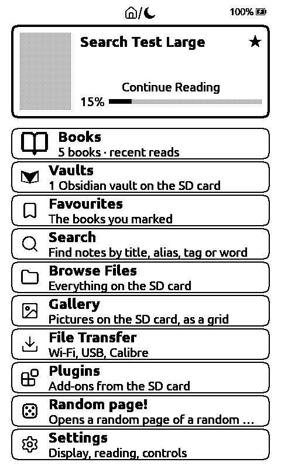
  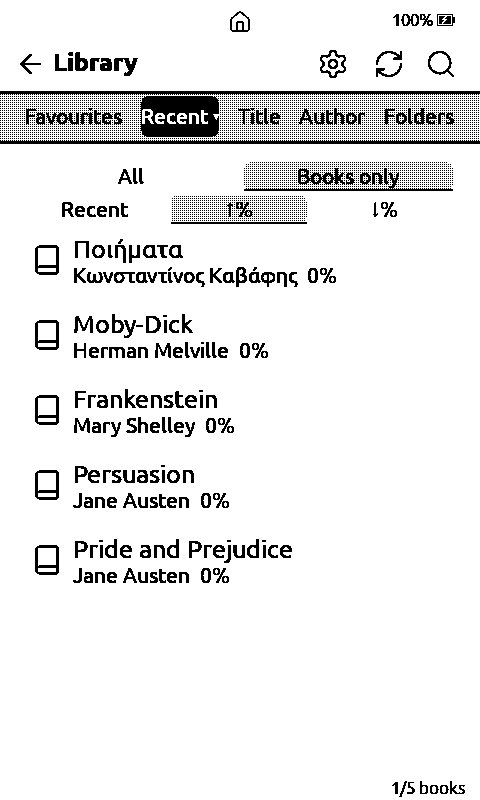
  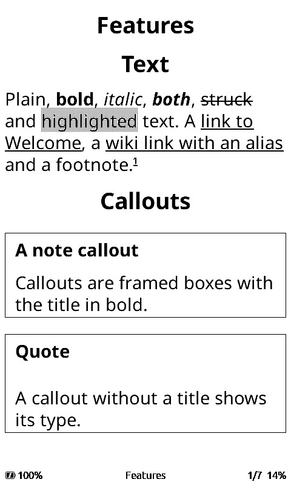
  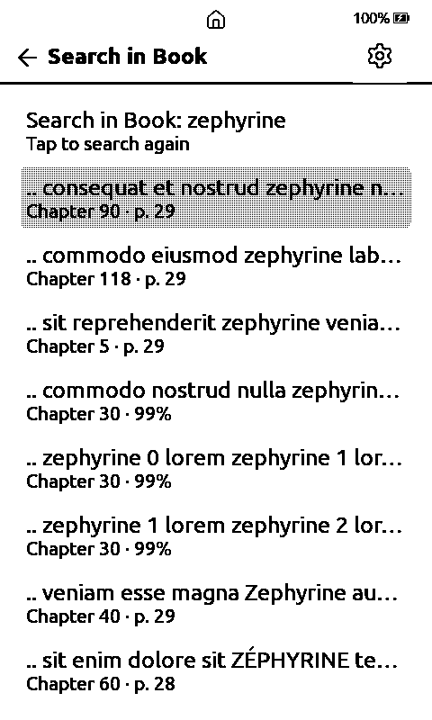
</p>

Home, the Library sorted by how far you have read, an Obsidian note, and Search in Book.

<p>
  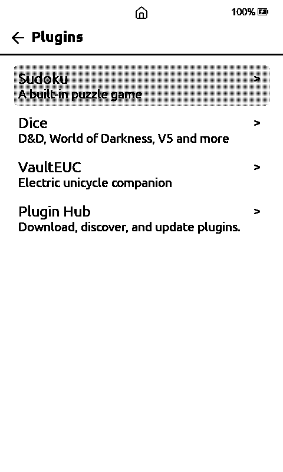
  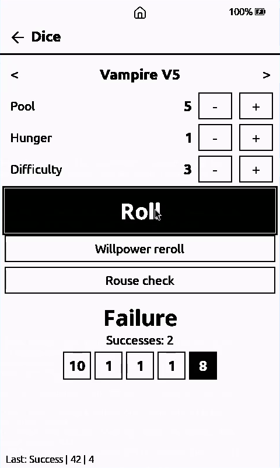
  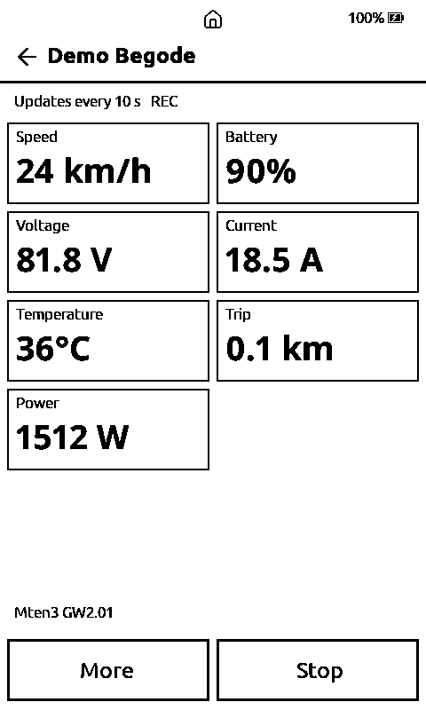
  
</p>

Home → Plugins holds the built-in tools: Sudoku, a dice roller, and VaultEUC for electric unicycles.

<p>
  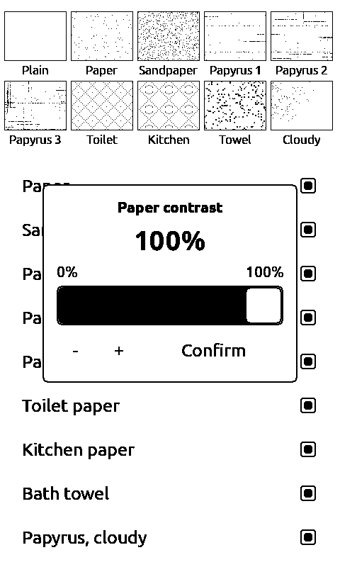
  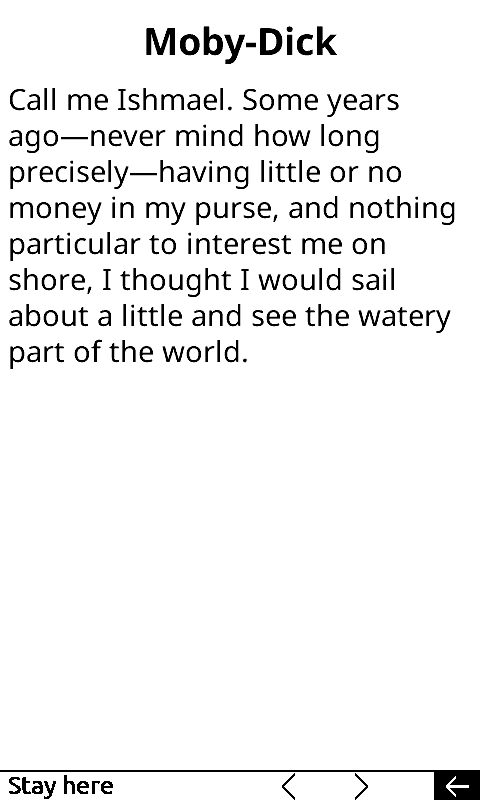
  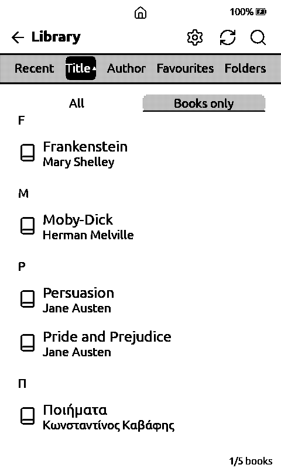
  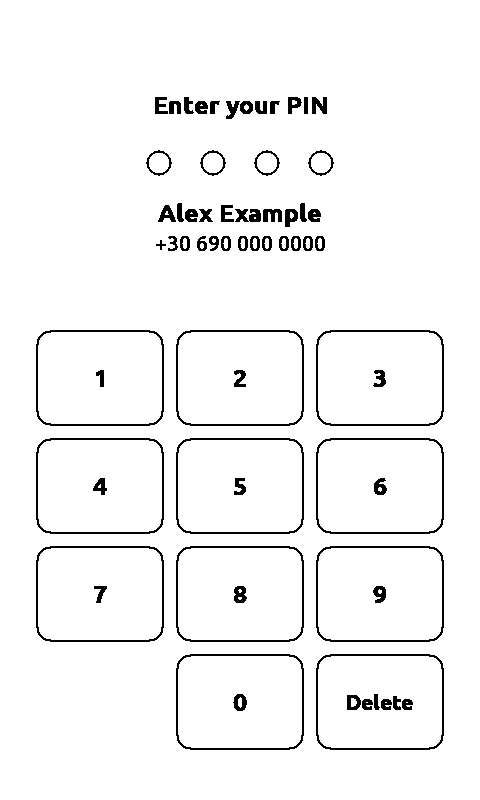
  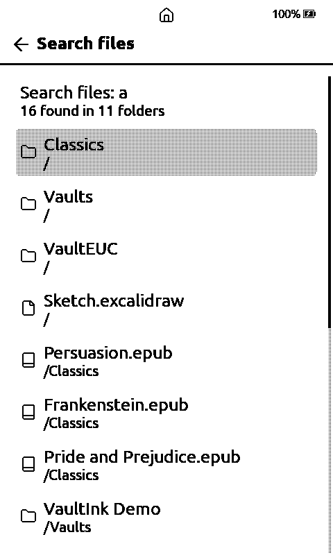
  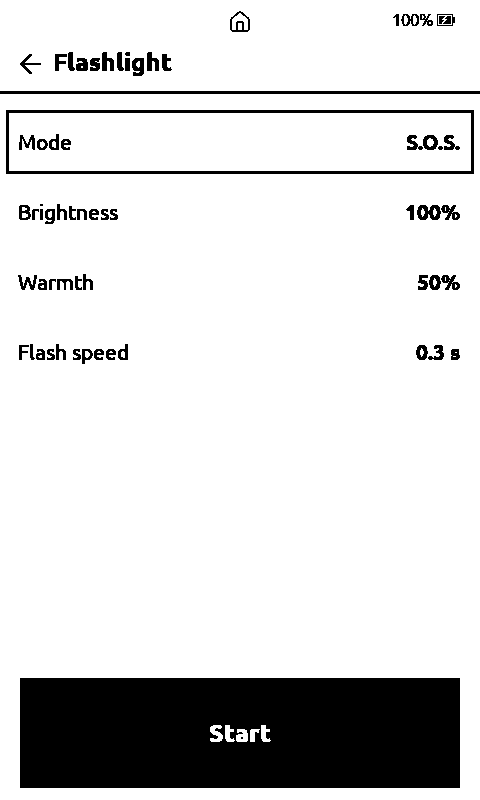
  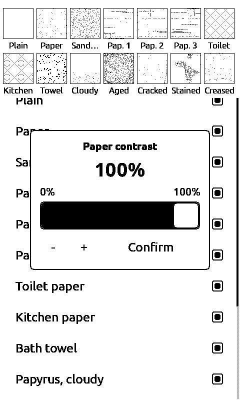
</p>

Page background contrast with a preview, Random page!, the Library's format filter, the lock screen, search in Browse Files, the flashlight and all fourteen page backgrounds.

<p>
  
  
  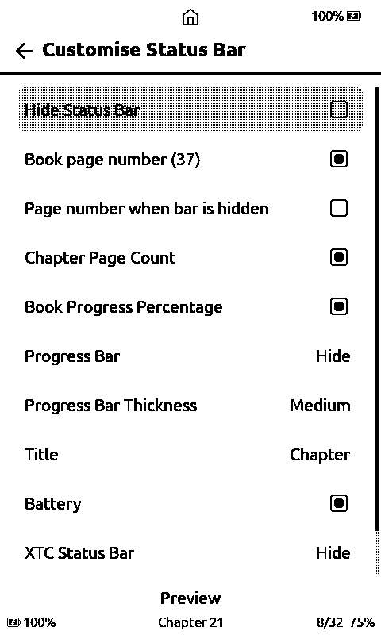
  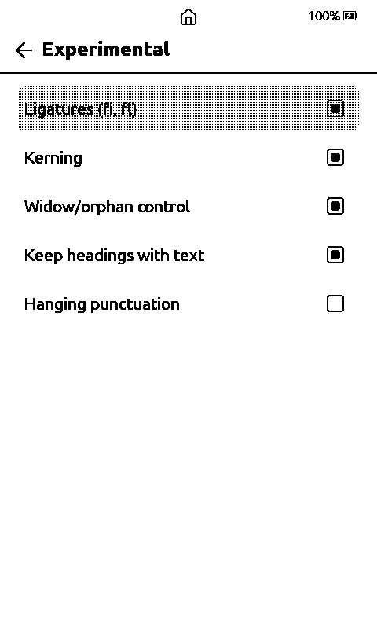
</p>

MOBI and AZW books, the status bar options with the book page number, and Advanced Typography.

More screenshots are in the sections below and in [docs/](docs/).

## New since 0.62 (up to 0.70.0)

Eleven releases in four days, most of it from kos25k's issues. The screenshots are from the simulator, except the companion ones, which come from a phone.

### MOBI, AZW and AZW3 (0.67.0, 0.67.1)

<p>
  
  
</p>

`.mobi` and `.prc` books open and show in the Library and in Browse Files, with a MOBI / AZW row in Book formats. Bold, italic, headings, lists, tables and pictures show. There are no chapters yet: the whole book is one chapter, like a `.txt`. Many MOBI files, most Kindle-store downloads without DRM among them, use Huffman compression, and 0.67.0 refused those; 0.67.1 reads them, and opens `.azw` and `.azw3` too. For the newer AZW3 files the text reads in order, but pictures, links and chapters don't work yet, and a heading can sit apart from its paragraph. Books with DRM are refused with a message. [docs/book-formats.md](docs/book-formats.md)

### Advanced Typography (0.66.0)

<p>
  
</p>

Settings → Reader → Advanced Typography, and in a book Text → Advanced Typography. Five switches: ligatures (fi, fl), kerning, widow and orphan control, keeping headings with their text, and hanging punctuation. The first four were always on and still are by default; now you can turn them off. Hanging punctuation is new and off by default: an opening quote or bracket at the start of a line hangs into the left margin, and a closing mark at the end of a justified line into the right one, Greek « » and ano teleia included, up to 12 px. It needs a little page margin. [docs/reading-and-files.md](docs/reading-and-files.md#advanced-typography-0660-renamed-from-experimental-in-0661)

### Reading presets and the More menu (0.70.0)

<p>
  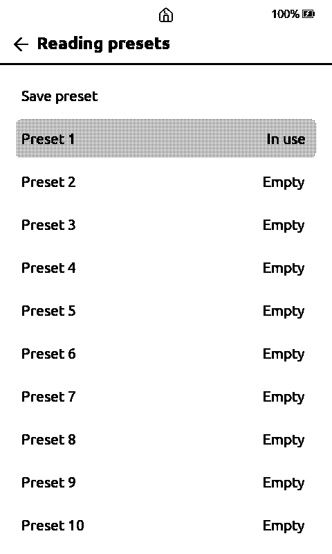
  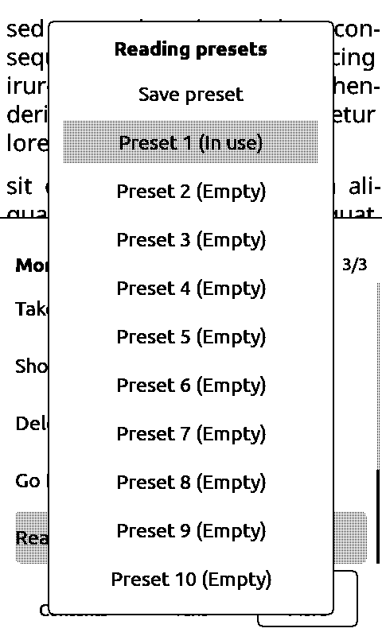
  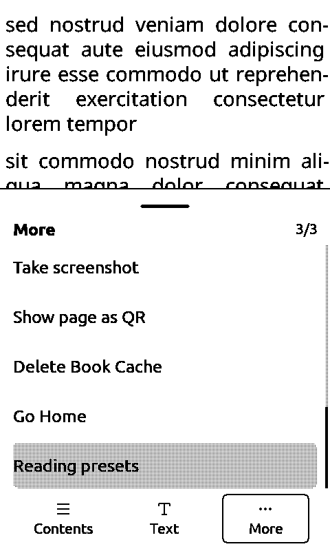
</p>

Ten slots, in Settings → Reader → Reading presets and as the last row of the book menu → More. **Save preset** keeps your current Text settings in a slot with a name you give it: font, size, line spacing, alignment, hyphenation, Focus Reading, Even Word Gaps, word and character spacing, margin, paragraph indent and the five Advanced Typography switches. Inside a book one press on a slot applies it and the page is laid out again. In the More menu, Search, Go to % and Go to page come first; the favourite toggle, Take screenshot, Show page as QR, Delete Book Cache, Go Home and Reading presets come last. Frontlight and Night Mode left More, and are still in the quick settings. [docs/reading-and-files.md](docs/reading-and-files.md#reading-presets-0700)

### Page numbers and the status bar (0.65.0 to 0.68.0)

<p>
  
  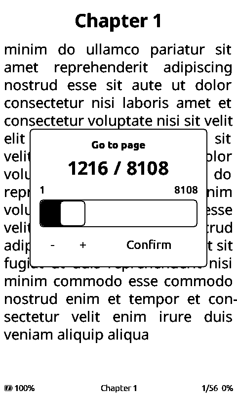
</p>

A book page number in brackets, like (37), next to the battery, counted from the first chapter, with a second switch to keep it when the bar is hidden. It's an estimate and changes with the font. Hide Status Bar sits in Customise Status Bar and in the book menu under More. **Go to page** (More, under Go to %) is a slider that counts pages the same way, so it's an estimate too; the side buttons jump by a twentieth of the book. It isn't for notes.

### The home screen, the home button and the stars (0.68.0 to 0.70.0)

<p>
  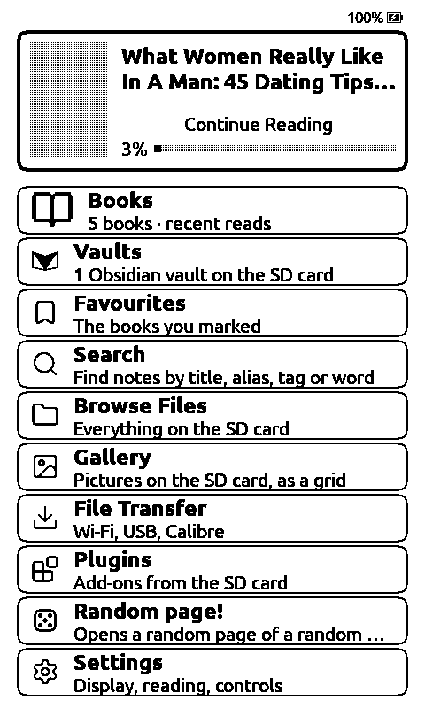
  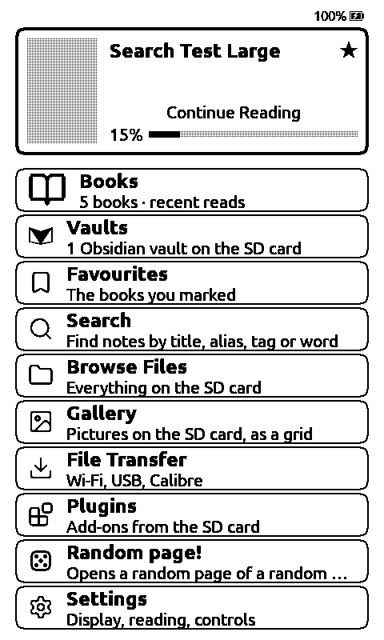
</p>

Every home tile is the same height with the same gap, the Books icon is bigger, and the Books count counts only books in the formats ticked in Book formats, not notes, text files or canvases. A ★ marks a favourite on the Continue Reading card, in Browse Files before the file type, and on the quick settings book card. A long press on the house at the top puts the reader to sleep, a tap still goes home, and the house has a small crescent moon on its roof. A Wi-Fi mark and a Bluetooth mark appear next to the battery as soon as the radio is on, with a ! until it's connected, and are gone when it's off.

### Browse Files (0.64.0, 0.69.0, 0.70.0)

<p>
  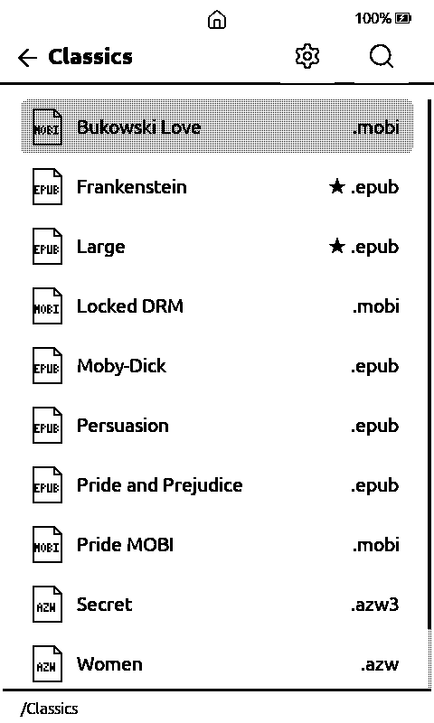
  
</p>

Search finds files and folders by name across the whole card, up to 200 hits and 12 folders deep. The sort gear next to it (name, newest, oldest, largest, smallest, folders first) stays the same in every folder until you change it. Icons are bigger with the file type written inside a book's icon, and in a folder's the type it holds most. Info and the date sort use the time the file was last added or changed on the card. [docs/reading-and-files.md](docs/reading-and-files.md#sorting-icons-and-stars-in-browse-files-0690)

### Papyrus, Battery and a Flashlight (0.65.0)

<p>
  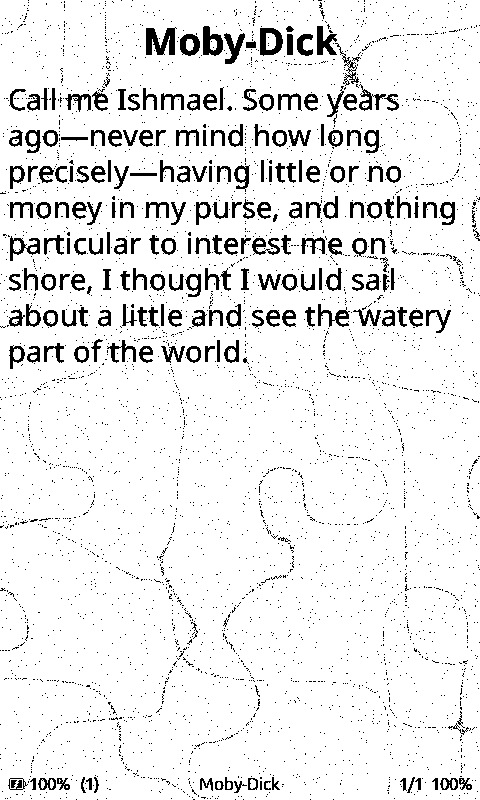
  
</p>

Four more papyrus looks (aged, cracked, stained, crumpled), drawn in code. The Battery page splits awake drain into light off and light on (it needs a few days of new data and is approximate). **Flashlight** (Home → Plugins) is the front light as S.O.S., blinking or steady, with brightness, warmth and speed, and it puts the light back as it was when you stop.

### Focus timer, Habits and Excalidraw (0.63.0)

<p>
  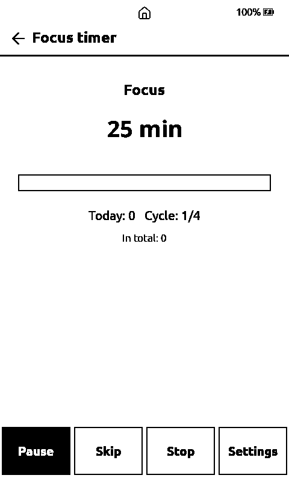
  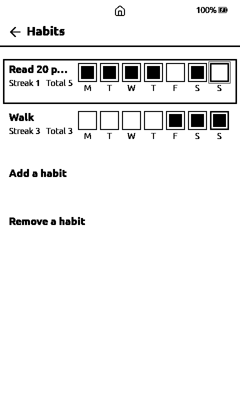
  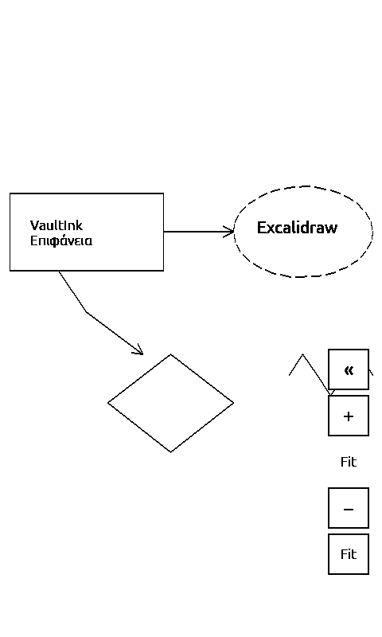
</p>

A Pomodoro **Focus timer** that follows the clock even while the reader sleeps, and **Habits**, up to 16 daily habits with the last seven days, a streak and a total. `.excalidraw` files and the Obsidian plugin's `.excalidraw.md` open in a viewer with fit, pan and zoom, compressed drawings included. [docs/tools.md](docs/tools.md)

### Typing, the phone and LiveSync (0.63.0 to 0.68.1)

<p>
  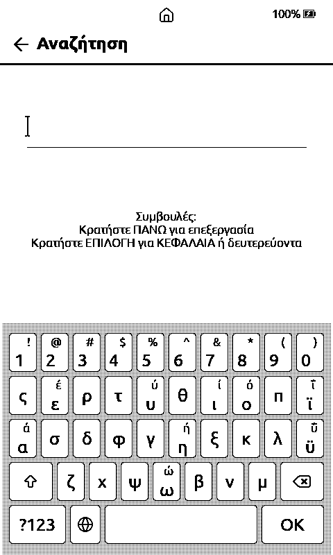
  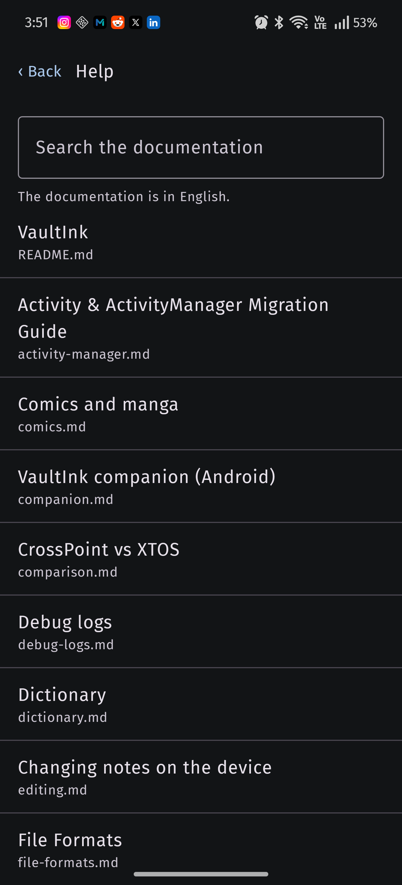
  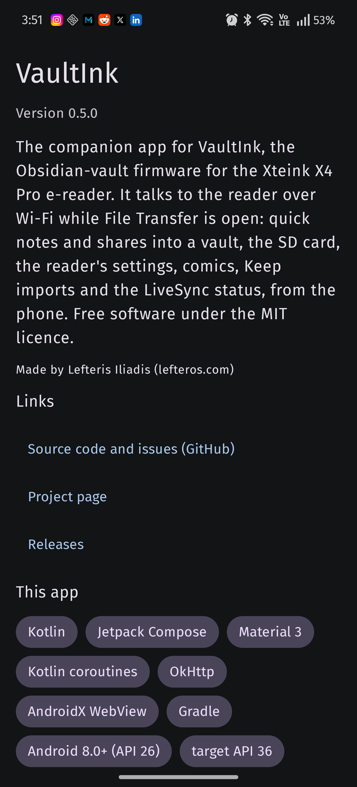
</p>

A paired Bluetooth keyboard types into the on-screen keyboard's line (US and Greek, off by default). The keyboard has a From phone button for text the companion app left on the card, and the companion app can ask for a LiveSync sync that runs at the reader's next wake. **LiveSync Setup URI (0.68.1):** the reader said "Turn on end-to-end encryption (V2)" for a vault that already used V2, because the plugin leaves its default settings out of the Setup URI. A missing algorithm now counts as V2, and the message says what's really wrong. Companion 0.5.0 adds an intro, About, the whole VaultInk documentation as Help, each file's type in the list, and Bring notes in (a Google Keep Takeout as Markdown notes). [docs/companion.md](docs/companion.md)

### What's tested on a real device, and what isn't

kos25k confirmed on his X4 Pro: the four papyrus looks, the Battery split, the Flashlight, the book page number, Hide Status Bar in the book menu, Advanced Typography, and MOBI, AZW and AZW3 (all three of his files opened). A cheap Bluetooth camera shutter turns pages with the Bluetooth Page Turner that was already there.

Everything else hasn't been on a device yet. Go to page, the home screen and the Books count, the stars, the Continue Reading fix, the Wi-Fi and Bluetooth marks, the sort gear and icons, reading presets, the More order and the sleep long press have only run in the simulator. Search in Browse Files, From phone, sync from the phone, the Focus timer, Habits, Excalidraw and the dice seed ran in the simulator and in tests on a computer. The LiveSync fix was checked against the plugin's source and with tests, not with a real vault. The Bluetooth keyboard hasn't met a real keyboard, and the companion app hasn't been tried against a real reader. **VaultEUC has never talked to a real wheel: don't use it while riding, and rely on the wheel's own alarms.** Back up your SD card before updating.

## What it does

Each line links to its guide where there is one; all the guides are listed in [docs/](docs/README.md). The full list is in [SPECS.md](SPECS.md), what changed in each version is in [CHANGELOG.md](CHANGELOG.md).

**Books** (what opens, and what doesn't: [docs/book-formats.md](docs/book-formats.md))
- Everything CrossPoint Reader offers: EPUB, TXT and XTC/XTCH books, SD-card fonts, hyphenation, bookmarks, highlights, dictionaries, KOReader sync, OPDS catalogs, Calibre wireless transfer and SD-card plugins. [docs/reading-and-files.md](docs/reading-and-files.md)
- **MOBI, PRC, AZW and AZW3** (0.67.0, 0.67.1): they open like a text book, read a record at a time, with bold, italic, headings, lists, tables and pictures; Huffman-compressed files too. No chapters yet, and AZW3 shows text only. DRM books are refused. Opened on a real X4 Pro (a MOBI, an AZW3 and an AZW). [docs/reading-and-files.md](docs/reading-and-files.md#mobi-azw-and-azw3-books-0670-0671)
- **FB2, HTML and RTF** (not released yet, tested on a computer only): `.fb2`, `.html` / `.htm` / `.xhtml` and `.rtf` files open like a text book, read a piece at a time. FB2 keeps its sections, titles, poems and quotes; HTML its headings, lists and quotes; RTF its paragraphs, bold and italic. Greek works in all three (UTF-8, Windows-1253, ISO-8859-7, RTF `\u` and `\'hh`). No pictures and no chapters. [docs/book-formats.md](docs/book-formats.md#fb2-html-and-rtf-in-detail)
- **Book map** (not released yet, computer tests only): More → Book map shows an EPUB as one strip, a segment per chapter, with marks for bookmarks and clippings and the place you were at. Drag along it to see the chapter, percent and estimated page, let go to jump; tap a bookmark's mark to open it. The chapter lists now show the page each chapter starts on. [docs/reading-and-files.md](docs/reading-and-files.md#book-map-and-page-numbers-in-the-chapter-list)
- **Hidden chapters** (not released yet, computer tests only): long-press a chapter in an EPUB's chapter list to leave it out of the book percent, the book page number, Go to page and Go to %. It can still be read. [docs/reading-and-files.md](docs/reading-and-files.md#hidden-chapters-left-out-of-the-page-count)
- **Auto warmth by the clock** (not released yet, computer tests only): Settings → Display turns the light warmer, and optionally night mode on, between two hours you pick. [docs/reading-and-files.md](docs/reading-and-files.md#auto-warmth-and-night-mode-by-the-clock)
- **Wikipedia lookup** (not released yet, computer tests only): when the dictionary has no entry, the Not found message offers Wikipedia. Wi-Fi comes on only on your tap, the article's summary shows as plain text in the book's language, and Wi-Fi goes off again. [docs/dictionary.md](docs/dictionary.md#wikipedia-when-the-dictionary-has-no-entry)
- **Certificate checks** (not released yet, computer tests only): Wikipedia is always checked against root certificates built into the firmware. The update check and downloads from GitHub are not checked yet, as before: that is ready in the code but waits for a test on a real device. KOReader sync has a new **Check certificate** switch, off by default so existing setups keep working. [docs/reading-and-files.md](docs/reading-and-files.md#certificate-checks)
- **PDF as text**: a PDF opens as reflowing text, Greek and filled-in form fields included, up to four columns, with its headings, bold and italic (the Style setting turns them off) and its filled boxes marked by dash lines (0.73.0); no pictures, tables or scans. PDFs are listed in the Library. [docs/reading-and-files.md](docs/reading-and-files.md#pdf-as-text)
- **Comics**: CBZ files open straight from the card (JPEG and PNG pages, chapters from folders, covers, landscape spreads as two pages, manga right to left, a page cache for faster turns). XTC/XTCH files from the Banana Comic Converter open with their chapters; a QR code in Settings opens the converter on your phone. [docs/comics.md](docs/comics.md)
- **Highlights to a vault note**: a book's clippings written to `Highlights/<title>.md` in your vault, and sent on by LiveSync. [docs/reading-and-files.md](docs/reading-and-files.md#highlights-to-a-vault-note)

**Library and finding your place**
- **Library**: tabs for Recent, Title, Author, Favourites and Folders, in an order you choose and with a tab it opens on. Sort Recent by how far you have read (↑% and ↓%), with the percent on every book. A gear filters the formats; **All | Books only** hides vault notes; Authors can be folders; a long press on any book gives Open, Delete, Favourites and Info. [docs/reading-and-files.md](docs/reading-and-files.md#library-sort-by-progress-tab-order-0600-0610)
- **Favourites** and **Book info** on a long press (title, author, size, percent read), in the Library, Browse Files and the home card. [docs/reading-and-files.md](docs/reading-and-files.md#favourites-0310)
- **Random page!** (a Home item, off by default): a random page of a random book, saving nothing, with a way back to where you were. [docs/reading-and-files.md](docs/reading-and-files.md#random-page-0600-0610-0640)
- **Reading stats** on a sleep screen: today, this week, this month and total, your last three books, a month calendar, streaks and finished books. [docs/reading-and-files.md](docs/reading-and-files.md#reading-statistics-on-the-sleep-screen-0510)

**Obsidian vaults** ([docs/editing.md](docs/editing.md), [docs/livesync.md](docs/livesync.md), [docs/flashcards.md](docs/flashcards.md))
- Every vault on the card opens like a folder of notes, and remembers the note you read last. The Vaults screen lists your recent notes.
- Notes read like book pages: headings, lists, tasks as real boxes, quotes, callouts in a frame, tables, code, footnotes, highlights (three styles), pictures with their sizes, note embeds (whole note, a heading or a block), frontmatter and tags, with Greek throughout. Links resolve the way Obsidian does, with aliases and partial paths; a note's menu has Backlinks and a « Back row.
- **Search** across every vault by title, alias, tag, heading, text and block id; a hit in a heading or block opens the note right there. Accents and capitals never matter.
- **Edit on the device**: tick tasks, edit a note line by line with undo, join lines, make, rename and delete notes (to `.trash`). Renaming a note updates the links to it. Untouched lines keep their exact bytes, and every save goes through a temp file.
- **LiveSync** both ways with Obsidian Self-hosted LiveSync over Wi-Fi: end-to-end encryption, certificate checks, a Sync tile in quick settings, sync on wake every 6 or 24 hours, and conflicts kept as a copy, never overwritten. Not tried against a real Obsidian install yet.
- **Flashcards** written in your notes (`Front::Back`, `?` cards, `{{gaps}}`), reviewed with spaced repetition, per deck or per note. Nothing is written into your notes.
- **Canvas** files open in a viewer: pan, zoom, pictures in cards, tap a card to open its note. **Excalidraw** drawings (`.excalidraw`, the plugin's `.excalidraw.md`, compressed too) open the same way, read only.
- **Import a vault from a ZIP** on the device's web page. Pictures in your vaults show in the Gallery.

**Reading comfort, search and typography**
- **Search in Book**: a word or phrase, partial or whole words (accents and capitals never matter), starting at your chapter and wrapping, with the words shaded on the page and a bar to step through the hits or go back to your place. A gear sets the type and the range; an opt-in index makes repeat searches faster. [docs/reading-and-files.md](docs/reading-and-files.md#search-in-a-book)
- **Text panel** in the book with every layout setting: font, size, line spacing 0 to 10, alignment, hyphenation (on by default, Greek and polytonic too), Even Word Gaps, word and character spacing, screen margin down to 0, paragraph indent. Changes show at once. [docs/reading-and-files.md](docs/reading-and-files.md#in-the-book-the-text-panel-0270)
- **Advanced Typography** (0.66.0): switches for ligatures, kerning, widow and orphan control, headings kept with their text, and hanging punctuation. [docs/reading-and-files.md](docs/reading-and-files.md#advanced-typography-0660-renamed-from-experimental-in-0661)
- **Reading presets** (0.70.0): ten named sets of your Text settings, saved and applied from Settings → Reader or the last row of the book menu's More, so one press applies one while you read. [docs/reading-and-files.md](docs/reading-and-files.md#reading-presets-0700)
- **Page backgrounds**: fourteen of them, from plain to papyrus and bath towel, a set you choose for the quick-settings paper tile, and a 0 to 100 contrast slider with a preview. [Mostly for fun](#page-backgrounds).
- **Status bar**: choose what it shows, hide it from Settings or the book menu, and show the page number counted from the start of the book in brackets, even with the bar hidden (the number is an estimate for books). **Go to page** in the book menu under More (0.68.0) jumps by that number. [docs/reading-and-files.md](docs/reading-and-files.md#hide-status-bar-and-the-book-page-number)
- **Tap Zones**: turn pages from the whole page or the corners only, so a stray finger does nothing. [docs/reading-and-files.md](docs/reading-and-files.md#tap-zones-corners-only-0250)
- **Gestures and a Quick Menu** (not released yet, computer tests only): Settings → Reader → Gestures gives the corner taps, the centre tap and the four swipes an action each (next chapter, bookmark, night mode, light panel, a Quick Menu of up to six actions, and more). The buttons and edge swipes stay fixed. [docs/reading-and-files.md](docs/reading-and-files.md#gestures-and-the-quick-menu)
- **Quick settings** on a swipe down: light and warmth, night mode, refresh, sleep, Wi-Fi, Sync, Library, the paper tile, and a book card that opens the Library or goes Home. One menu at a time, so menus never stack.

**Tools** (Home → Plugins, built into the firmware: [docs/tools.md](docs/tools.md))
- **Sudoku**: three levels, pencil notes, undo, hints, a timer, and it saves where you left off.
- **Dice**: polyhedral dice with advantage, keep-highest and exploding dice; old World of Darkness; Vampire V5 with Hunger dice, Willpower reroll and Rouse checks; Chronicles of Darkness; Fate; Powered by the Apocalypse; Blades in the Dark; Call of Cthulhu; Shadowrun; Savage Worlds; Year Zero; Cyberpunk Red. The seed mixes the chip's generator with the time and the battery. Not tried on a device yet. [docs/reading-and-files.md](docs/reading-and-files.md#dice-0610)
- **Focus timer**: a Pomodoro timer that follows the clock, so a sleeping reader still knows when a phase ended; finished phases are logged. **Habits**: up to 16 daily habits with the last seven days, a streak and a total.
- **Flashlight** (0.65.0): the front light as an S.O.S., blinking or steady, with brightness, warmth and flash speed.
- **VaultEUC**: an electric unicycle companion over Bluetooth (Begode, Veteran/Leaperkim, KingSong, InMotion, Ninebot, VESC): live numbers every 5 to 30 seconds, alarm limits, ride logs as CSV on the card, your wheels remembered, km/h or mph, a demo wheel to try it. **Not for use while riding, and not tried on a real wheel yet.** [docs/vaulteuc.md](docs/vaulteuc.md)
- **Plugins** from the SD card and the Plugin Hub: [docs/sd-plugins.md](docs/sd-plugins.md).

**The device**
- **Home screen** with the book or note you were reading on top, counts on the Books and Vaults rows, rows in any order and any of them hidden, a home button in the top bar, and a Favourites row. CrossPoint's home styles stay as a choice. [docs/reading-and-files.md](docs/reading-and-files.md#home-screen-rows-0320)
- **Settings** grouped by task, with a search that finds a setting by name, and rows that show their current value.
- **Browse Files** with Open, Delete, Rename, Move, Copy, New folder, Extract here for zips, Open as gallery and Info on every file. Books keep their place when they or their folder move. A magnifier searches the whole card by name (0.64.0). [docs/reading-and-files.md](docs/reading-and-files.md#search-in-browse-files-0640) A sort gear (name, date, size) is kept in every folder, list icons are bigger with the file type written inside (a folder shows its most common type), and favourite books have a ★ ([guide](docs/reading-and-files.md#sorting-icons-and-stars-in-browse-files-0690)).
- **Gallery** for the pictures on the card, nine to a page, with filters, chosen folders, phone photos up to 50 MP, and Set as sleep picture. [docs/reading-and-files.md](docs/reading-and-files.md#gallery-0240)
- **Sleep screens**: your own picture (JPEG, PNG or BMP, cropped or fitted), the battery percent, the owner's name and phone, or the reading stats.
- **Lock screen** with a 4-digit PIN or a corner long-press, how long after sleeping it locks, and the owner's name and phone on it. [docs/reading-and-files.md](docs/reading-and-files.md#lock-screen-0490)
- **Battery** page: charge, voltage, charging, temperature, and the drain per hour asleep and awake (light off and on). [docs/reading-and-files.md](docs/reading-and-files.md#battery-page-0440)
- **Updates over Wi-Fi** from the reader, with the release notes shown first, **What's New** after an update, and a five-page **welcome guide** on the first start. Debug logs to the card on request. [docs/debug-logs.md](docs/debug-logs.md)
- No telemetry, accounts or payments; the update check is the only network call you don't start yourself.

**Phone, Bluetooth and languages**
- **File Transfer** over Wi-Fi (as `vaultink.local`), **USB Drive** (the SD card as a drive over the USB-C cable, no Wi-Fi: File Transfer → USB Drive) and Calibre; a web page for files, notes, settings, LiveSync setup and vault import. [docs/webserver.md](docs/webserver.md)
- **Android companion app** ([docs/companion.md](docs/companion.md)): quick notes into a vault, share text, pictures, books and comics from other apps, the SD card with uploads and downloads, the reader's settings, a comic converter inside the app, an outbox for when the reader is away, a Google Keep importer, LiveSync status with a sync request, typing into the reader from the phone, and the documentation offline. English and Greek. Tested against the simulator, not a real X4 Pro yet.
- **Bluetooth**: a page-turner remote, and a Bluetooth keyboard can type into the on-screen keyboard's line (off by default, not tried with a real keyboard). [docs/reading-and-files.md](docs/reading-and-files.md#bluetooth-keyboard-typing-0630)
- Full **Greek** interface, a Greek and English on-screen keyboard, Greek (monotonic and polytonic) in the built-in fonts and hyphenation. Menus in many more languages from CrossPoint. [docs/translating.md](docs/translating.md)

### Page backgrounds

<p>
  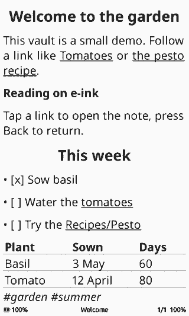
  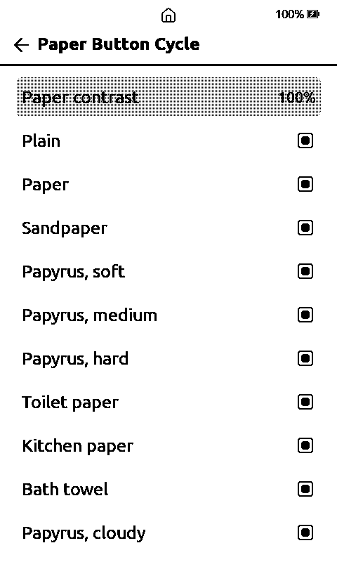
</p>

Swipe down from the top for quick settings, then tap the paper tile to change the page background
under the text. It's also under **Settings → Reader → Page Background**. The choices are plain,
paper, sandpaper, papyrus (soft, medium, hard, cloudy, aged, cracked, stained and crumpled), toilet paper, kitchen paper and bath towel.
**Settings → Reader → Paper Button Cycle** sets which of them the tile steps through, and its first row,
**Paper contrast**, opens a 0 to 100 slider with a tile of every background that changes as you move it (0.60.0).

While a background is on, text anti-aliasing is switched off, so the letters stay sharp on the
real screen. This one is mostly for fun 😄. Plain is the default and the easiest to read, but the papyrus ones
are actually nice for a long read. The idea came from kos25k.

## Getting started

The first time VaultInk starts, it shows a short welcome guide. The five pages are below.

<p>
  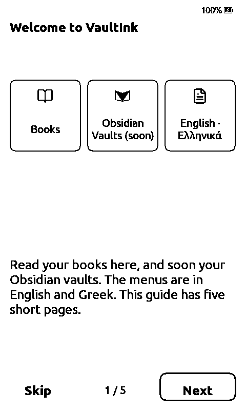
  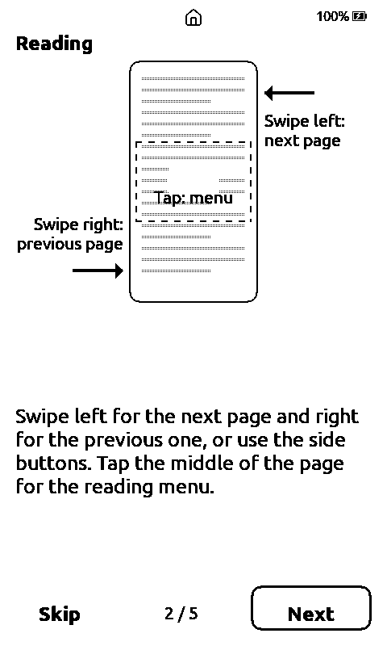
  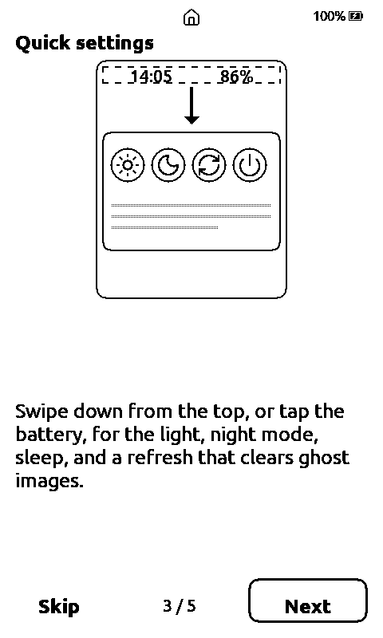
  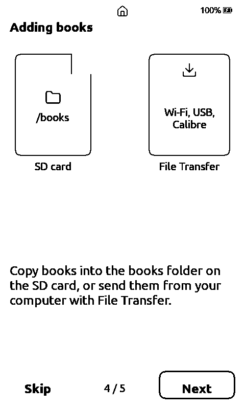
  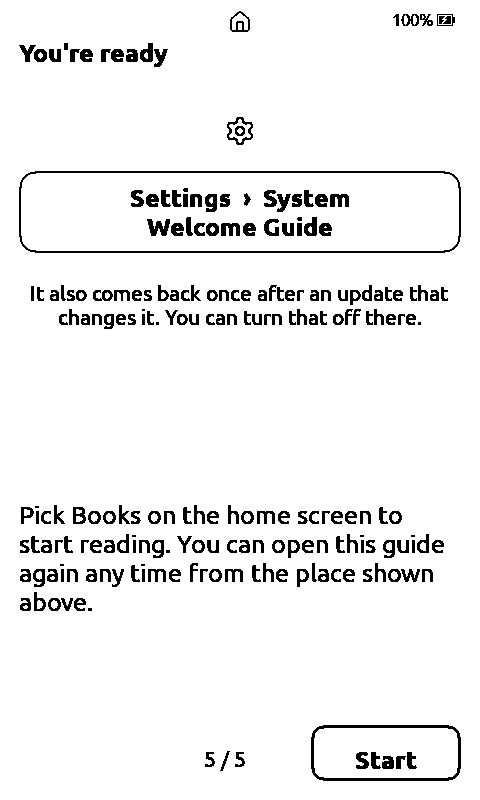
</p>

1. **Welcome.** VaultInk is for your books and your Obsidian vaults. The menus are in English, Greek and many other languages, listed on this page.
2. **Reading.** Swipe left for the next page and right for the previous one, or use the side buttons. Tap the middle of the page to open the reading menu.
3. **Quick settings.** Swipe down from the top of the screen, or tap the battery. You get the light, night mode, sleep, and a full refresh (to clear ghost images).
4. **Adding books.** Copy books into the `books` folder on the SD card, or send them from your computer with File Transfer (Wi-Fi, USB Drive over the USB-C cable, or Calibre).
5. **That's it.** Open the guide again from **Settings → System → Welcome Guide**. It also comes back once after an update that changes it. To stop that, turn off **Show Welcome Guide After Updates** in the same place.

**Screenshots.** Hold Power and press Down at the same time, on any screen, and the reader saves what is on the screen as a BMP in `/screenshots/` on the SD card (in a book it goes in a folder with the book's title). The Down button is the right-hand side button on the X4 Pro. Inside a book it is also in the book menu, under More, as Take screenshot. [docs/reading-and-files.md](docs/reading-and-files.md#screenshots)

**Menus in Greek:** Settings → System → Language, then **Ελληνικά** (second in the list, right
after English). Back in Greek the same place is Ρυθμίσεις → Σύστημα → Γλώσσα.

In the guide, Next (or OK, or the right and down keys) moves on. Back goes back a page. On the first page, Back asks whether you want to skip.

## Comics and manga, with Banana Comic Converter

<a href="https://seethroughme.github.io/Banana-Comic-Converter/">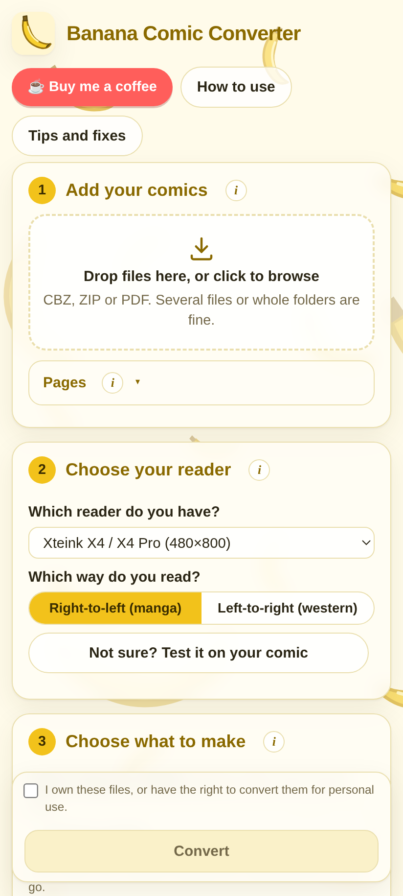</a>

Comics on the X4 Pro go through **[Banana Comic Converter](https://seethroughme.github.io/Banana-Comic-Converter/)**,
made by **u/curseofthebanana** ([Reddit](https://www.reddit.com/user/curseofthebanana/),
[GitHub: seethroughme](https://github.com/seethroughme)). It's a free tool in your browser, on a
phone or a computer, with no AI: it cuts every page into its panels and repacks them to fill the
small screen, instead of shrinking the whole page. It has an X4 / X4 Pro preset, manga
(right-to-left) or western order, a full panel editor for the pages it gets wrong, batch
conversion and file splitting, and it writes XTC, XTCH, EPUB and CBZ.

We're working on this together: its author is happy for VaultInk to send comic readers their way,
and VaultInk is built to open what it makes. Convert to **XTCH** (or **XTC** for the fastest page
turns), upload the file with the companion app or the web page, and read it like a book. The
companion app converts comics too, XTCH pages turn faster since 0.36.1, and since 0.39.0 plain CBZ
files open as well (JPEG and PNG pages). The guide: [docs/comics.md](docs/comics.md).

On the X4 Pro, **Settings → Library → Convert comics** shows a QR code that opens the converter on
your phone.

If it saves you time, the converter's page has a "Buy me a coffee" link for its author.

<br clear="right">

## What's coming

The [roadmap](ROADMAP.md) has the details and the order. Open items right now:

- Real-device testing of the newest features: MOBI and AZW books, Advanced Typography, Dice, VaultEUC with a real wheel and the Bluetooth client and keyboard.
- Chapters and the cover for MOBI books, and pictures and links for AZW3.
- The XTCH refresh choice and a few share-to-reader edge cases wait for device tests.

The companion app lives in `companion/` in this repo and is released separately (guide: [docs/companion.md](docs/companion.md)).

<p>
  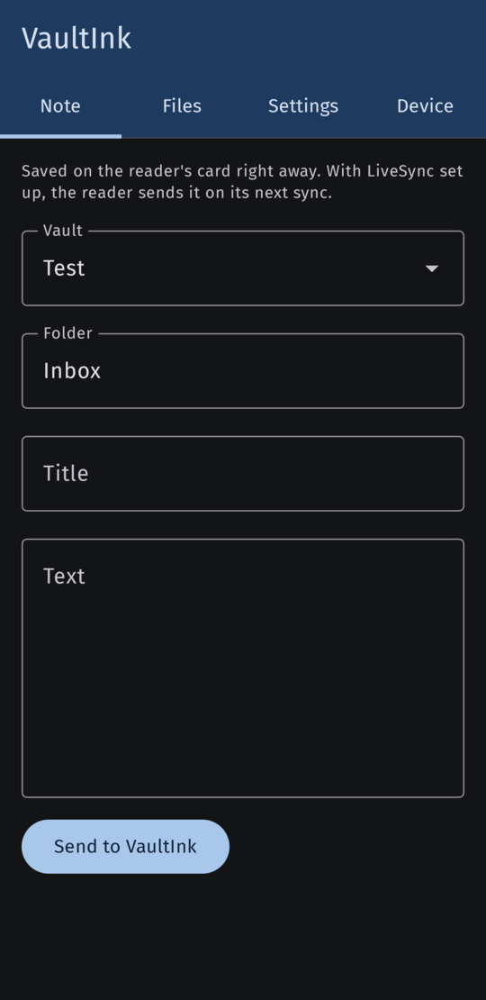
  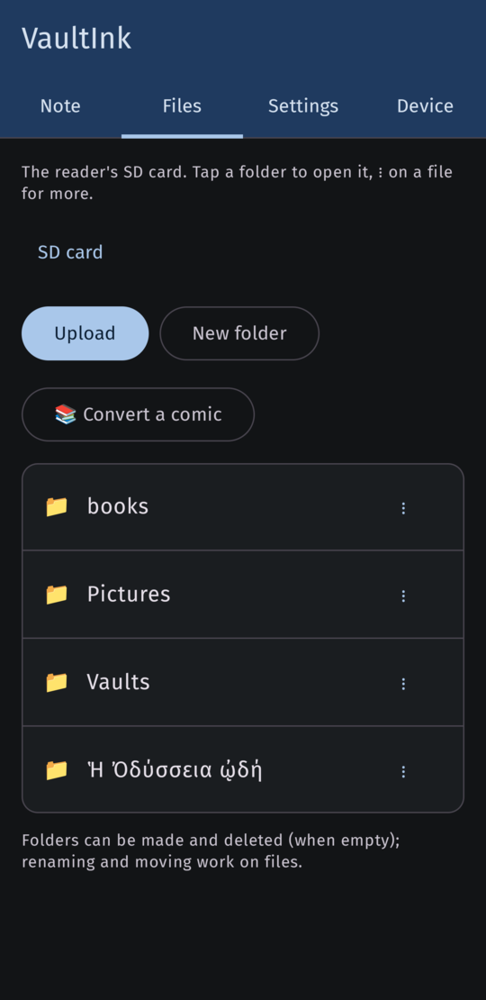
  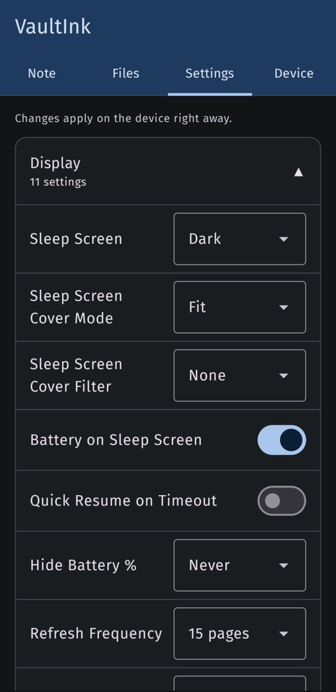
  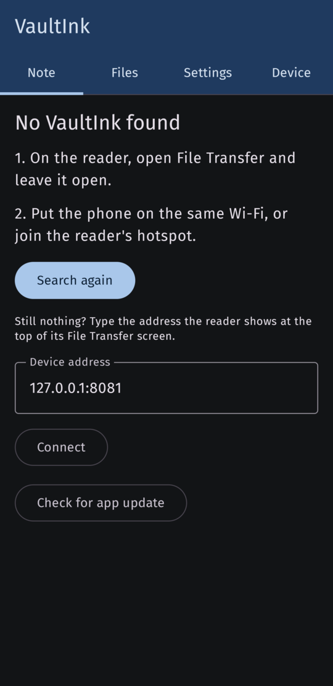
</p>

What is in and out of scope is in [SCOPE.md](SCOPE.md).

## Installing

The easiest way is the **web installer** at **https://somnius.github.io/VaultInk/**. Pick your
device there and follow its steps. For the X4 Pro, in short:

1. Back up your SD card.
2. Copy `vaultink-<version>-x4pro.bin` from the [latest release](https://github.com/Somnius/VaultInk/releases/latest)
   (not the `factory` file) to the SD card, so you can reinstall from the reader under
   **Settings → System → SD Card Firmware Update**.
3. Put the reader in boot mode: switched off, hold **Power**, then also hold both page-turn
   buttons.
4. Connect it over USB-C to a computer with Chrome or Edge and press Install. Erasing the device
   wipes the reader's own memory (settings, Wi-Fi networks), not the SD card.

After that, updates come over Wi-Fi: **Settings → System → Check for Updates** shows what's new
in the newest release (scroll it), with Cancel and Update at the bottom, and Update installs it.

You can also build it yourself (see below) and flash it over USB with
[`esptool`](https://github.com/espressif/esptool):

```sh
esptool.py --chip esp32s3 --port /dev/ttyACM0 --baud 921600 write_flash 0x0 .pio/build/x4pro/firmware.factory.bin
```

## Tech stack

| | |
| --- | --- |
| Device | Xteink X4 Pro: ESP32-S3, 480×800 e-ink touch screen, SD card |
| Firmware | C++20 on Arduino and FreeRTOS (ESP-IDF underneath), built with PlatformIO |
| Base | [CrossPoint Reader](https://github.com/crosspoint-reader/crosspoint-reader) and the [FreeInk SDK](https://freeink.org) (drivers, UI, keyboard) |
| Notes | A streaming Markdown to XHTML converter, so notes render through the book reader |
| Search | A per-vault index file on the SD card, updated incrementally, with Greek and accent folding |
| Desktop | An SDL2 simulator that runs the same code, and host tests with CMake and GoogleTest |
| Installer | ESP Web Tools on GitHub Pages; the firmware is built locally, not on CI |

## Building

You need [PlatformIO](https://platformio.org) and a copy of this repository with its submodules:

```sh
git clone --recursive https://github.com/Somnius/VaultInk.git
cd VaultInk
pio run -e x4pro            # firmware for the X4 Pro
pio run -e simulator_x4_pro # desktop simulator (Linux needs SDL2 and OpenSSL headers)
```

The simulator runs the same code in a window on your computer. It reads its "SD card" from a folder
called `fs_` in the directory you start it from:

```sh
mkdir -p fs_/books && cp some-book.epub fs_/books/
.pio/build/simulator_x4_pro/program
```

Arrow keys are the buttons, Enter is OK, Escape is Back, and the mouse works as touch.

## Translating

The menus are in English and Greek, and many other languages from CrossPoint Reader are partly
there. To ask for your language or help translate it, see [docs/translating.md](docs/translating.md),
or open a [translation request](https://github.com/Somnius/VaultInk/issues/new?template=translation_request.yml).

## Author and donations

VaultInk is made by **Lefteris Iliadis** ([lefteros.com](https://lefteros.com)). The app page,
[lefteros.com/en/apps/vaultink](https://lefteros.com/en/apps/vaultink), has more about it, and you
can donate there to support the project.

## Credits

VaultInk stands on other people's work:

- [CrossPoint Reader](https://github.com/crosspoint-reader/crosspoint-reader), which everything
  here is built on, and the [FreeInk SDK](https://freeink.org) under it.
- [CrossNext](https://github.com/manuelx900/CrossNext) and KOReader's SimpleUI plugin, for ideas.
- kos25k, who tested every step of the way.
- u/curseofthebanana ([seethroughme](https://github.com/seethroughme)), whose
  [Banana Comic Converter](https://seethroughme.github.io/Banana-Comic-Converter/) makes the comics
  VaultInk reads.

The licences of the fonts, icons and libraries are listed in [NOTICE](NOTICE).

## License

MIT for VaultInk's own source. See [LICENSE](LICENSE).

The firmware binaries also contain wolfSSL (TLS 1.3), which is GPL-2.0-or-later, so the binaries are distributed under the GPL terms, with the source in this repository. See [NOTICE](NOTICE).
