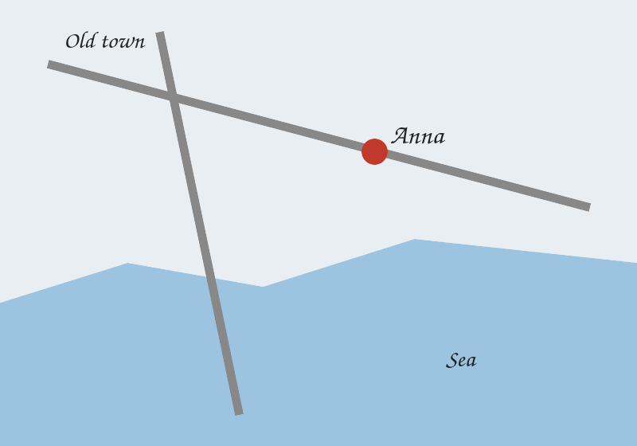

# Features

## Text
Plain, **bold**, *italic*, ***both***, ~~struck~~ and ==highlighted== text. A [link to Welcome](Welcome.md), a [[Welcome|wiki link with an alias]] and a footnote.[^1]

## Callouts
> [!note] A note callout
> Callouts are framed boxes with the title in bold.

> [!quote]
> A callout without a title shows its type.

> And a plain quote stays indented.

## Lists and tasks
1. First
2. Second
   - nested
   - nested again
- [ ] a task to do
- [x] a task done

## Table
| Plant | Water | Sun |
|---|:-:|---|
| Tomato | daily | full |
| Basil | often | half |

## Embeds
A whole note:
![[Nikos]]

Only one heading of a note:
![[Places/Thessaloniki#Food]]

Only one block:
![[Places/Thessaloniki#^tip]]

An image, and one sized with `|200`:
![[garden.png]]

![[portrait.jpg|200]]

A Markdown-style image too: 

## Code
```
code blocks keep their spacing
    like this
```

[^1]: Footnotes jump here and back.
