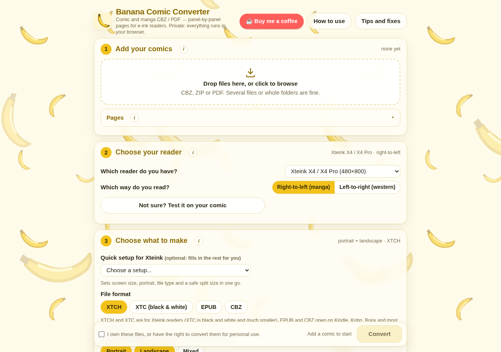
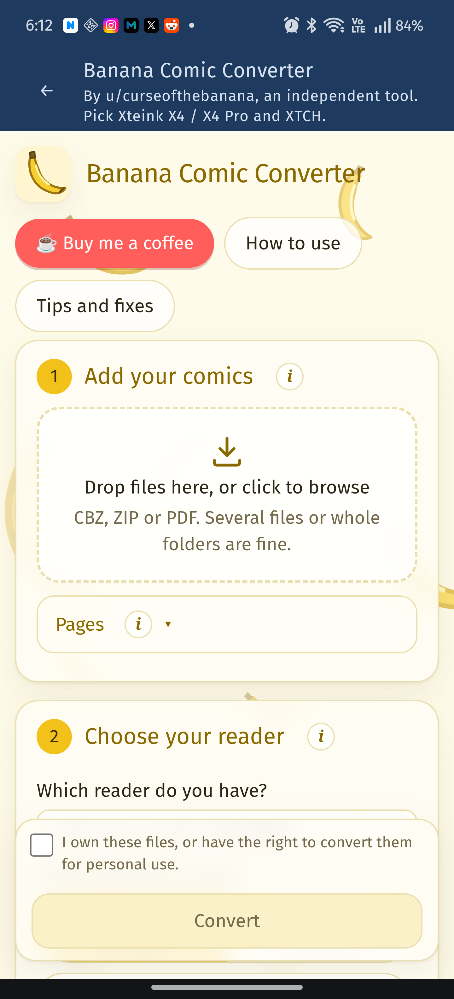
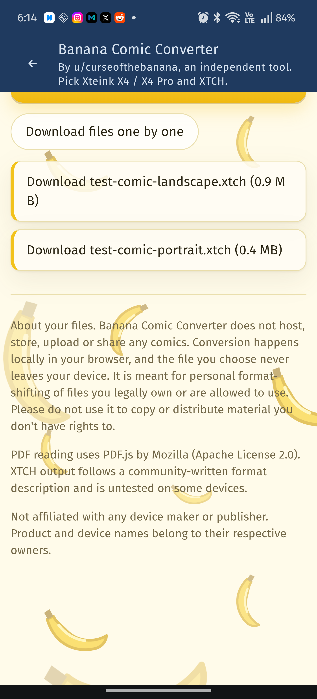
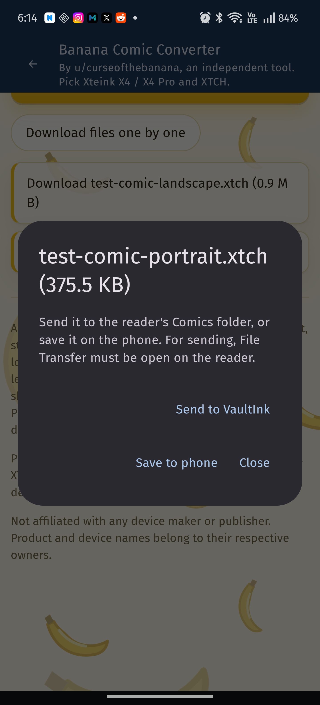
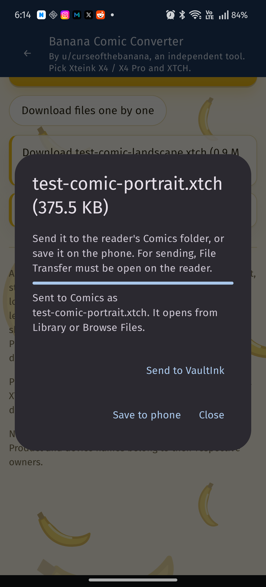
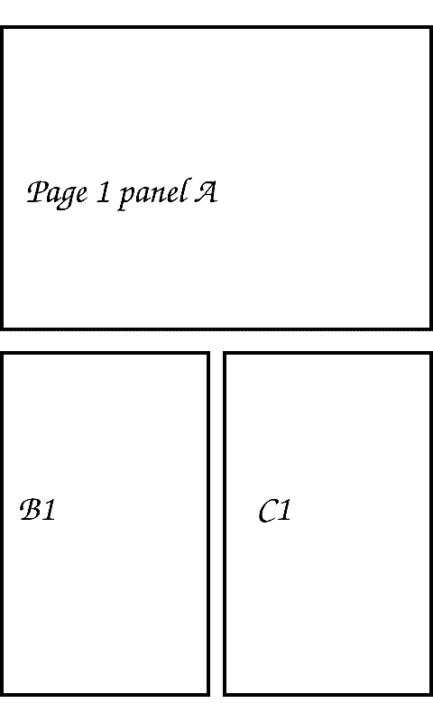

# Comics and manga

The X4 Pro's screen is small for a comic page. The way to read comics on it is to convert them
first with **Banana Comic Converter** by u/curseofthebanana (GitHub: seethroughme):

**https://seethroughme.github.io/Banana-Comic-Converter/**

It's a free tool that runs in the browser, on a phone or a computer, and uses no AI; your files stay
in the browser. It takes CBZ, ZIP or PDF, cuts each page into its panels and repacks them so they
use as much of the screen as possible, instead of shrinking the whole page. It has a manual panel
editor for the pages it gets wrong, batch conversion, metadata editing, and it can split big files.
It writes XTC, XTCH, EPUB and CBZ.

  
  

## In the converter

1. **Add your comics**: CBZ, ZIP or PDF, one or several files.
2. **Choose your reader**: pick **Xteink X4 / X4 Pro (480×800)**, and **Right-to-left (manga)** or
   **Left-to-right (western)**. The reading direction is set here, so the pages arrive on the X4 Pro
   in the right order.
3. **Choose what to make**: the X4 quick setup fills in the screen size, file type and a safe split
   size; or pick the format yourself (see below).
4. Tick that you own the files (or may convert them for personal use) and press **Convert**.

It's an independent project, not part of VaultInk. Its author agreed to VaultInk linking to it.
Questions about the conversion go to its author (the page has instructions and troubleshooting).
VaultInk doesn't convert anything on the device.

## From the X4 Pro itself (0.34.0)

**Settings → Library → Convert comics** shows a QR code for the converter. Scan it with your phone
and the page opens there, with a reminder of what to pick (the X4 / X4 Pro preset and XTCH).

## Which file to make

- **XTCH**: grayscale. The best choice for most manga and comics.
- **XTC**: black and white only. The fastest page turns, good for line art.
- **EPUB**: also opens on VaultInk, with the pictures on its pages.
- **CBZ**: opens on VaultInk too since 0.39.0 (see "CBZ files" below), but XTCH looks better and
  turns faster on the X4 Pro, because the converter fits the panels to the screen.

For coloured comics, the converter's author suggests the **Light** setting for Darken Midtones.
Big series are easier to handle split into several files (the converter can split by the number
of panels per file).

## Converting inside the companion app (companion 0.2.0)

In the Android app, **Files → 📚 Convert a comic** opens the converter right in the app (live from
its site, so it's always the current version). Pick your comic with its file box, choose the
X4 / X4 Pro preset and XTCH, and convert. When you tap a finished file's download link, the app
catches it and asks: **Send to VaultInk** puts it in the reader's **Comics** folder (with File
Transfer open on the reader), **Save to phone** keeps it on the phone. Links to other pages (Ko-fi,
GitHub) open in your browser. If the converter's site can't be reached, the app says so and offers
to try again or open it in the browser.

  
  
  
  
  

## CBZ files (0.39.0)

A CBZ copied straight onto the card (not converted) opens like a book, from Browse Files or the
Library. Each page is fitted to the screen in grayscale; swipe or use the buttons to turn, and the
book remembers its page. Only JPEG and PNG pages are shown, in natural order ("2" before "10");
`__MACOSX` and other leftovers are skipped.

Since 0.53.0 a page is decoded once and kept on the card as a screen-sized picture, and while you
look at a page the next one is prepared, so turning forward (or back to a page you just saw) only
draws the kept picture. The first page of a session still takes the full decode. PNG pages go up
to 24 megapixels and 3072 pixels wide (4096 for PNGs without transparency); JPEG up to 50
megapixels (since 0.48.0). Not timed on the device yet. Not yet:

- WebP pages, CBR (RAR) files: run them through the converter.

From 0.54.0: a landscape page (a two-page spread, wider than tall) is shown as
two pages, its left half then its right, or right then left in a right-to-left book.
- Since 0.43.0, manga read right to left: a CBZ whose ComicInfo.xml says so (Manga: YesAndRightToLeft)
  opens that way, and Confirm or the menu tap shows **Right to left (manga): On/Off** to change it
  for that book. The pages stay in their order; next and previous swap. (Since 0.40.0: Confirm or the menu tap opens the list of chapter folders,
  and the first page is the cover on the home with the progress bar.) XTCH still turns faster: its
  pages need no decoding at all.

## Getting the file onto the X4 Pro

The converter gives you the file in your browser's downloads. Then, any of these:

- **Companion app** (Android): on the X4 Pro open **File Transfer**, then in the app go to
  **Files**, open the folder you want (for example make a **Comics** folder), tap **Upload** and
  pick the file. A progress bar shows how far it got. See [companion.md](companion.md).
- **Web page**: open File Transfer on the X4 Pro and the address it shows in a browser on the same
  Wi-Fi, then upload there.
- **SD card**: copy the file to the card with a computer.

The file then opens from **Library** or **Browse Files** like a book, with its chapters, progress
and cover.

## What's planned

All in [Phase 1c of the roadmap](../ROADMAP.md):

1. **Share to VaultInk** from other apps for converted files, uploading them straight to /Comics
   (converting inside the companion app is done, see above).
2. **Faster XTCH page turns**: since 0.36.1 an XTCH page made for the X4 / X4 Pro (480×800) is
   copied into the screen buffer a byte at a time instead of pixel by pixel. Still to do on the
   device: timing it, and the grayscale refresh.
3. More for CBZ: ✅ chapters, covers, ✅ a page cache and PNG pages over 8 megapixels (0.53.0), landscape spreads shown
   as two halves, a progress bar with chapter ticks at the top of the CBZ menu.
4. **Right-to-left** page order for manga, per book, and covers in the Library.
