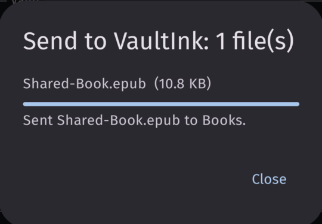
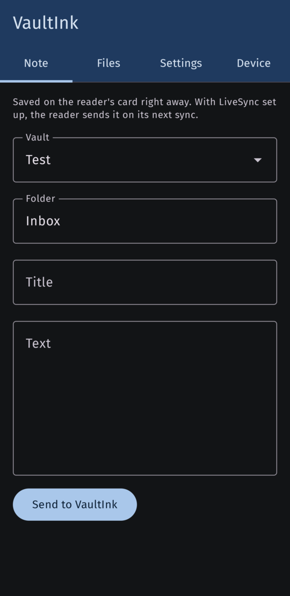
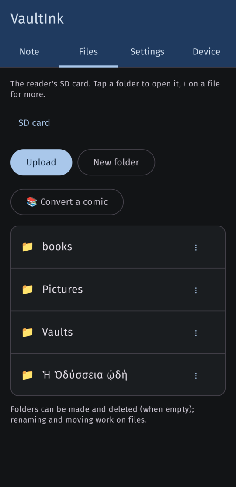
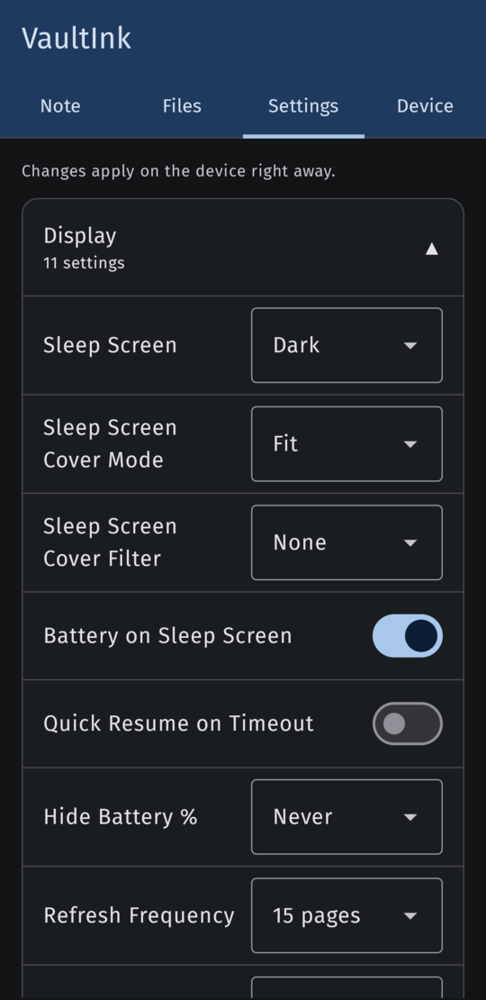
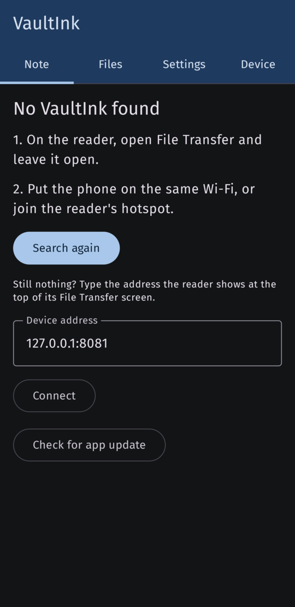

# VaultInk companion (Android)

The companion is an Android app that talks to the device over Wi-Fi, through the web server the
device runs while **File Transfer** is open. Its code is in [`companion/`](../companion/) in this
repo, and it has its own releases, tagged `companion-x.y.z`.

Status: `companion-0.5.0` is out (needs VaultInk 0.29.0 or newer on the device; typing and sync from the phone need 0.64.0). Download the APK
from the [newest companion release](https://github.com/Somnius/VaultInk/releases?q=companion&expanded=true)
on the phone and open it. After an update the reader shows a QR code that opens this page. It's tested on one phone (Android 16) against the simulator, not yet
against a real X4 Pro. See "Tested so far" below.

## First start

Four short pages (0.5.0; three before): what the app is (the reader's companion), what the reader
needs (File Transfer open, with **Join a Network** or **Create Hotspot**), what the app does (the
four tabs, the comic converter, Bring notes in, Type into the reader, the LiveSync status, Help), and a privacy note (the
app talks only to the reader on your Wi-Fi, to GitHub when you check for an update, and to the
comic converter's site when you open it). **Skip** or **Start** goes to the connect step, Back goes
to the previous page. **Intro** in the ⋮ menu of the header (or **Show the intro again** on the
Device tab) brings it back without losing the connection or the open tab. Each tab then has a
one-line hint at the top.

## The ⋮ menu: Intro, Help, About (0.5.0)

At the right of the blue header:

- **Intro**: the first-start pages again.
- **Help**: VaultInk's documentation inside the app, offline. At build time Gradle copies the
  repo's `README.md` and `docs/*.md` (Markdown only, no images, about 300 KB) into the APK's
  assets with a generated index. The screen lists the documents by title, with a search box that
  matches titles and words inside the documents (a matching document shows its first matching
  line). A document is rendered by a small Markdown reader of our own (`Markdown.kt`, pure Kotlin,
  JUnit tests): headings, paragraphs, bullet and numbered lists, task boxes, bold, italic, inline
  code, fenced code, block quotes, pipe tables as "header: cell" rows, rules; images appear as
  their alt text. A link to another bundled document opens it in the app (with `#anchor` scrolling
  to that heading); `http` links open the browser. Back goes back the way you came. The
  documentation is in English; the list says so in the phone's language.
- **About**: app name and version, what it is and the MIT licence, links (source code, project page,
  releases), the tech stack as two groups of pills ("This app": Kotlin, Jetpack Compose, Material 3,
  coroutines, OkHttp, AndroidX WebView, Gradle, API levels; "VaultInk firmware": C++20, ESP32-S3,
  PlatformIO, Arduino + FreeRTOS, NimBLE, Expat, FreeInk SDK, CrossPoint Reader, Obsidian,
  Self-hosted LiveSync, English · Ελληνικά), and credits (kos25k for testing, CrossPoint Reader,
  Banana Comic Converter by u/curseofthebanana). Not in a released app yet: "Open-source licences",
  the libraries inside the app with their licences and a link to [licenses.md](licenses.md).

## Connecting

1. On the device, open **File Transfer** (it announces itself on the network as `vaultink.local`).
2. Join the phone to the same Wi-Fi, or to the device's hotspot.
3. Open the app. It tries the last address that worked, then `vaultink.local`, then looks for the
   device on the network (mDNS, `_http._tcp`, named "vaultink"). If none answers, type the address
   the device shows (for example `192.168.1.23`). While it searches, the app shows what the reader
   needs; if nothing answers, it lists the two steps again with **Search again** and the address
   field.

The connection is plain HTTP on your local network, like the device's web page. In hotspot mode
anyone who joins the device's Wi-Fi can read and change the card; the app warns about it.

## Tabs

### Note

Pick a vault (the folders in `/Vaults`) and a folder (default `Inbox`), write a title and text,
and **Send to VaultInk**. The note is saved as `<title>.md` with the title as its heading. A name
that's already there gets `-2`, `-3`, ... added. The draft stays until it's saved.

Sharing from another app works too: text and pictures shared to VaultInk open in this tab. The
first line of shared text becomes the title. Pictures go to the vault's `attachments` folder and
the note links them with `![[...]]`.

Books and comics shared from another app (0.3.0) go straight to the reader instead: EPUB, TXT
and the like to `/Books`, XTC, XTCH and CBZ to `/Comics`. A dialog lists them with their size;
**Send to VaultInk** uploads them one after the other with a progress bar. Files the reader can't
open (PDF needs converting first) are named as not sent, and a file the sharing app didn't let the
companion read is named too, so nothing disappears without a word.

<p>
  
</p>

### When the reader isn't there (0.4.0)

With no reader found you can still write a note: under the "No VaultInk found" steps there's the
note form, with the vaults the app saw last time. **Send to VaultInk** then keeps the note on the
phone ("kept, it goes to the reader when it's found"). Books and comics shared with no reader, or
whose upload breaks off, are kept the same way. The kept items survive closing the app; the top of
the Note tab says how many are waiting. The next time the app finds the reader it sends them,
oldest first, and says how many went. An item is deleted from the phone only after the reader took
it; if the reader goes away halfway, the rest wait for the next time.

Notes saved this way, or uploaded through the web page into `/Vaults`, are marked as changed, so
the device's next LiveSync sync sends them to the server (from 0.29.0).

### Files

The whole SD card:

- Tap a folder to open it; the path at the top ("SD card › books") takes you back up.
- Every file shows its type (0.5.0, from kos25k's screenshot: a long name is cut with "…" and
  loses its extension): the extension as a small chip under the name (EPUB, CBZ, XTCH, MD, PDF,
  PNG…) next to the size, and an icon by kind: 📘 books (EPUB, TXT, PDF…), 📚 comics (CBZ, XTC,
  XTCH), 📝 notes (MD, canvas, Excalidraw, JSON…), 🖼️ pictures, 📄 anything else; folders keep 📁.
  Names wrap onto two lines.
- The toolbar buttons (**Upload**, **New folder**, **↑ Up**, **Convert a comic**) are one line each
  and the row scrolls sideways when they don't fit (0.5.0; before, Greek "Πάνω" broke into two lines).
- **Upload** picks one or more files on the phone and sends them to the open folder, with a
  progress bar.
- **New folder** makes a folder here.
- The **⋮** menu of a file: **Download to phone** (you pick where it's saved, with a progress
  bar), **Rename**, **Move** (browse to the folder and tap **Move here**), **Delete** (asks first).
- The ⋮ menu of a folder: **Delete**, for an empty folder only.

What the device's web server allows, the app allows: folders can't be renamed or moved, a
non-empty folder can't be deleted, an upload never overwrites a file with the same name, and the
saved Wi-Fi/OPDS/KOReader credential files and system folders can't be touched. A book you rename or
move keeps its reading place on the reader (from VaultInk 0.35.1).

### Comics: Files → Convert a comic (0.2.0)

Opens Banana Comic Converter (by u/curseofthebanana, an independent tool) inside the app, live from
its site. Its downloads are caught and offered as **Send to VaultInk** (to `/Comics` on the card,
with a progress bar) or **Save to phone**. The page gets a message channel to the app only from its
own site; other links open in the browser; an unreachable site shows a retry screen. Details and
screenshots: [comics.md](comics.md).

### Settings

The device's settings, one card per category (Display, Reader, ...). Tap a card's title to open or
close it. Switches, choices and numbers change on the device straight away.

### Device

The address and firmware version, **Search again**, and **Check for app update**: the app looks
for a newer `companion-*` release on GitHub, downloads the APK and opens Android's install prompt.
The update dialog has **Not now** (0.3.0). **Check for app update** is also on the "No VaultInk
found" screen (0.3.0), so the app can update itself without a reader.

<p>
  
  
  
  
</p>

## Look

The app follows the phone's light or dark mode, with an ink-blue header. The status bar (clock,
notifications, battery) stays visible in both.

## Languages

English and Greek (the phone's language picks one). "Vault" stays in English in Greek, as on the
device.

## Building

```bash
cd companion
taskset -c 0-23 nice -n 10 ./gradlew assembleRelease
```

The release build is signed from `companion/signing.properties`, which is not in the repo (it
points to the maintainer's keystore). Without it, `assembleDebug` still builds a debug APK.

Kotlin + Jetpack Compose, OkHttp; minSdk 26, targetSdk 36. Package `com.lefteros.vaultink`.

The Help assets are copied by the `copyHelpDocs` task in `app/build.gradle.kts` from `../README.md`
and `../docs/*.md` into `app/build/generated/helpdocs/help/` (with `index.txt`), so the repo's
docs are the source; nothing is checked in twice. Unit tests: `./gradlew testDebugUnitTest`
(`KeepImportTest`, `MarkdownTest`, `PhoneTextTest`).

### Bring notes in: Google Keep (0.5.0)

On the Note tab, under **Send**, **Bring notes in** imports a Google Keep export. Export Keep with
Google Takeout (tick Keep only), then in the dialog pick either the Takeout `.zip` or the unzipped
`Takeout/Keep` folder (Android's document picker; nothing else on the phone is read). The app
reads every Keep note JSON and shows a count first ("42 notes ready", "Skipped: 3 in the bin, 2
files that aren't Keep notes"); **Send** uploads them one by one with a progress bar into
`Imported/Keep` of the vault chosen above.

Each note becomes a Markdown file: YAML front matter (`created`, `updated`, `tags` from the Keep
labels, `pinned`/`archived` when set, `source: keep`), a `# Title` heading (the first line of the
text when there's no title, else "Untitled"), the text, and checklists as `- [ ]` / `- [x]`. Notes
in Keep's bin are skipped, archived ones are kept. File names are `yyyy-MM-dd HHmm Title.md` (date
prefix from the note's creation time, title stripped of characters FAT and Obsidian refuse, 60
characters at most; two with the same name get `-2`, `-3`). Attachments (pictures, drawings,
recordings) are not imported. If the reader can't be reached, or goes away halfway, the remaining
notes wait in the outbox like a quick note and are sent the next time the reader is found.

The conversion is in `KeepImport.kt` with JUnit tests (`app/src/test`): run them with
`./gradlew testDebugUnitTest`.

### LiveSync card (0.5.0)

The Device tab has a LiveSync card read from the reader (`GET /api/livesync/status`, firmware
0.63.0 or newer; older firmware shows "doesn't report LiveSync yet"). It says whether LiveSync is
set up, whether a pasted Setup URI still waits for its passphrase on the reader, the vault, the
last sync's result text as the reader's own LiveSync screen shows it, and the automatic-sync
interval with the last automatic try. **Sync now** appears only when the reader says it can take a
sync request from there (`canSync`); today's firmware can't, because a sync runs on the reader's
LiveSync screen and leaving File Transfer restarts the reader, so the card says to start it there.

**Sync when I leave File Transfer** (companion 0.5.0, firmware 0.64.0 or newer, `syncRequest`
in the status): the sync still can't run next to the web server, so the button leaves a small file on
the card instead (`/.vaultink/sync-request`, uploaded like a note). When you leave File Transfer the
reader restarts, and at the wake that follows it runs one LiveSync sync as if it were due, then
deletes the file. The card says so under the button and confirms "Request left on the reader. Leave
File Transfer there; the sync runs at its next wake." Without a saved profile the reader just
removes the file. An older firmware (no `syncRequest`) keeps the previous text, "a sync starts on
the reader".

### Type into the reader (firmware 0.64.0)

At the bottom of the Note tab, under **Bring notes in**: a text box for the reader's keyboard
screen. The reader's on-screen keyboard is slow for anything longer than a word, so you type here
instead and **Send to the reader** writes the text to `/.vaultink/phone-text.txt` on the card (UTF-8,
2,000 bytes at most; the counter under the box counts bytes, and the box stops at the limit without
splitting a character). A newer text replaces the older one. Then, on the reader, leave File Transfer
and open any text field (a note line, a search, a habit name): a **From phone** button appears in its
header; tapping it puts the text into the line (line breaks become spaces) and deletes the file.
The app says so after sending. If the reader can't be reached the text waits in the outbox like a
note (only the last text typed is kept, since the reader holds one) and is sent the next time the
reader is found. An upload to `/.vaultink` makes that folder when it is missing (reader firmware
0.64.0), so this works on a brand-new card too; an older firmware answers with an error.

The byte counting and clipping are in `PhoneText.kt` with JUnit tests (`PhoneTextTest`).

## Releases

The newest app is always at the fixed link
`https://github.com/Somnius/VaultInk/releases/download/android/vaultink-companion.apk` (release tag `android`, not Latest;
repoint it by uploading the new APK with `--clobber` after each companion release).

Tag `companion-x.y.z`, asset `vaultink-companion-x.y.z.apk`. A companion release is never marked
**Latest**: the device's update check reads the latest release, and from 0.29.0 it also ignores
tags that aren't a plain `x.y.z` version.

## Tested so far

On a OnePlus phone (Android 16) against the simulator's web server, over USB debugging:

- Note: typed note saved with the right content; shared text; Greek file and folder names.
- Files: list, a 3 MB upload (byte for byte the same), a download (the same), rename, move into
  another folder, the delete prompt.
- Settings: a switch turned on and off on the device.
- Look: dark mode, status bar visible.
- Intro (English and Greek): the three pages, Next, Back to the previous page, Start, Show the
  intro again; the searching and not-found screens; the tab hints.
- Delete from the phone after the simulator fix.
- Sharing a picture with text: the picture saved in `attachments/` byte for byte, the note links
  it with `![[...]]`.
- Update check: "newest version" while no `companion-*` release exists. Downloading and installing
  an update can only be tried once a newer release is out.
- Greek tab names fit on one line (they broke mid-word at a large phone font before).
- 0.3.0 (2026-10-30): an EPUB shared from the OnePlus file manager's share sheet went to
  `/Books` on the simulator's card; a share the app couldn't read now says so; Check for app update
  on the not-found screen. Not tried: **Not now** (it needs a newer release to show up).
- 0.4.0 (2026-10-30): with no reader, a note written in the offline form was kept ("1 item waiting
  for the reader"); after connecting to the simulator the app said "Sent 1 waiting item" and the
  note was on the card. Not tried yet: a book shared with no reader, and a reader lost halfway.
- 0.5.0 (2026-11-01, not released): the file-type chips, the one-line toolbar, the ⋮ menu, the
  four-page intro, About and Help were only compiled (`assembleDebug`) and unit tested
  (`MarkdownTest`, 11 tests); none of it has run on a phone yet. The same goes for **Sync when I
  leave File Transfer** and **Type into the reader** (firmware 0.64.0): compiled and unit tested
  (`PhoneTextTest`), not yet tried against the simulator or a reader.

Not tested yet:

- Anything against a real X4 Pro over Wi-Fi, including finding it with mDNS.
- The progress bar at Wi-Fi speed (over USB the transfers finished in about a second).
- Delete in the simulator first came back with a garbled path. Found with ThreadSanitizer: the
  firmware frees the request's arguments after `handleClient()` to save memory, and in the
  simulator the handler runs on another thread, so they were freed under it. On the device the
  handler finishes inside `handleClient()`. Fixed for the simulator (0.29.0); 30 of 30 deletes pass.
- Installing an app update: tested 2026-10-29, 0.1.0 found companion-0.2.0, downloaded it and
  Android installed it (version 0.2.0 afterwards).
