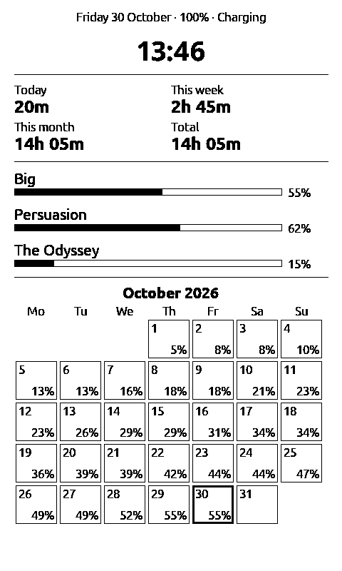

# Reading settings and file actions

This page covers the reading and file features from kos25k's issues: #1 to #6 (0.20.0) and #2, #7,
#8, #9, #10 (0.24.0).

## Page backgrounds: Paper Button Cycle

The paper tile in quick settings (swipe down from the top) changes the page background. By
default it steps through all ten: plain, paper, sandpaper, papyrus soft, medium and hard, toilet
paper, kitchen paper, bath towel, and (from 0.30.0) papyrus cloudy: soft blotches of dots with no
strips or lines, like a cloudy sky. A cycle you set up before 0.30.0 doesn't include the new one;
tick it in the checklist below.

**Settings → Reader → Paper Button Cycle** has a checklist of them. Untick the ones you don't
want, and the tile skips them. At least one always stays ticked. If the background in use isn't
ticked, the next tap goes to the next ticked one.

All ticked is saved as "all", so a background added in a later version joins the cycle too.
Settings → Reader → Page Background still picks any background directly. A background change
only redraws the page, nothing is laid out again.

## Your own sleep picture (PNG too, 0.41.0)

In the **Gallery**, tap a picture and choose **Set as sleep picture** (0.41.2), then confirm. Or open
it in the Gallery or Browse Files and press the Confirm button. JPEG, PNG (since 0.41.0, kos25k #21) and BMP work. **Settings → Display →
Sleep Screen Cover Mode** decides how it's sized: **Crop** fills the screen and cuts the edges,
**Fit** shows it all. The picture is stored as `/sleep.bmp` in four grays. In the transparent
overlay sleep modes a PNG is still used as an overlay, as before.

## Home button at the top (0.41.0)

On screens with the top bar (the Library, Settings, Browse Files, the quick settings panel and the
rest), a small house sits in the middle, between the time and the battery (kos25k #17). Tap it to
go to the home screen. It isn't drawn on book and note pages, where the top is text (swipe down for
the panel, which has it), nor on the home screen itself, nor when the clock is set to the centre.
Its tap area is wide and reaches the top edge, and a short slip of the finger counts as a tap (0.42.0); a longer pull-down still opens quick settings. Turn it off in **Settings → Display → Home Button at the Top**.

## Reading statistics on the sleep screen (0.51.0)

**Settings → Display → Sleep Screen → Reading stats** (kos25k #23) shows, while the reader sleeps:

- the date, battery and charging on top, and the time, large;
- how long you read **today**, **this week** (from Monday), **this month** and in **total**;
- the last three books you read, each with a bar and its percent (books only, no notes);
- this month's calendar, with the percent the current book was at by the end of each day. A day
  you didn't read keeps the day before's percent; the days still to come are empty.

Reading time is counted from 0.51.0 on, while a book is open and pages turn (a page left open for
more than 30 minutes counts as 30). It's kept in `/.vaultink/reading-log.tsv` on the SD card, one
line per reading session; delete the file to start over. The clock has to be set (Wi-Fi time or
Settings → System → Clock), or the screen asks for it, since undated reading can't be put on a day.

## Battery percent on the sleep screen

While the device sleeps, the battery percent shows at the bottom right, black on a small white
patch so it stays readable over a cover or a custom picture. It is the charge at the moment the
device went to sleep: the screen isn't updated while it sleeps.

On the default dark or light sleep screen it sits centred above the VaultInk logo (0.24.0); on
covers and pictures it stays in the corner. Turn it off under **Settings → Display → Battery on
Sleep Screen**. It shows on the dark and light
screens, the blank screen, covers and custom pictures. Quick Resume (which keeps the last page)
and the transparent overlay pictures don't get it.

## Line spacing, 0 to 10

Line spacing has eleven levels, shown as numbers. **0** (from 0.30.0) leaves no space between the
lines: descenders and the accents on the line below can touch. **1** packs them tight, so they nearly
touch. **10** is the former Extra wide. The old four steps are now levels 5 (Tight), 6 (Normal), 8
(Wide) and 10 (Extra wide). A setting saved by an older version loads as the same spacing.

Change it under **Settings → Reader → Text Settings → Layout → Line Spacing**, or inside a book or
note: tap the middle of the screen, open the Text panel, third row. Inside the reader it applies
at once.

SD-card fonts and the built-in font have separate scales (SD fonts 0.70× to 1.20× of the font's
line height, built-in 0.65× to 1.05×), because they measure their line height differently. With
some fonts, accents on capitals can touch the line above at levels 0 and 1.

## Hide Status Bar

**Settings → Reader → Hide Status Bar** hides the whole status bar at the bottom of a book or
note, and the text uses that room. Your choices under Customise Status Bar are kept for when you
turn it back on.

There is no tap to show and hide it inside a book. A different page height means the chapter
has to be laid out again, which takes a few seconds each time. The bottom of the screen also
already turns the page.

## The book card in quick settings (0.26.0)

When quick settings (swipe down from the top) is opened over a book or note, the card at the top
with its title and progress can be tapped: a **tap** opens the library (for a note: the note's
folder in the vault), a **long press** goes to the home screen. The whole card is the target.

## Tap Zones: corners only (0.25.0)

**Settings → Controls → Tap Zones** chooses where a tap turns the page. **Whole page** (the
default) is as before: the left third goes back, the rest forward, and the middle opens the menu.
**Corners only** turns pages only from a tap in one of the four corners (a square about a sixth
of the screen's short side): the right corners go forward, the left ones back (the other way round
for right-to-left books and Inverted Tap). Taps anywhere else do nothing, so resting a finger or
tapping by mistake while reading doesn't turn the page. Swipes and the buttons work as always. The
status bar strip at the very bottom still opens quick settings, also in the bottom corners. Taps
only turn pages when the page gestures (Settings → Controls) allow taps.

## Even Word Gaps (0.24.0, levels in 0.27.0)

**Settings → Reader → Even Word Gaps (justified)** keeps justified text from stretching word gaps
much. **Slight**: a line is justified when its gaps grow by up to half a space. **Medium**: up to
one space, so more lines are filled to the right edge. A line that would need more stays ragged,
with normal gaps. **Off** (the default) justifies every line, as before. A change lays the open
chapter out again.

## In the book: the Text panel (0.27.0)

Inside a book or note, the Text panel (tap the middle, then Text) has every layout setting now:
font, size, line spacing, alignment, hyphenation, focus reading, **Even Word Gaps, word spacing,
character spacing, screen margin and paragraph indentation**. Each change applies at once to the
page you're on. The panel scrolls.

## Favourites (0.31.0)

The Library has a fourth tab, **Favourites**, next to Author. It lists the books you marked, the
newest first (up to 50).

- **Add or remove a book** from inside it: tap the middle of the screen, **More**, then **Add to
  Favourites** (or **Remove from Favourites**). Notes don't have this entry.
- Or in the Library's **Recent** tab: long-press a book, and the last entry adds or removes it.
- In the Favourites tab, tap a book to open it. Long-press (or swipe left) for **Remove from
  Favourites**: only the list entry goes, the book stays on the card.
- Books renamed or moved with the file browser, the reading menu or the web page keep their place.
  A book deleted from the Library or the web page leaves the list. If a favourite's file is gone
  some other way (or its folder was renamed), opening it says so and offers to remove it.
- Search from the Favourites tab searches the whole library, on the Title tab.

The four tabs are as wide as their names (in Greek too) instead of four equal quarters.

The list is kept in `/.crosspoint/favourites.json`. If that file can't be read, it's kept as
`favourites.json.bad` instead of being overwritten.

## Going back from a note (0.33.1)

In a vault note, a swipe from the left edge to the right goes back, the same as the arrow at the
top: to the note you came from if you opened it through a link, otherwise to its folder. Before
0.33.1 this swipe turned to the previous page in notes opened from a folder, so a one-page note
seemed stuck (kos25k #15). In a note, the previous page is the left tap zone now. In books the
swipe still turns to the previous page.

## Book info (0.35.0)

Long-press a book to see what it is without opening it: title, author, file name, size, how far
you've read and whether it's a favourite (fields the book doesn't have are left out).

- **Browse Files**: long-press a book (EPUB, TXT, XTC/XTCH), the last entry is **Info**.
- **Library**: long-press a book in Recent, Title or Author (last entry), or in Favourites.
- **Home**: long-press the Continue card, or on the CrossPoint home styles with a row of covers,
  long-press a cover or hold Confirm on it; on the Cover grid, hold Confirm (0.35.2).

## Books only in the Library (0.35.0)

Under the Library's tabs there's a switch, **All** | **Books only**. Books only leaves the vault
notes (and canvases) out of Recent, Title and Author, so the list is just your books. Search still
works with it on, and finds only books. The choice is remembered. Favourites only ever hold books,
so the switch isn't shown there.

## Long-press in the Library, Authors as folders (0.36.0)

A long press on any book in the Library (every tab, and in search results) opens the same menu:
Open, Delete, Refresh library, Add to/Remove from Favourites, Info. On the Title tab the last
entry is **Group by letter**, on the Author tab **Group by author**: the list folds into one row
per letter or author; tap one to jump to its books, Back unfolds it.

**Settings → Library → Authors as folders** (off by default, kos25k #18) makes the Author tab
open folded every time: an author with two or more books is a folder showing how many, and an
author with one book shows as that book. Tap a folder to see only that author's books (the
author's name is in the header); Back returns to the authors. The same person written two ways
("Jane Austen", "jane austen", "Austen, Jane") is one author, because the library merges the
spellings when it's built. A search shows the plain list; Books only works with folders too.

## Search settings (0.33.0)

**Settings → Search settings** (the first row) finds a setting by name. Type part of it and press
OK; capitals and Greek accents don't matter. Each result says which section it's in. Tap one and
that section opens with the setting selected. Settings that live in **Text Settings** (line spacing,
word spacing, fonts and so on) open the Reader section on its Text Settings row, one tap away.

The last row, **Search notes for "…"**, searches your vault notes for the same words, the same as
**Home → Search**. Back from there comes back to the settings results. Tap the top row to search
again. It doesn't search other files on the card: there's no index of them, and reading the whole
card on every search would be far too slow.

## Home screen rows (0.32.0)

**Settings → Display → Home Screen Rows** sets the order of the rows on the VaultInk home (Books,
Vaults, Search, Files, Gallery, Transfer, Plugins, Settings). Tap a row to pick it up, then tap
where it should go; tap it again to put it back. **Reset to default order** at the end undoes it
all. The order is saved when you leave the screen. The Continue card always stays on top, and the
Plugins row keeps its place even while it's hidden. This is for the VaultInk home style only; the
CrossPoint styles keep their own menus.

Since 0.44.0 the home also has a **Favourites** row (after Vaults), which opens the Library on its
Favourites tab. **Settings → Display → Home Screen Items** has a switch for each row: untick the
ones you don't want on the home (kos25k #14). Books and Settings always stay.

## Battery page (0.44.0)

**Settings → System → Battery** shows what the battery chip reports: the charge, the voltage,
whether it's charging, whether the charger is plugged in, and the battery temperature when the chip
gives a believable value (kos25k #20). The X4 Pro's gauge (Cellwise CW2017) keeps no charge-cycle
count or battery health, and the firmware can't stop charging at a set level, so those aren't
there.

## Lock screen (0.49.0)

**Settings → System → Lock Screen** (kos25k #22):

- **4-digit PIN**: you type a new PIN twice. From then on the reader asks for it on a keypad when
  it wakes after sleeping 30 minutes or more (the default; see Lock After Sleeping below), and after a restart or a flat battery. Shorter naps
  don't ask. A wrong PIN just clears the dots.
- **Hold a corner**: the same times, the reader shows "Locked" and opens after a long press on any
  of the four corners. It keeps a stray tap in a bag from opening a book, but it's no protection.
- **Change the PIN** shows up once a PIN is set; **Off** turns the lock off and deletes the PIN.
- (0.52.0) **Lock After Sleeping**: always, or after 5, 10, 15, 30 minutes (the default), 1, 2 or
  3 hours asleep. **Unlock Corner**: any corner, or only one (the only one marked). **Corner Hold**:
  how long to hold it, from 0 (a single touch) to 10 seconds.
- The lock options moved onto their own page, **Settings → System → Lock Screen**:
  **Lockscreen Type** (off, PIN, corner, change the PIN) comes first, then the three above. The same
  page holds **Owner's Name** and **Owner's Phone**: they show at the top of the lock screen, so
  whoever finds the reader knows whom to call. **Settings → Display → Owner on Sleep Screen** puts the
  same two lines on the sleep screen, bottom left next to the battery percent.

Forgot the PIN? Take the SD card out and delete `/.vaultink/lock-pin.txt` on a computer: the PIN
lock is then off. That's also why the PIN stops someone picking the reader up and reading, not
someone who takes the card out; the notes on the card aren't encrypted.

If the reader goes to sleep while the lock screen is up, it asks again on the next wake, however
short the sleep.

## Library in quick settings (0.27.0)

When quick settings is opened anywhere except over a book, the second row has a **Library** tile
next to the paper tile. Over a book that place keeps the **Home** tile, and the book card at the
top opens the library instead.

## Word gaps and hyphenation

Justified text spreads the room left on a line over its word gaps. Without hyphenation, a long
word that doesn't fit leaves a lot of room, so some lines get big gaps. From 0.20.0 hyphenation
is **on by default**. Greek, English and the other languages in [hyphenation](hyphenation-trie-format.md)
are split at real syllables.

A setting you saved before stays as it was. Turn hyphenation on inside the reader (Text panel →
Hyphenation) or under Settings → Reader → Text Settings. Left alignment has no stretched gaps at
all, if you prefer a ragged right edge.

## File browser: Move, Copy, New folder, Rename

In **Browse Files**, long-press a file or a folder for:

| Action | What it does |
|---|---|
| Open | Opens the book, note or picture, or goes into the folder. |
| Delete | Asks first, then deletes (a folder with everything in it). |
| Rename | Types a new name. Files keep their extension. Folders can be renamed too. |
| Move | Opens a folder picker. Go to the target folder and tap **« Put it in this folder**. |
| Copy | The same picker. Files and whole folders can be copied. |
| New folder | Makes a folder inside the folder you're looking at. |

Books keep where you were when you rename or move them, and so do the books inside a folder you
rename or move (0.35.1): reading position, bookmarks, highlights, the Recent and Favourites
entries. The same goes for renames and moves from the web page, WebDAV and the companion app,
which used to start the book over from page 1.

In an empty folder, tap anywhere (or press Confirm) for **New folder** (0.45.0).

A **.zip** has one more action, **Extract here** (0.24.0), and tapping it offers the same menu.
The zip is unpacked into a new folder with the zip's name next to it. Nothing outside that folder
is written: entries with `..` or an absolute path, names the card can't hold, and macOS
`__MACOSX` leftovers are skipped. If that folder already exists you get a message; if the card
fills up, the half-made folder is removed. A **folder** has one more action, **Open as gallery**.

The details:

- Nothing is ever overwritten. If the target folder already has that name, you get a message
  and nothing changes.
- A folder can't be moved or copied into itself.
- A copy is written as `name.part` and renamed when it's complete. If the card fills up or a read
  fails, the part file is removed, and for a folder the half-made copy is removed too.
- Moving or renaming a **book** takes its reading position, bookmarks, clippings and recent-books
  entry with it.
- Moving or renaming a **folder** is one rename on the card. Books inside it start again from the
  beginning (their caches are rebuilt), and a vault's search index is built again the next time
  you search it or open backlinks. Carrying their state along is on the roadmap.
- Copying doesn't copy reading positions. The copy is a new book.
- A new folder's name can't contain `/` or `\`, or be `.` or `..`. If the SD card refuses
  the name, you get "Could not create the folder".

## Gallery (0.24.0)

**Home → Gallery** (in every home style with a menu list; from 0.30.0 also the CrossPoint styles)
shows every picture on the card (PNG, JPEG, and BMP/GIF by name), nine to a
page, from all folders except hidden ones. In Browse Files, long-press a folder → **Open as
gallery** for just that folder and its subfolders. Swipe left or right (or the page buttons) to
turn pages. Tap a picture for:

- **View**: the picture full screen; swipe for the next one in its folder, Back returns to the grid.
- **Delete** (asks first), **Move** and **Copy** (a folder picker, nothing overwritten).

The first time a page is shown its thumbnails are decoded, which takes a moment per picture; they
are kept in `/.crosspoint/thumbs`, so the page comes back fast. Up to 2000 pictures are listed.

At the top right (kos25k #8):

- The **refresh** arrows (0.48.0) look through the folders again, for pictures added or removed
  while the Gallery is open.
- The **gear** (0.45.0) picks what to show: **All pictures**, **PNG only**, **Pictures in vaults
  (notes)**, or (0.48.0) **Chosen folders**. **Add a folder** picks a folder to add to that list
  and switches to it; **Clear chosen folders** empties the list. The list is kept in
  `/.vaultink/gallery-folders.txt`, one folder per line. A gallery opened on one folder (Open as
  gallery) always shows that folder.

Phone photos: since 0.48.0 JPEGs up to 50 megapixels are shown (before, anything over 8 MP, so most
phone photos, showed only its name). The first draw of a big photo takes longer; after that its
thumbnail comes from the cache. PNG stopped at 8 MP until 0.53.0, now 24 MP (and 3072 pixels wide with
transparency, 4096 without).

## What's New after an update (0.24.0)

After an update, the first start opens a note with what changed since the version you had before
(the release notes, from `CHANGELOG.md` in this repository). Back leaves it. **Settings → System →
What's New** opens the last twelve releases any time, and **Show What's New After Updates** turns
the note after updates off. Updating from 0.23.0 or older shows only the newest release's notes,
because older versions didn't remember which version they were.

## PDF as text

A `.pdf` in **Browse Files** (or a `[[Rules.pdf]]` link in a note) opens as text: the first time, VaultInk reads the
PDF's text and writes it to a text file on the card (`/.vaultink/pdf/<id>/<name>.txt`, with a progress bar), then
opens that file in the book reader. So it reflows, hyphenates, and keeps your place like any book. Opening it again
is instant until the PDF changes.

What it reads: the text of every page, in the order the PDF draws it, with Greek and other scripts when the PDF carries
its text properly (most do), and the filled-in values of form fields (a character sheet's name, clan and so on, after the
page's text). It checked out on 30 real PDFs (character sheets, notes saved from a phone, print exports): all opened, and
the word count matched the desktop tool `pdftotext` within a few percent on 28 of them.

What it doesn't: pictures, tables as tables, more than two columns, page numbers as pages, and
scans without a text layer. Two columns are read left then right when the page has a clear gutter (a title across both is kept in place). A scan says "This PDF has no text to read". A PDF locked with a password you need to open it says so (PDFs that are only locked against copying or printing, with no password to open, are read: RC4 and AES-128, which most shop-bought ones use; AES-256 ones are not). A PDF you have read
shows in Recent and on the Continue card (opening it from there goes straight to the text), but it isn't a Library book;
find it again in Browse Files or by its link.

## Highlights to a vault note

In a book that has clippings, the reading menu has **Highlights to a Vault Note**. It writes them to
`Highlights/<book title>.md` in your vault (the one you used last, when you have several): the title, the author, then each
clipping as a block quote under a heading for its chapter, in reading order. Export again after more highlighting and the same
note is rewritten. A note of that name that VaultInk didn't write is never touched: the export goes to `<title> (highlights).md`
instead. The note counts as changed on the reader, so LiveSync Sync now sends it and it shows up in Obsidian.

