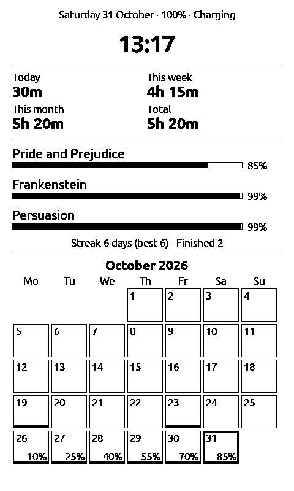
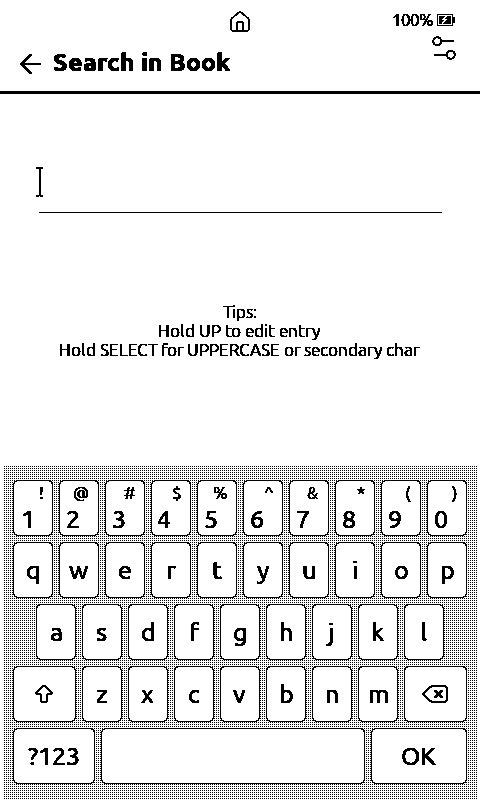
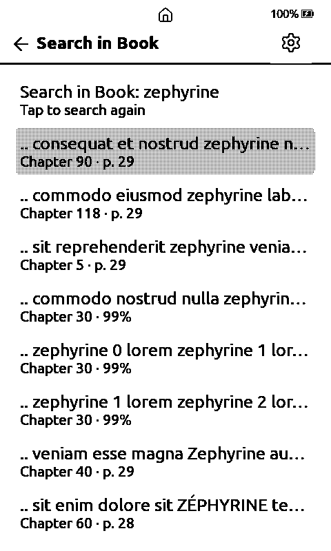
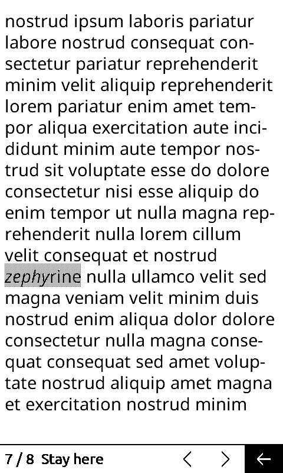
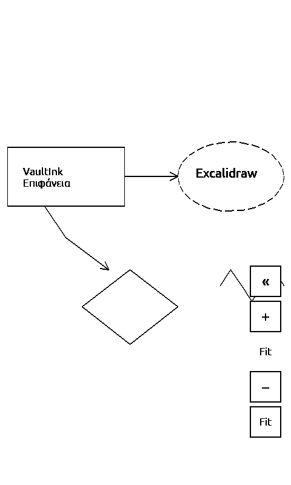
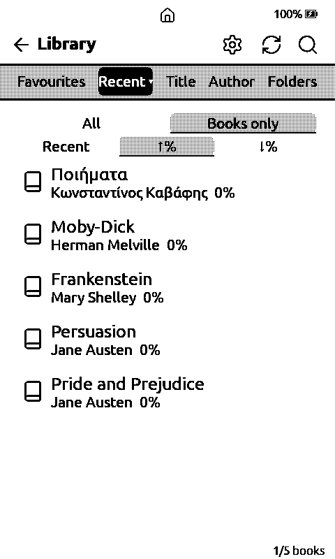
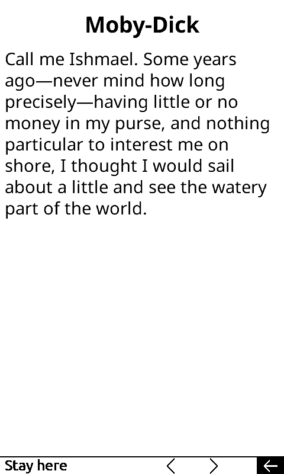
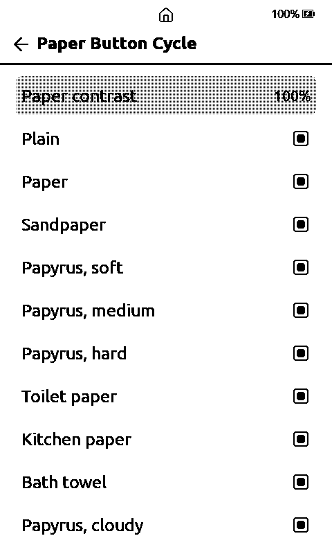
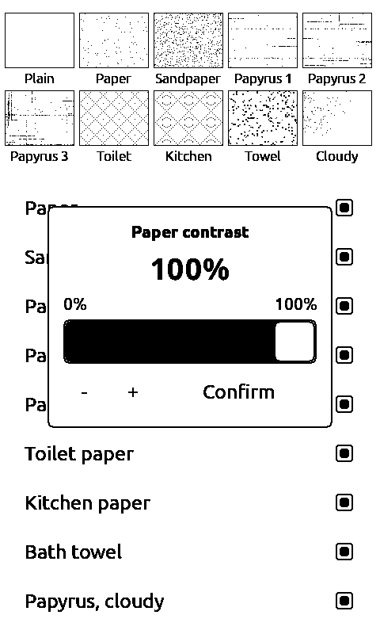

# Reading settings and file actions

This page covers the reading and file features from kos25k's issues: #1 to #6 (0.20.0) and #2, #7,
#8, #9, #10 (0.24.0).

## Page backgrounds: Paper Button Cycle

The paper tile in quick settings (swipe down from the top) changes the page background. By
default it steps through all ten: plain, paper, sandpaper, papyrus soft, medium and hard, toilet
paper, kitchen paper, bath towel, and (from 0.30.0) papyrus cloudy: soft blotches of dots with no
strips or lines, like a cloudy sky. A cycle you set up before 0.30.0 doesn't include the new one;
tick it in the checklist below.

**Settings → Reader → Paper Button Cycle** has a checklist of them. Untick the ones you don't
want, and the tile skips them. At least one always stays ticked. If the background in use isn't
ticked, the next tap goes to the next ticked one.

All ticked is saved as "all", so a background added in a later version joins the cycle too.
Settings → Reader → Page Background still picks any background directly. A background change
only redraws the page, nothing is laid out again.

## Your own sleep picture (PNG too, 0.41.0)

In the **Gallery**, tap a picture and choose **Set as sleep picture** (0.41.2), then confirm. Or open
it in the Gallery or Browse Files and press the Confirm button. JPEG, PNG (since 0.41.0, kos25k #21) and BMP work. **Settings → Display →
Sleep Screen Cover Mode** decides how it's sized: **Crop** fills the screen and cuts the edges,
**Fit** shows it all. The picture is stored as `/sleep.bmp` in four grays. In the transparent
overlay sleep modes a PNG is still used as an overlay, as before.

## Home button at the top (0.41.0)

On screens with the top bar (the Library, Settings, Browse Files, the quick settings panel and the
rest), a small house sits in the middle, between the time and the battery (kos25k #17). Tap it to
go to the home screen. It isn't drawn on book and note pages, where the top is text (swipe down for
the panel, which has it), nor on the home screen itself, nor when the clock is set to the centre.
Its tap area is wide and reaches the top edge, and a short slip of the finger counts as a tap (0.42.0); a longer pull-down still opens quick settings. Turn it off in **Settings → Display → Home Button at the Top**.

## Reading statistics on the sleep screen (0.51.0)

**Settings → Display → Sleep Screen → Reading stats** (kos25k #23) shows, while the reader sleeps:

- the date, battery and charging on top, and the time, large;
- how long you read **today**, **this week** (from Monday), **this month** and in **total**;
- the last three books you read, each with a bar and its percent (books only, no notes);
- this month's calendar, with the percent the current book was at by the end of each day. A day
  you didn't read keeps the day before's percent; the days still to come are empty. From
  0.56.0 a small bar under the day number marks every day you read, in any book;
- from 0.56.0 a line with your **streak** (days in a row up to today or yesterday, and the best
  one) and the number of books you **finished**. A book counts as finished when your last session
  in it ended at 98% or more.

Reading time is counted from 0.51.0 on, while a book is open and pages turn (a page left open for
more than 30 minutes counts as 30). It's kept in `/.vaultink/reading-log.tsv` on the SD card, one
line per reading session; delete the file to start over. The clock has to be set (Wi-Fi time or
Settings → System → Clock), or the screen asks for it, since undated reading can't be put on a day.

## Battery percent on the sleep screen

While the device sleeps, the battery percent shows at the bottom right, black on a small white
patch so it stays readable over a cover or a custom picture. It is the charge at the moment the
device went to sleep: the screen isn't updated while it sleeps.

On the default dark or light sleep screen it sits centred above the VaultInk logo (0.24.0); on
covers and pictures it stays in the corner. Turn it off under **Settings → Display → Battery on
Sleep Screen**. It shows on the dark and light
screens, the blank screen, covers and custom pictures. Quick Resume (which keeps the last page)
and the transparent overlay pictures don't get it.

## Line spacing, 0 to 10

Line spacing has eleven levels, shown as numbers. **0** (from 0.30.0) leaves no space between the
lines: descenders and the accents on the line below can touch. **1** packs them tight, so they nearly
touch. **10** is the former Extra wide. The old four steps are now levels 5 (Tight), 6 (Normal), 8
(Wide) and 10 (Extra wide). A setting saved by an older version loads as the same spacing.

Change it under **Settings → Reader → Text Settings → Layout → Line Spacing**, or inside a book or
note: tap the middle of the screen, open the Text panel, third row. Inside the reader it applies
at once.

SD-card fonts and the built-in font have separate scales (SD fonts 0.70× to 1.20× of the font's
line height, built-in 0.65× to 1.05×), because they measure their line height differently. With
some fonts, accents on capitals can touch the line above at levels 0 and 1.

## Hide Status Bar

**Settings → Reader → Hide Status Bar** hides the whole status bar at the bottom of a book or
note, and the text uses that room. Your choices under Customise Status Bar are kept for when you
turn it back on.

There is no tap to show and hide it inside a book. A different page height means the chapter
has to be laid out again, which takes a few seconds each time. The bottom of the screen also
already turns the page.

## The book card in quick settings (0.26.0)

When quick settings (swipe down from the top) is opened over a book or note, the card at the top
with its title and progress can be tapped: a **tap** opens the library (for a note: the note's
folder in the vault), a **long press** goes to the home screen. The whole card is the target.

## Tap Zones: corners only (0.25.0)

**Settings → Controls → Tap Zones** chooses where a tap turns the page. **Whole page** (the
default) is as before: the left third goes back, the rest forward, and the middle opens the menu.
**Corners only** turns pages only from a tap in one of the four corners (a square about a sixth
of the screen's short side): the right corners go forward, the left ones back (the other way round
for right-to-left books and Inverted Tap). Taps anywhere else do nothing, so resting a finger or
tapping by mistake while reading doesn't turn the page. Swipes and the buttons work as always. The
status bar strip at the very bottom still opens quick settings, also in the bottom corners. Taps
only turn pages when the page gestures (Settings → Controls) allow taps.

## Even Word Gaps (0.24.0, levels in 0.27.0)

**Settings → Reader → Even Word Gaps (justified)** keeps justified text from stretching word gaps
much. **Slight**: a line is justified when its gaps grow by up to half a space. **Medium**: up to
one space, so more lines are filled to the right edge. A line that would need more stays ragged,
with normal gaps. **Off** (the default) justifies every line, as before. A change lays the open
chapter out again.

## In the book: the Text panel (0.27.0)

Inside a book or note, the Text panel (tap the middle, then Text) has every layout setting now:
font, size, line spacing, alignment, hyphenation, focus reading, **Even Word Gaps, word spacing,
character spacing, screen margin and paragraph indentation**. Each change applies at once to the
page you're on. The panel scrolls.

## Favourites (0.31.0)

The Library has a fourth tab, **Favourites**, next to Author. It lists the books you marked, the
newest first (up to 50).

- **Add or remove a book** from inside it: tap the middle of the screen, **More**, then **Add to
  Favourites** (or **Remove from Favourites**). Notes don't have this entry.
- Or in the Library's **Recent** tab: long-press a book, and the last entry adds or removes it.
- In the Favourites tab, tap a book to open it. Long-press (or swipe left) for **Remove from
  Favourites**: only the list entry goes, the book stays on the card.
- Books renamed or moved with the file browser, the reading menu or the web page keep their place.
  A book deleted from the Library or the web page leaves the list. If a favourite's file is gone
  some other way (or its folder was renamed), opening it says so and offers to remove it.
- Search from the Favourites tab searches the whole library, on the Title tab.

The four tabs are as wide as their names (in Greek too) instead of four equal quarters.

The list is kept in `/.crosspoint/favourites.json`. If that file can't be read, it's kept as
`favourites.json.bad` instead of being overwritten.

## Going back from a note (0.33.1)

In a vault note, a swipe from the left edge to the right goes back, the same as the arrow at the
top: to the note you came from if you opened it through a link, otherwise to its folder. Before
0.33.1 this swipe turned to the previous page in notes opened from a folder, so a one-page note
seemed stuck (kos25k #15). In a note, the previous page is the left tap zone now. In books the
swipe still turns to the previous page.

## Book info (0.35.0)

Long-press a book to see what it is without opening it: title, author, file name, size, how far
you've read and whether it's a favourite (fields the book doesn't have are left out).

- **Browse Files**: long-press a file or folder, the last entry is **Info**: for a book its title, size and read percent, for any other file or folder its name, size and the date and time it was last changed (0.59.0).
- **Library**: long-press a book in Recent, Title or Author (last entry), or in Favourites.
- **Home**: long-press the Continue card, or on the CrossPoint home styles with a row of covers,
  long-press a cover or hold Confirm on it; on the Cover grid, hold Confirm (0.35.2).

## Books only in the Library (0.35.0)

Under the Library's tabs there's a switch, **All** | **Books only**. Books only leaves the vault
notes (and canvases) out of Recent, Title and Author, so the list is just your books. Search still
works with it on, and finds only books. The choice is remembered. Favourites only ever hold books,
so the switch isn't shown there.

## Folders tab (0.56.0)

The Library has a fifth tab, **Folders** (after Favourites): one row per folder on the card that
holds books, with its book count. Tap a folder to see its books, Back to return. The tab always
shows the Title order; Search from it jumps to the Title tab. In Greek the tab names are
shortened (Πρόσφ., Συγγρ., Αγαπ.) so all five fit.

## Format filter (0.58.0)

A **gear** button in the Library header (left of search and refresh, on touch screens) opens a short
list of formats: EPUB, PDF, TXT, Markdown, XTC / XTCH and CBZ (kos25k #18). Untick the ones you
don't want in the Recent, Title and Author lists; at least one stays on. The Folders tab still
shows everything. The same list is under **Settings → Library → Book formats**, and
**Format filter button** there hides the gear. PDFs are listed in the Library from 0.58.0 (the
first start after the update rebuilds the list once); opening one converts it to text as before.

## Long-press in the Library, Authors as folders (0.36.0)

A long press on any book in the Library (every tab, and in search results) opens the same menu:
Open, Delete, Refresh library, Add to/Remove from Favourites, Info. On the Title tab the last
entry is **Group by letter**, on the Author tab **Group by author**: the list folds into one row
per letter or author; tap one to jump to its books, Back unfolds it.

**Settings → Library → Authors as folders** (off by default, kos25k #18) makes the Author tab
open folded every time: an author with two or more books is a folder showing how many, and an
author with one book shows as that book. Tap a folder to see only that author's books (the
author's name is in the header); Back returns to the authors. The same person written two ways
("Jane Austen", "jane austen", "Austen, Jane") is one author, because the library merges the
spellings when it's built. A search shows the plain list; Books only works with folders too.

## Search settings (0.33.0)

**Settings → Search settings** (the first row) finds a setting by name. Type part of it and press
OK; capitals and Greek accents don't matter. Each result says which section it's in. Tap one and
that section opens with the setting selected. Settings that live in **Text Settings** (line spacing,
word spacing, fonts and so on) open the Reader section on its Text Settings row, one tap away.

The last row, **Search notes for "…"**, searches your vault notes for the same words, the same as
**Home → Search**. Back from there comes back to the settings results. Tap the top row to search
again. It doesn't search other files on the card: there's no index of them, and reading the whole
card on every search would be far too slow.

## Home screen rows (0.32.0)

**Settings → Display → Home Screen Rows** sets the order of the rows on the VaultInk home (Books,
Vaults, Search, Files, Gallery, Transfer, Plugins, Settings). Tap a row to pick it up, then tap
where it should go; tap it again to put it back. **Reset to default order** at the end undoes it
all. The order is saved when you leave the screen. The Continue card always stays on top, and the
Plugins row keeps its place even while it's hidden. This is for the VaultInk home style only; the
CrossPoint styles keep their own menus.

Since 0.44.0 the home also has a **Favourites** row (after Vaults), which opens the Library on its
Favourites tab. **Settings → Display → Home Screen Items** has a switch for each row: untick the
ones you don't want on the home (kos25k #14). Books and Settings always stay.

## Battery page (0.44.0)

**Settings → System → Battery** shows what the battery chip reports: the charge, the voltage,
whether it's charging, whether the charger is plugged in, and the battery temperature when the chip
gives a believable value (kos25k #20). Since 0.58.0 it also shows the **drain per hour asleep**
and **awake**, worked out from the battery level written at each sleep and each wake (a few days
of use before it shows a number). Whole percent steps only, so short stretches are not shown. The
"awake" figure includes reading, the light, Wi-Fi and PDF conversion. How much each app uses is not
measured: the firmware has no way to know, and the page says so. The X4 Pro's gauge (Cellwise CW2017) keeps no charge-cycle
count or battery health, and the firmware can't stop charging at a set level, so those aren't
there.

## Lock screen (0.49.0)

**Settings → System → Lock Screen** (kos25k #22):

- **4-digit PIN**: you type a new PIN twice. From then on the reader asks for it on a keypad when
  it wakes after sleeping 30 minutes or more (the default; see Lock After Sleeping below), and after a restart or a flat battery. Shorter naps
  don't ask. A wrong PIN just clears the dots.
- **Hold a corner**: the same times, the reader shows "Locked" and opens after a long press on any
  of the four corners. It keeps a stray tap in a bag from opening a book, but it's no protection.
- **Change the PIN** shows up once a PIN is set; **Off** turns the lock off and deletes the PIN.
- (0.52.0) **Lock After Sleeping**: always, or after 5, 10, 15, 30 minutes (the default), 1, 2 or
  3 hours asleep. **Unlock Corner**: any corner, or only one. **Corner Hold**:
  how long to hold it, from 0 (a single touch) to 10 seconds.
- The lock options moved onto their own page, **Settings → System → Lock Screen**:
  **Lockscreen Type** (off, PIN, corner, change the PIN) comes first, then the three above. The same
  page holds **Owner's Name** and **Owner's Phone**: they show at the top of the lock screen, so
  whoever finds the reader knows whom to call. **Settings → Display → Owner on Sleep Screen** puts the
  same two lines on the sleep screen, bottom left next to the battery percent.

- The owner's name and phone sit under the PIN dots (under the word "Locked" in corner mode), no longer at the very top. From 0.57.0 the corner lock screen shows only "Locked" and the owner lines: no hint text and no corner marks (kos25k #22). While the lock screen is up, the swipe down from the top edge no longer opens the frontlight panel, so nobody gets past the lock through it (kos25k #22).

Forgot the PIN? Take the SD card out and delete `/.vaultink/lock-pin.txt` on a computer: the PIN
lock is then off. That's also why the PIN stops someone picking the reader up and reading, not
someone who takes the card out; the notes on the card aren't encrypted.

If the reader goes to sleep while the lock screen is up, it asks again on the next wake, however
short the sleep.

## Library in quick settings (0.27.0)

When quick settings is opened anywhere except over a book, the second row has a **Library** tile
next to the paper tile. Over a book that place keeps the **Home** tile, and the book card at the
top opens the library instead.

## Word gaps and hyphenation

Justified text spreads the room left on a line over its word gaps. Without hyphenation, a long
word that doesn't fit leaves a lot of room, so some lines get big gaps. From 0.20.0 hyphenation
is **on by default**. Greek, English and the other languages in [hyphenation](hyphenation-trie-format.md)
are split at real syllables.

A setting you saved before stays as it was. Turn hyphenation on inside the reader (Text panel →
Hyphenation) or under Settings → Reader → Text Settings. Left alignment has no stretched gaps at
all, if you prefer a ragged right edge.

## File browser: Move, Copy, New folder, Rename

In **Browse Files**, long-press a file or a folder for:

| Action | What it does |
|---|---|
| Open | Opens the book, note or picture, or goes into the folder. |
| Delete | Asks first, then deletes (a folder with everything in it). |
| Rename | Types a new name. Files keep their extension. Folders can be renamed too. |
| Move | Opens a folder picker. Go to the target folder and tap **« Put it in this folder**. |
| Copy | The same picker. Files and whole folders can be copied. |
| New folder | Makes a folder inside the folder you're looking at. |

Books keep where you were when you rename or move them, and so do the books inside a folder you
rename or move (0.35.1): reading position, bookmarks, highlights, the Recent and Favourites
entries. The same goes for renames and moves from the web page, WebDAV and the companion app,
which used to start the book over from page 1.

In an empty folder, tap anywhere (or press Confirm) for **New folder** (0.45.0).

A **.zip** has one more action, **Extract here** (0.24.0), and tapping it offers the same menu.
The zip is unpacked into a new folder with the zip's name next to it. Nothing outside that folder
is written: entries with `..` or an absolute path, names the card can't hold, and macOS
`__MACOSX` leftovers are skipped. If that folder already exists you get a message; if the card
fills up, the half-made folder is removed. A **folder** has one more action, **Open as gallery**.

The details:

- Nothing is ever overwritten. If the target folder already has that name, you get a message
  and nothing changes.
- A folder can't be moved or copied into itself.
- A copy is written as `name.part` and renamed when it's complete. If the card fills up or a read
  fails, the part file is removed, and for a folder the half-made copy is removed too.
- Moving or renaming a **book** takes its reading position, bookmarks, clippings and recent-books
  entry with it.
- Moving or renaming a **folder** is one rename on the card. Books inside it start again from the
  beginning (their caches are rebuilt), and a vault's search index is built again the next time
  you search it or open backlinks. Carrying their state along is on the roadmap.
- Copying doesn't copy reading positions. The copy is a new book.
- A new folder's name can't contain `/` or `\`, or be `.` or `..`. If the SD card refuses
  the name, you get "Could not create the folder".

## Gallery (0.24.0)

**Home → Gallery** (in every home style with a menu list; from 0.30.0 also the CrossPoint styles)
shows every picture on the card (PNG, JPEG, and BMP/GIF by name), nine to a
page, from all folders except hidden ones. In Browse Files, long-press a folder → **Open as
gallery** for just that folder and its subfolders. Swipe left or right (or the page buttons) to
turn pages. Tap a picture for:

- **View**: the picture full screen; swipe for the next one in its folder, Back returns to the grid.
- **Delete** (asks first), **Move** and **Copy** (a folder picker, nothing overwritten).

The first time a page is shown its thumbnails are decoded, which takes a moment per picture; they
are kept in `/.crosspoint/thumbs`, so the page comes back fast. Up to 2000 pictures are listed.

At the top right (kos25k #8):

- The **refresh** arrows (0.48.0) look through the folders again, for pictures added or removed
  while the Gallery is open.
- The **gear** (0.45.0) picks what to show: **All pictures**, **PNG only**, **Pictures in vaults
  (notes)**, or (0.48.0) **Chosen folders**. **Add a folder** picks a folder to add to that list
  and switches to it; **Clear chosen folders** empties the list. The list is kept in
  `/.vaultink/gallery-folders.txt`, one folder per line. A gallery opened on one folder (Open as
  gallery) always shows that folder.

Phone photos: since 0.48.0 JPEGs up to 50 megapixels are shown (before, anything over 8 MP, so most
phone photos, showed only its name). The first draw of a big photo takes longer; after that its
thumbnail comes from the cache. PNG stopped at 8 MP until 0.53.0, now 24 MP (and 3072 pixels wide with
transparency, 4096 without).

## What's New after an update (0.24.0)

After an update, the first start opens a note with what changed since the version you had before
(the release notes, from `CHANGELOG.md` in this repository). Back leaves it. **Settings → System →
What's New** opens the last twelve releases any time, and **Show What's New After Updates** turns
the note after updates off. Updating from 0.23.0 or older shows only the newest release's notes,
because older versions didn't remember which version they were.

## PDF as text

A `.pdf` in **Browse Files** (or a `[[Rules.pdf]]` link in a note) opens as text: the first time, VaultInk reads the
PDF's text and writes it to a text file on the card (`/.vaultink/pdf/<id>/<name>.txt`, with a progress bar), then
opens that file in the book reader. So it reflows, hyphenates, and keeps your place like any book. Opening it again
is instant until the PDF changes.

What it reads: the text of every page, in the order the PDF draws it, with Greek and other scripts when the PDF carries
its text properly (most do), and the filled-in values of form fields (a character sheet's name, clan and so on, after the
page's text). It checked out on 30 real PDFs (character sheets, notes saved from a phone, print exports): all opened, and
the word count matched the desktop tool `pdftotext` within a few percent on 28 of them.

What it doesn't: pictures, tables as tables, more than four columns, page numbers as pages, and
scans without a text layer. Two, three or four columns (0.56.0) are read column by column when the page has clear gutters (a title across all of them is kept in place). A file whose fonts carry no text map (so the letters can't be told) says the text can't be read, instead of showing garbage (0.56.0). A scan says "This PDF has no text to read". A PDF locked with a password you need to open it says so (PDFs that are only locked against copying or printing, with no password to open, are read: RC4, AES-128 and, from 0.56.0, AES-256). A PDF you have read
shows in Recent and on the Continue card (opening it from there goes straight to the text), but it isn't a Library book;
find it again in Browse Files or by its link.

## Highlights to a vault note

In a book that has clippings, the reading menu has **Highlights to a Vault Note**. It writes them to
`Highlights/<book title>.md` in your vault (the one you used last, when you have several): the title, the author, then each
clipping as a block quote under a heading for its chapter, in reading order. Export again after more highlighting and the same
note is rewritten. A note of that name that VaultInk didn't write is never touched: the export goes to `<title> (highlights).md`
instead. The note counts as changed on the reader, so LiveSync Sync now sends it and it shows up in Obsidian.

## Search in a book

In a book's reading menu, **Search in Book** (above Toggle Bookmark) asks for a word or a short
phrase with the keyboard, then reads the chapters' text and lists what it finds: a few words around
each hit and, under it, the chapter and where in it ("Chapter 12 · 40%"; the page, "Chapter 12 · p. 9",
once that chapter has been laid out before). Tap a result to go to that spot; tap the top row to
search again. EPUB books only: notes have the vault search.

  
  
  

**What matches.** Capital letters and accents never matter ("ΚΑΛΗΜΕΡΑ" finds "καλημέρα"). The
**search type** is either *Partial match* (a part of a word matches: "read" finds "reading") or *Exact
match* (whole words only: "read" does not find "reading" or "unread"). A space in the phrase matches
any run of white space, also across a paragraph; a phrase split by a page break is still found.

**The gear.** On touch screens a gear sits at the right of the header, on the keyboard screen and on
the results screen. It opens **Partial match**, **Exact match** and **Search range** (the whole book,
or the start up to where you are). The type applies at once (a search on screen runs again); the
range applies to the next search you start. The same settings, plus the switch that shows Search in
Book in the More menu and the book index, are in **Settings → Reader → Search word**.

**Where it starts.** It starts at the chapter you are in, goes on to the end, then wraps to the
chapters before it, so the hits near you come first. With the range "start to reading point" it goes
through the book in order, up to where you are. Typing the same words again (same type and range)
shows the last finished result at once, without reading the book again.

**While it works.** The top row shows how far it is, hits appear as chapters finish, and **Back**
stops it at once and keeps what was found. At most 100 results are listed, and at most 3 close
together, so one page full of the word does not push the rest away. The result lines start with two
dots where the text was cut and run to the right edge of the row, with no dots at the end.

**On the page.** After you pick a result the searched words are shaded on the page, and a bar at the
bottom steps through the hits: the counter ("6 / 8 Stay here"), previous, next, and the white arrow at
the bottom right that goes back to exactly where you were before the search. Tap the counter to keep
the page you are on instead. Back also returns. While you look at hits the reading position, the
reading log and the sync are left alone, so closing the book reopens it where you left it.

**Index books (off by default).** *Settings → Reader → Search word → Index books* makes each search
remember what it read: a small filter of the three-letter pieces of each chapter's text is saved in
the book's cache (`search.idx`, 8 KB per chapter, removed by Clear cache). Later searches skip a
chapter whose filter shows it cannot contain the words, and fill in the chapters they read. The hits
are the same with the index and without it; words of fewer than three letters are never skipped. It
grows with use, so there is no waiting to build it. The speed on a long book on the device has not
been measured yet.

## Dice (0.61.0)

Home → Plugins → **Dice**. The top row picks the system (tap < or >, or Left/Right); the rows under it are that system's numbers and switches; **Roll** rolls (Confirm on the buttons). The dice show as tiles: Hunger dice black, criticals with a thick border, a dot on a die a rule added or rerolled, a crossed die was dropped by keep-highest. What you set is kept for next time, and the last results are listed at the bottom.

- **D&D / polyhedral**: number of dice (1 to 20), die (d4, d6, d8, d10, d12, d20, d100), modifier, keep the highest N, Advantage or Disadvantage (one d20), Exploding (a top face adds a die, at most 20 extra).
- **World of Darkness (classic)**: pool, difficulty (target number), Specialty (10s add a die), Willpower (one automatic success, never a botch), Mage rerolls. 1s cancel successes; no successes and a 1 is a botch.
- **Vampire V5**: pool, Hunger (the last dice), difficulty (successes needed). Pairs of 10s are worth 4; messy critical when the pair has a Hunger 10; bestial failure when a failed roll has a Hunger 1. **Willpower reroll** rerolls up to three normal dice that failed, once. **Rouse check** rolls one Hunger die and raises your Hunger on a failure (at Hunger 5 it says frenzy test).
- **Chronicles of Darkness** (pool, 10/9/8-again, rote, a pool of 0 is a chance die), **Fate**, **Powered by the Apocalypse**, **Blades in the Dark**, **Call of Cthulhu** (skill, bonus and penalty dice), **Shadowrun** (hits and glitches), **Savage Worlds** (trait and wild die, raises), **Year Zero** (with Push), **Cyberpunk Red** (exploding d10, DV).

SD plugins cannot run code on the reader, so the roller is built into the firmware like Sudoku.

## Excalidraw drawings (0.63.0)

A `.excalidraw` file (or the Obsidian Excalidraw plugin's `.excalidraw.md`) opens in a viewer like the canvas one: the whole drawing fitted to the screen, pan with swipes or the buttons, zoom with the **« + − Fit** panel at the bottom right (or Confirm), Back returns. Rectangles, ellipses, diamonds, lines, arrows (with arrowheads), free drawing and text are drawn, dashed and dotted lines as such, a rotated shape rotated; colours are not shown (a filled shape is drawn plain), pictures are skipped and counted. Text is shown in the nearest of the reader's sizes and left out when it would be too small to read. A drawing the plugin saved **compressed** (`compressed-json`) cannot be read: the screen says so (turn compression off in the plugin's settings). Large drawings are cut at 1,500 shapes, 12,000 points and 24 KB of text. Read only. Not yet tried on a drawing exported from the real plugin: only on hand-written samples.

## Bluetooth keyboard typing (0.63.0)

*Settings → Connectivity → Bluetooth Page Turner* has **Bluetooth keyboard typing** (off by default, and only while the page turner switch is on). With it on, a paired Bluetooth keyboard types into the on-screen keyboard's line (a note line in the editor, a search): letters, digits and punctuation of a US keyboard, Backspace, Delete, the arrows, Home, End, Enter (finishes the line) and Escape (cancels). With the Greek layout selected on the on-screen keyboard the same keys type Greek (the key at the US `;` position is the tonos dead key: it accents the next vowel). Keys with Ctrl, Alt or Gui held type nothing. While a text screen is open the keyboard does not turn pages. **Not tried with a real keyboard yet:** pairing, the passkey, reconnecting and how it behaves next to a page-turner remote are untested.

## Library: sort by progress, tab order (0.60.0, 0.61.0)

  

- **Sort by how far you have read.** With the **Recent** tab open, a small bar under the tabs offers
  **Recent** (the usual order), **↑%** (the most read first) and **↓%** (the least read first). A book
  you never opened counts as 0%. Percent sorting leaves out the pinned recent books that sit on top of the
  normal Recent list. The first time you pick it takes a few seconds on a big library while it looks at each
  book's saved place; the numbers are remembered until you open a book.
- **The percent on every book.** Each book row shows its percent after the author ("Jane Austen  37%"),
  with no progress bar. In the Author tab, where the author is the heading, the percent is on its own
  under the title. Comics and XTC books show theirs too; a file with no saved place shows nothing.
- **Open on tab.** *Settings → Library → Open on tab* picks the tab the Library opens on (Recent, Title,
  Author, Favourites or Folders). The Favourites row on the Home still opens Favourites.
- **Tab order.** *Settings → Library → Tab order*: tap a tab, then tap the place it goes to. The last row puts
  the default order back. The tab bar, the left/right keys and "Open on tab" all follow the order.

## Random page! (0.60.0, 0.61.0)

  

A Home item that opens a random page of a random book from your library: EPUB, text, PDF, comics (CBZ)
and XTC books (notes are not picked). It is **off by default**: *Settings → Display → Home screen items →
Random page!* (VaultInk home only). With all ten Home items on, the rows are a little tighter so Settings
still fits. The dice on its row is an icon: the reading fonts have no dice character.

Nothing is saved while you look. In an EPUB or text book the bar at the bottom is the one from Search
in Book: the white arrow goes back to where you were, the counter ("Stay here") keeps the page. In a
comic or XTC book your saved place is simply left alone, and Back leaves. Tap the Home item again for another page.

## Paper contrast (0.60.0)

  
  

The first row of *Settings → Reader → Paper Button Cycle* is **Paper contrast**. It opens a slider from
0 to 100: how many of the dots of the paper backgrounds are drawn (100 is the pattern as designed, the
default; 0 draws none). Above the slider is a small tile of every background that changes while you move
it: drag the slider, tap - or +, or use the buttons (Left/Right one step, Up/Down ten). Confirm keeps the
value and Back leaves the old one. The setting applies to every page background in the reader.

## Sudoku (0.59.0)

**Home → Plugins → Sudoku** (the first row) is a built-in game, not an SD-card plugin: SD plugins can't
run code on the device. Pick a cell, then a digit. **Notes** switches to pencil marks, **Erase** clears the
cell, **Undo** takes back the last 64 changes, **Hint** fills the next easiest cell, **New** starts another
puzzle and the last button cycles **Easy / Medium / Hard**. A wrong digit gets a box around it, a finished
digit is blanked on the pad, and the timer stops when it is solved (tap for a new one). On the buttons:
Up/Left and Down/Right move the cursor, Confirm adds one to the digit in the cell, a long Confirm turns
notes on or off, Back leaves. The game is saved to `/.vaultink/sudoku.sav` when you leave, change
something or the device sleeps, and carries on where you left it.
