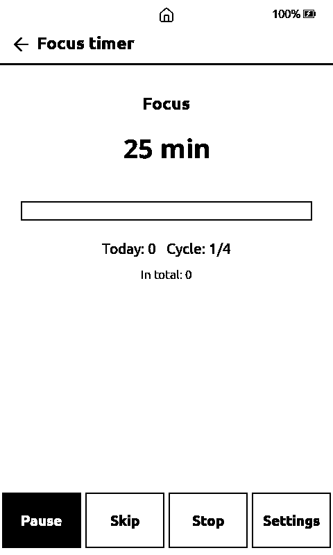
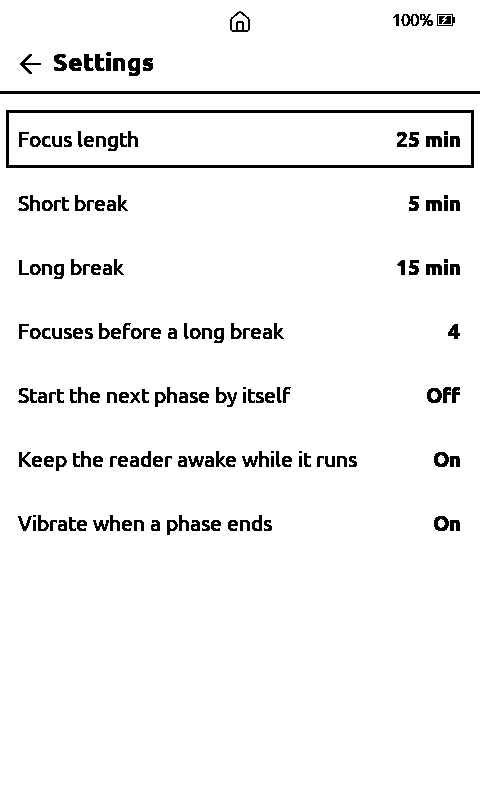
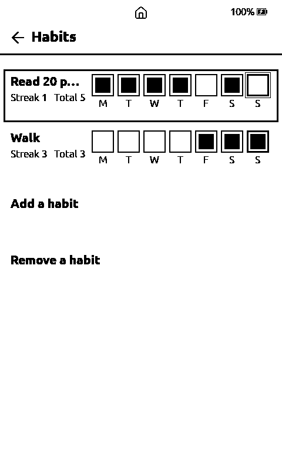

# Tools in Home → Plugins (0.59.0 to 0.63.0)

Home → Plugins starts with the tools that are built into the firmware (SD-card plugins cannot run code on the reader): **Sudoku**, **Dice**, **VaultEUC**, **Focus timer** and **Habits**. Their guides: Sudoku and Dice in [reading-and-files.md](reading-and-files.md), VaultEUC in [vaulteuc.md](vaulteuc.md). This page covers the Focus timer and Habits and what the dice roll uses for randomness.

## Focus timer (0.63.0)

  
  
  

A Pomodoro timer: focus, short break, long break. Pick **Start** and it runs the focus length, then offers the break, then the next focus; after the set number of focuses (4 by default) the break is the long one. The timer follows the clock, not the screen, so a reader that went to sleep still knows when the phase ended (the next time you wake it, the phase is finished, once).

- **Screen:** the phase ("Focus", "Short break", "Long break"), the minutes left, a bar for how far the phase is, the focuses done today and the position in the cycle, and the total. It is redrawn once a minute and whenever something changes (e-ink), so it shows whole minutes.
- **Buttons on screen:** Start / Pause / Resume, Skip (ends the phase now; a skipped focus counts as done), Stop, Settings. On the hardware buttons: Confirm starts or pauses, Left skips, Right stops, Up opens the settings, Back leaves.
- **Settings:** focus length (15, 20, 25, 30, 45, 50, 60 min), short break (3, 5, 10), long break (10, 15, 20, 30), focuses before a long break (3 to 6), *Start the next phase by itself*, *Keep the reader awake while it runs* (on: the reader does not sleep while a phase runs; it uses more battery) and *Vibrate when a phase ends* (on; nothing happens on a board without a vibration motor).
- **Saved:** the running state and settings in `/.vaultink/focus.txt` (so a running timer survives sleep and a restart), every finished or stopped phase as a line in `/.vaultink/focus.tsv` (time, phase, minutes, completed). The "today" count starts again each day; the clock must have been set.

## Habits (0.63.0)

A daily habit tracker for up to 16 habits. Each habit is a row with its streak and total and **seven boxes, the last seven days with today on the right**, each under its weekday letter. Tap a box to tick or untick that day (a tap anywhere else on the row ticks today). On the buttons: Up/Down choose a habit, Left/Right choose a day box, Confirm ticks it.

- **Add a habit** asks for the name with the keyboard (up to 30 characters, no duplicates). **Remove a habit** switches the list to a mode where tapping a habit removes it.
- **Streak** is the number of days in a row ending today, or ending yesterday while today is not ticked yet. Each habit remembers its last 400 days.
- **Saved** in `/.vaultink/habits.txt`, a plain text file (`name|day,day,...`, days counted from 2020-01-01) that you can read or edit on a computer. It needs the clock set (Settings → System → Clock); without it the screen says so.

## Where the dice get their randomness (0.63.0)

Every roll starts from a fresh seed: the chip's hardware random number generator mixed (with a hash, so a small change spreads over every bit) with the **date and time** of the roll (as `yyyymmddhhmmss`), the **battery percentage** and the **battery voltage**, the clock's own jitter (microseconds and milliseconds since boot) and a counter, so two rolls in the same instant still differ. The same seed source is used for new Sudoku puzzles and for Random page!. The mixing code is `lib/Dice/DiceEntropy.h`; its tests check that each part changes the seed and that a one-millivolt change flips about half of its bits. The numbers are noise on top of the hardware generator, not a replacement for it: the hardware generator stays the main source.
