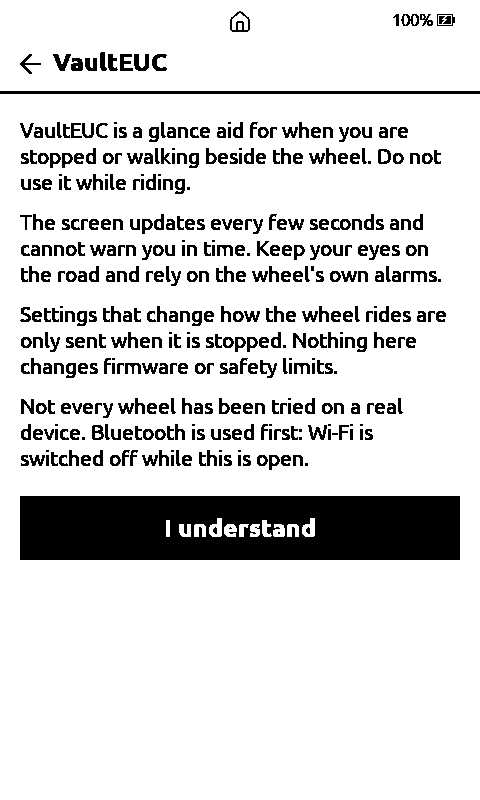
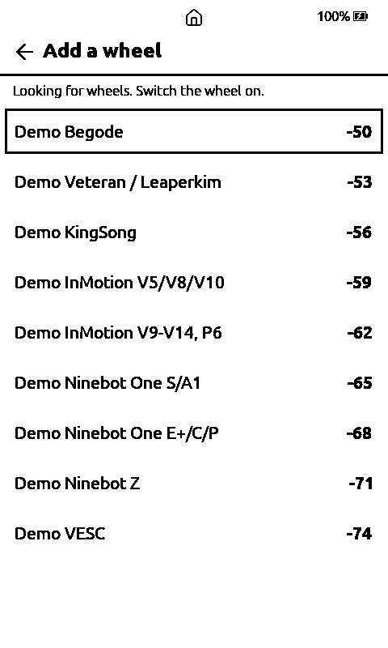
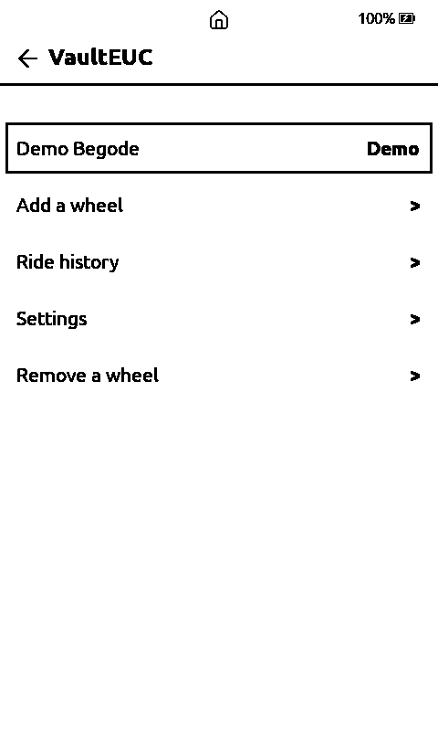
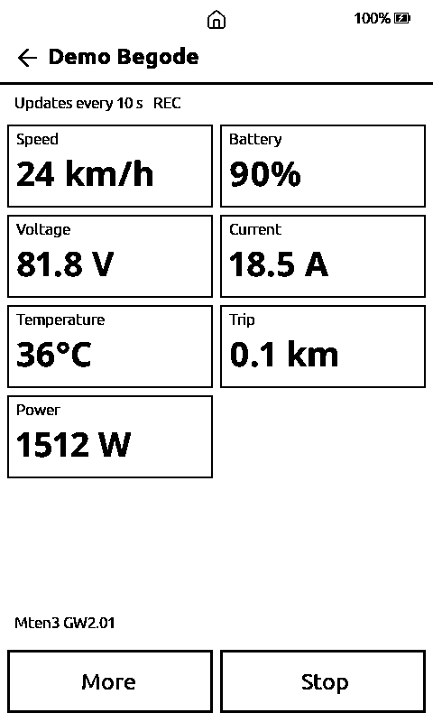
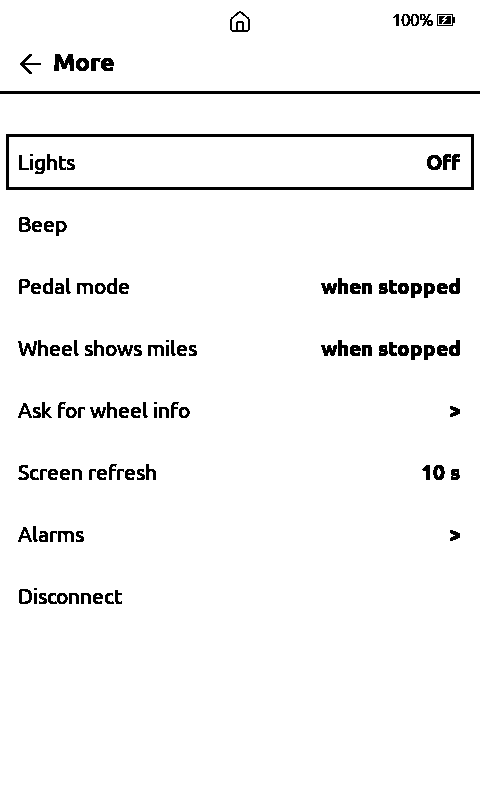

# VaultEUC (0.62.0)

An electric unicycle companion built into VaultInk: Home → Plugins → **VaultEUC**. It connects to a wheel over Bluetooth LE, shows its numbers on the e-ink screen every 5, 10, 15 or 30 seconds, watches your alarm limits on every update, logs each ride to the SD card and keeps a list of your wheels.

**It is a glance aid, not a speedometer. Do not use it while riding.** It says so at every start. The screen is slow and cannot warn you in time; rely on the wheel's own alarms. Nothing in VaultEUC changes firmware or safety limits.

## Wheels it speaks to

| Brand | Models (as far as the reference apps know them) |
|---|---|
| Begode / Gotway | Mten3, MCM5, T3, Tesla, Nikola, MSuper, EX, EX20S, EXN, Monster, Master, ExtremeBull |
| Veteran / Leaperkim | Sherman, Sherman S, Abrams, Patton, Lynx, Nosfet, Oryx |
| KingSong | 14D/14S/16S, 18L/18LH/16X, S18, S19, S20, S22 |
| InMotion V2 | V9, V11, V11y, V12 HS/HT/PRO/S, V13, V14, P6, X1, E20, Adventure |
| InMotion V1 | V5, V8, V10 |
| Ninebot | One S/A1, One E+/C/P, One Z6/Z8/Z10 (read only) |
| VESC | Floatwheel, DIY boards |

The protocols come from the open reference apps (WheelDash, VESCDash, eucWatch, WheelLog). **None of it has run against a real wheel yet**; every point the sources disagree on is marked UNVERIFIED in `lib/Euc/`. The InMotion V13/V14/P6 may refuse a client that does not do the maker's key handshake (no open code for it exists). KingSong and Leaperkim PIN locks are not supported.

## Using it

1. **Add a wheel.** Switch the wheel on, tap *Add a wheel*, pick it in the list, then its maker and model, then name it. It is saved with its Bluetooth address, so next time you just tap it; you only scan again when you add another.
2. **Dash.** Speed, battery, voltage, current, temperature, trip, PWM (where the wheel reports it), power, ride time and top speed. A black banner shows an alarm. *More* has lights, horn, beep and the other safe commands the brand supports, the alarm limits, the refresh interval and *Disconnect*.
3. **Rides.** Every ride is logged to `/VaultEUC/<name>_<date>_<time>.csv` (the folder is created when missing) and listed under *Ride history* with distance, time, top and average speed and battery used. The CSV uses the DarknessBot/WheelLog column names, so eucviewer and euc_soh_kotlin read it. There is no GPS.
4. **Settings.** km/h or mph (default km/h), °C or °F (default °C), the refresh interval (5, 10, 15 or 30 s, never faster), *Keep the reader awake* (off; it keeps the Bluetooth link alive and uses more battery), *Vibrate on alarms* (off; only if the board has a motor), demo wheels, and the default alarm limits.

## Safety rules in the code

- Only a short list of commands exists: horn, beep, lights, ride LEDs, pedal mode, volume, reset trip, miles and info. There is no firmware update, factory reset, calibration, power off, tiltback off, PWM limit, lock, transport mode or PIN write, on any brand.
- Everything except horn, beep, lights, ride LEDs, volume and info is refused above 2 km/h, and **an unknown speed counts as moving**.
- Alarms are checked on every update from the wheel, however slowly the screen refreshes; an alarm draws the screen at once (at most once a second).
- PWM is hidden for Begode: its frame does not carry a trustworthy PWM.

## Bluetooth and Wi-Fi

Bluetooth comes first. While VaultEUC is open Wi-Fi is switched off (the first screen says so), and the page turner's radio is off outside books and the Home anyway. Leaving VaultEUC takes the Bluetooth stack all the way down.

## Demo wheels

Add a wheel → *Demo Begode*, *Demo KingSong* ... runs a fake wheel through the same protocol code (a looping three-minute ride with a speed alarm), in the emulator and, with *Demo wheels in the scan list* on, on the device. It is how the screens are tested without a wheel; the fake wheel's protocol code is in `lib/Euc/` (`WheelSimulator`).

## Screenshots (the emulator, demo wheel)

| Warning | Wheels | Scan | Saved wheel | Dash | More |
|---|---|---|---|---|---|
|  |  |  |  |  |  |
